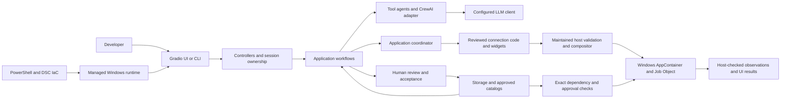

<p align="center">
  
</p>

<h1 align="center">AgentiX</h1>

<p align="center">
  Agentic Software Development — Human in the Loop
</p>


> 🚧 **Under Active Development**
>
> This aplication is currently under active development. Its architecture, features, and documentation are evolving and may change as research and implementation progress. **Not yet recommended for production use**.

# AgentiX v7

Independent successor to v4. The Tools and Applications tabs share a left sidebar.

**Human-supervised agentic software engineering for Python developers.** Agents propose tools and application code; developers control review, approval, authorization, and reuse.

> **Development status:** AgentiX is an evolving engineering and research project, not a claim of production readiness. Generated, tested, reviewed, approved, authorized, and isolated are distinct states; none by itself proves that software is correct or secure.

## Overview

AgentiX is a Windows desktop development system for software developers who want to use agentic AI to create reusable Python tools and compose them into small applications. Its Gradio interface and command-line workflow coordinate role-based agents, a local or explicitly configured model, approved-artifact catalogs, human review, and native Windows isolation.

Unlike a coding assistant that primarily returns a patch or code block, AgentiX has explicit artifact lifecycles. Tool code and application source are persisted for inspection, tested in a separate process, reviewed against human-supplied acceptance cases, and bound to the exact approved content before reuse or execution. Developers—not agents—decide whether a proposal is accepted and what it may do.

This is a design philosophy and workflow boundary, not a guarantee against defects, malicious output, or technical debt.

## The problem and the design philosophy

Generated code can be plausible while omitting requirements, embedding unsafe behavior, or passing tests that do not meaningfully test it. A model-generated test suite is not an independent oracle, and successful execution on a few inputs cannot establish correctness for all inputs.

AgentiX therefore treats model output as untrusted proposal data. It separates proposal generation from testing, human review, authorization, and execution. Human decisions are explicit and bound to reviewed content and policy; approvals are invalidated when relevant content changes. This makes the process more inspectable and controllable, but places responsibility for review and acceptance with the developer.

## How AgentiX works

### Tool lifecycle

1. **Describe a requirement.** A developer submits a natural-language request. The manager first considers compatible installed applications or approved tools; if creation is needed, it starts a staged tool workflow.
2. **Generate artifacts.** CrewAI roles propose a specification, Python implementation, and `unittest` suite in separate stages. The host checks that each expected artifact was actually saved and is fresh for the current operation.
3. **Run provisional tests.** Proposed tests execute in a restricted child process. A pass is provisional evidence only; it does not authorize execution or catalog publication.
4. **Review acceptance cases.** The developer reviews and may edit a bounded, declarative set of inputs and expected outcomes. The expected values remain in the trusted host process. A required manual decision authorizes the host to compare those expectations with fresh isolated observations.
5. **Authorize and publish.** Only a successful host comparison for the reviewed cases can authorize the covered function(s). The reviewed tool bytes are then published to the installed catalog. Protected approval records are stored separately from tool files and are bound to exact content and maintained policy.
6. **Reuse under current checks.** Later use rechecks current bytes, approval, policy, and function coverage. Sensitive or unclassified operations can require confirmation for the exact call. Reuse is not a blanket grant for arbitrary functions or inputs.

Artifact writes follow the session's configured authorization policy. That setting does not replace the mandatory manual acceptance decision.

### Application lifecycle

1. **Search and select.** In Applications, catalog retrieval presents matching tools as candidates. Developers choose an explicit eligible subset; search ranking and candidate selection do not approve tools or applications.
2. **Compose.** Sequential CrewAI tasks propose typed public inputs, a presentation/widget inventory, and Python connection code. Ordinary Python values connect actual results between tool calls. A later task generates only missing widgets; unchanged approved widgets and tool snapshots can be reused.
3. **Inspect and edit.** The review shows the application source closure, tool dependencies, proposed widget tests, and independent acceptance data. The developer reviews the code and supplies or completes host-held application inputs and expected results. Editing source or cases invalidates the previous application approval.
4. **Verify independently.** New widget tests are provisional and run natively. The maintained acceptance flow compares application results with independent host-held values, then exercises the rendered interface and completed callbacks in a browser. Previously approved tool unit tests are not rerun during composition.
5. **Install and execute.** Only a reviewed, unchanged, independently verified package is eligible for installation. Installed applications recheck their exact dependencies. Reopening or running an approved application does not call agents; application code and tool copies run in the native isolated worker.

The default catalog-driven route stores generated `application_logic.py` connection code; the host does not import it or interpret it as a graph. Earlier versioned graph packages remain supported through compatibility paths.

## Architecture

AgentiX is a layered modular monolith with explicit composition and adapter boundaries, not a microservice system. The package boundaries separate UI/session handling from workflow orchestration, contracts, storage, model/framework adapters, security, and native execution. The legacy `lab` package still contains maintained application transport and worker components; its name does not mean those components are a separate service.



Key responsibilities include:

- `domain` and `application`: contracts, validation, workflows, review, and invocation.
- `controllers` and `ui`: session-bound callbacks, Gradio views, and presentation.
- `agents` and `adapters`: agent roles, structured proposals, and CrewAI coordination.
- `storage`: tool/application catalogs, artifact snapshots, profiles, and installation records.
- `security` and `sandbox`: authorization evidence, acceptance, Windows data protection, and native process isolation.
- `retrieval`: local hybrid catalog search and GUI candidate support; retrieval results are not execution permissions.
- `infra/`: reviewed Windows provisioning and managed launchers.

See [architecture](docs/V7_ARCHITECTURE.md), [storage](docs/V7_STORAGE.md), and [generated application code specification](docs/specs/043-generated-application-code.md).

## Security and human oversight

Implemented controls include:

- Generated Python is treated as untrusted. Host validation parses and compiles bounded source but does not import it. AST and schema checks are filters, not isolation or proof of safety.
- Native execution requires Windows AppContainer and a Job Object. The child receives a temporary staged copy, no project directory mount, and no AppContainer capabilities; bounded time, memory, process count, and output limits are enforced. If the native boundary cannot be established, execution is denied rather than falling back to ordinary host execution.
- Human-reviewed acceptance expectations stay outside the child. The host compares typed observations and binds authorization to approved source, tests, cases, function coverage, and security policy. Persisted approval data uses user-scoped Windows protection.
- Application packages are content-bound, checked against the maintained runtime and exact approved tool dependencies, and rechecked when opened or executed. Application execution uses the maintained native worker and IPC/ASGI transport, not an agent or host import of generated code.
- Local Ollama is the default model path. External model profiles require explicit session consent and validated HTTPS destinations. Provider credentials are kept out of prompts and generated-child inputs; external inference sends task data to that provider.
- Logs record technical operation events while limiting sensitive payloads. Verbose agent output is intentionally visible to the owning workflow and should not be treated as secret storage.

These controls reduce specific classes of risk; they do not make arbitrary generated code safe. A reviewer can approve flawed or malicious code, prompt injection is not solved, finite cases can miss defects, and native isolation does not establish semantic correctness. Same-user compromise and other documented residual risks remain. See [current limitations](docs/KNOWN_ISSUES.md) and the source-level control boundaries above.

## Technical stack

The managed Windows profile pins CPython 3.11.9 and hashed Python dependencies. Current direct runtime pins include:

| Component | Verified use |
|---|---|
| Python 3.11.9 | Managed application and worker runtime |
| CrewAI 1.15.28 | Tool/application agent orchestration |
| Gradio 6.30.0 | Developer interface |
| Pydantic 2.12.5 | Structured contracts and model output validation |
| ChromaDB 1.5.9 | Local tool-retrieval index |
| Ollama | Default local model transport; model installation and lifecycle are external to AgentiX IaC. |
| Windows AppContainer, Job Objects, DPAPI, Credential Manager | Native isolation, bounded child processes, protected approvals, and external-provider credentials |
| PowerShell and DSC 3.3.0 | Per-user infrastructure management |
| `pytest`, `unittest`, Playwright, Ruff | Offline, native/framework, browser, and maintained-code checks |

The GUI candidate search uses local embedding and keyword providers (Ollama; the current defaults are `nomic-embed-text:latest` and `qwen3:14b`) with a persisted Chroma index and lexical ranking. This is a candidate-discovery feature, not agent execution routing or approval. Models are not downloaded by AgentiX IaC.

## Implemented capabilities

- Staged specification, code, and provisional-test generation for Python tools.
- Human-reviewed declarative acceptance and host-side result comparison before approved tool reuse.
- Catalog-based application candidate search, explicit tool-subset selection, and exact dependency checks.
- CrewAI-generated application connection code and missing Gradio widgets, with reuse of unchanged approved widgets.
- Editable application review, independent acceptance cases, native execution, browser verification, and installation of verified applications.
- Gradio GUI and command-line entrypoints, session-scoped model profiles, and Windows per-user infrastructure management.
- Local ChromaDB/Ollama retrieval integrated with Applications candidate search; the standalone retrieval API is also available.

These are implementation capabilities, not evidence that arbitrary requests, models, dependencies, or generated applications will succeed.

## Example workflow

**Illustrative request:** “Build a small text-analysis application that counts words and vowels and uses an approved calculator tool to derive additional values.” This example uses the kind of scalar contracts supported by the catalog pipeline; it does not claim a new execution result.

A developer searches for and explicitly selects currently approved text-counter and calculator tools. The application crew proposes input fields, one widget per required tool, and connection code that passes each real result into the next call. Existing approved tool and widget bytes can be reused; agents propose only missing widgets and do not receive approval or execution authority. The developer inspects the generated code and widgets, reviews any new widget tests as provisional, and supplies independent application inputs and expected values. After approval, native execution and browser callbacks are checked against those host-held expectations. Only then can the unchanged verified package be installed and run; reopening it does not invoke the agents. A passing finite example is not proof of correctness for other text or inputs.

## Installation and execution

**Supported profile:** Windows 11 x64, a standard non-administrator user, and a v7 source checkout. The maintained installer provisions a private Python environment from a hash-pinned lock and DSC resources. It does not install, start, update, or download Ollama or models, and it does not start the GUI automatically.

nomic-embed-text:latest, qwen3:14b, and qwen3-coder:30b must be installed in Ollama.

From the AgentiX v7 checkout, first check the managed installation:

```powershell
.\infra\Invoke-AgentiXIac.ps1 -Action Test
```

If resources are missing or drifted, create and inspect a plan before applying it, then test again:

```powershell
.\infra\Invoke-AgentiXIac.ps1 -Action Plan -OutFile .\deployment.plan.json
Get-Content .\deployment.plan.json
.\infra\Invoke-AgentiXIac.ps1 -Action Apply -PlanFile .\deployment.plan.json
.\infra\Invoke-AgentiXIac.ps1 -Action Test
```

Launch only after the final test reports the managed desired state:

```powershell
.\infra\Invoke-AgentiXIac.ps1 -Action LaunchGui
# Or use -Action LaunchCli for terminal operation.
```

The GUI listens on loopback port `7878`; it fails closed if the port is occupied and does not stop another process. Install and start Ollama separately before model-backed generation. The managed default generation model is `qwen3-coder:30b`; the Applications retrieval feature also depends on its configured local retrieval models. No model is downloaded automatically. See the detailed [installation and launch guide](docs/INSTALLATION.md) before provisioning.

Installation readiness has limits: clean-Windows installation of every missing prerequisite has not been established by the available evidence. Provisioning and application tests are separate; a successful IaC `Test` does not establish Ollama/model availability, generated-code quality, or native/browser acceptance. Python 3.11.9 remains pinned and its lifecycle risks are not resolved. No graphical installer, Docker deployment, administrator installation, automatic startup, or rollback guarantee is provided.

## Current status, limitations, and roadmap

AgentiX v7 is actively developed. The checkout includes offline, CrewAI/Gradio framework, browser, and Windows-native test suites, but no fresh aggregate v7 test run was performed for this README; earlier feature reports are scoped evidence, not a current whole-project pass. The public repository landing page currently labels the project as under development, but its displayed README describes an earlier v3 workflow; the v7 checkout should not be assumed to match the public default branch until the release/publishing branch is reviewed. No production-readiness claim is made.

Current constraints include:

- Windows is required for the maintained AppContainer boundary; non-Windows execution is denied.
- Application dependencies must be approved, canonical, portable catalog tools. Arbitrary third-party package provisioning and third-party tool runtimes are not delivered.
- Application inputs support bounded scalar and homogeneous-array JSON shapes; tool result contracts are bounded. This is not a general-purpose workflow engine.
- Finite independent acceptance cases do not prove general correctness, and generated test success is provisional.
- Retrieval is local and candidate-oriented; it does not grant approval or execute a returned candidate. It has no background watcher and does not make multi-process index writers safe.
- Model/API timeouts and resource bounds are safeguards, not guaranteed immediate cancellation or provider billing limits. External provider use requires explicit consent.
- Filesystem and external installer operations are not cross-service transactions. Cleanup can be delayed by nonempty or locked resources.

No dated roadmap was verified. Documented non-delivered scope includes arbitrary third-party dependency installation and unrestricted/dynamic application planning. These items are not promised features or release commitments.

## Historical context

The copied v2/v3/Lab/v4 specifications and reports are historical background. Their passing results do not validate v7; fresh v7 validation is recorded separately.

Historical V5 delivery evidence is retained in [V5_039_DELIVERY_REPORT.md](docs/reports/V5_039_DELIVERY_REPORT.md). Permanent deletion and rejected-tool repair are specified in [038](docs/specs/038-catalog-removal-and-tool-repair.md); research recommendations remain in the [dependency and retrieval study](docs/proposals/V5_Dependencies_and_Tool_Retrieval_Study.md).

## The Glass Box AI Project

AgentiX is the project’s human-in-the-loop agentic software-engineering research and development system. It applies the broader project interests in inspectability, human oversight, modularity, and reproducibility to developer workflows. See [The Glass Box AI Project](https://github.com/glassboxai).

## Contributing, license, and links

Contributions should preserve the explicit review and execution boundaries, include focused regression tests, and distinguish offline/framework doubles from native Windows and browser evidence. The repository’s `AGENTS.md` contains the engineering and verification rules; no separate contributing guide was found in this checkout.

This project is licensed under **GNU Affero General Public License v3.0**; see [LICENSE](LICENSE).

- Repository: [github.com/glassboxai/AgentiX](https://github.com/glassboxai/AgentiX) (URL verified; the currently displayed repository documentation appears older than this v7 checkout)
- Project organization: [github.com/glassboxai](https://github.com/glassboxai)
- [Architecture](docs/V7_ARCHITECTURE.md) · [Storage](docs/V7_STORAGE.md) · [Installation](docs/INSTALLATION.md) · [Known limitations](docs/KNOWN_ISSUES.md) · [Test plan](docs/specs/TEST_PLAN.md)
- LinkedIn: [Professional Profile](https://www.linkedin.com/in/glassbox-ai-research/)


