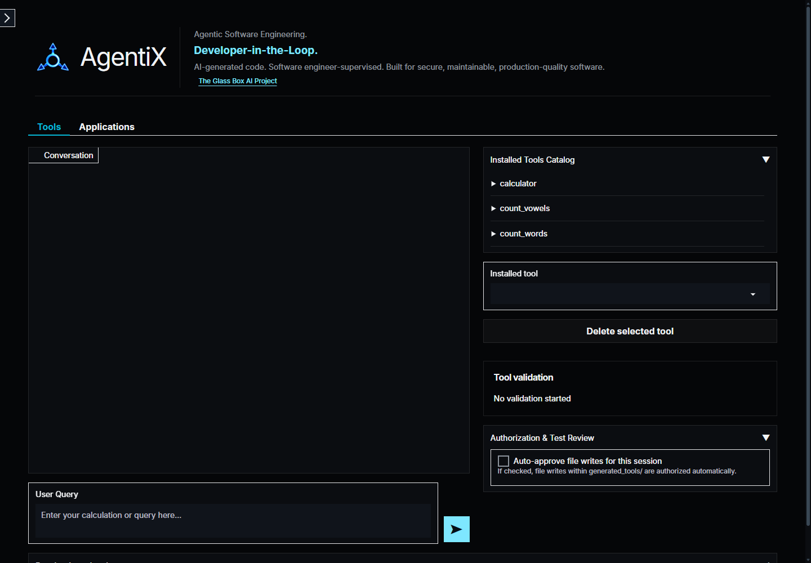
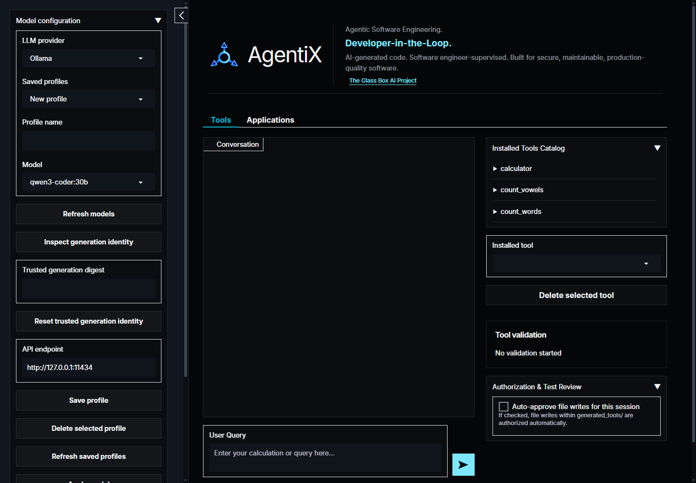
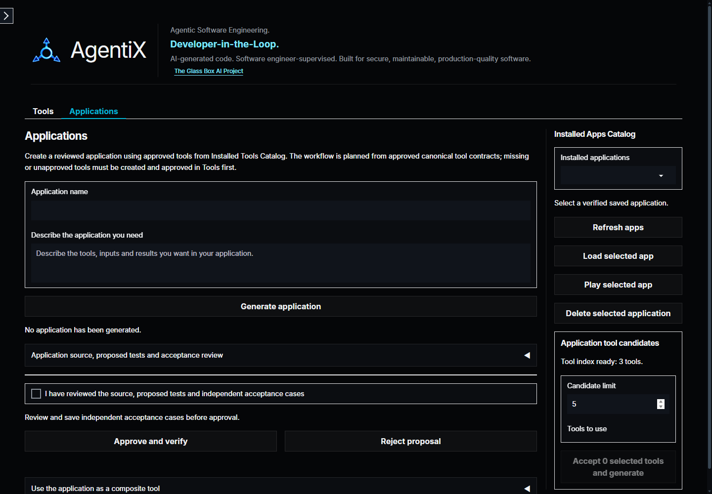

# AgentiX v7 — GUI User Guide

This guide explains how to use the AgentiX graphical user interface (GUI): how to configure a model, create and approve **Tools**, build **Applications** from approved tools, and manage the installed catalogs.

AgentiX is a *developer-in-the-loop* system. AI agents propose code, tests and applications, but **nothing is installed, trusted or executed as approved until you review and explicitly approve it**.

> For installation, launch and infrastructure details, see [INSTALLATION](INSTALLATION.md). For internals, see [V7_ARCHITECTURE](V7_ARCHITECTURE.md).

## Contents

1. [Before you start](#1-before-you-start)
2. [Starting the GUI](#2-starting-the-gui)
3. [Interface overview](#3-interface-overview)
4. [Configuring the model (sidebar)](#4-configuring-the-model-sidebar)
5. [The Tools tab](#5-the-tools-tab)
6. [The Applications tab](#6-the-applications-tab)
7. [Installed Apps Catalog](#7-installed-apps-catalog)
8. [Host dependency recovery](#8-host-dependency-recovery)
9. [Notifications and progress](#9-notifications-and-progress)
10. [Security principles you should know](#10-security-principles-you-should-know)
11. [Troubleshooting](#11-troubleshooting)
12. [Glossary](#12-glossary)

---

## 1. Before you start

You need:

- A working AgentiX v7 installation (the IaC `Test` action reports `inDesiredState: true`).
- For local generation: **Ollama** running separately on the loopback address (`http://127.0.0.1:11434` by default) with your chosen model installed. The recommended model is `qwen3-coder:30b`. AgentiX never installs or downloads Ollama or its models.
- A normal, non-elevated Windows user account.

## 2. Starting the GUI

From the v7 checkout, in PowerShell:

```powershell
Set-Location 'D:\AI\AgentiX_v7'
.\infra\Invoke-AgentiXIac.ps1 -Action LaunchGui
```

- The GUI listens only on the loopback address (`127.0.0.1`), by default on port **7878**, and opens in your browser.
- Keep the launching terminal open. Press **Ctrl+C** in it to close the GUI.
- If the port is already in use, the launch fails safely and does not stop the other process.

Each browser session owns its own model settings, drafts and pending reviews. Sessions expire after a period of inactivity (30 minutes), so reload the page if the GUI stops responding after a long absence.

## 3. Interface overview

The window has four main areas:

| Area | Purpose |
| --- | --- |
| **Header** | AgentiX identity and tagline. |
| **Progress bar** | Shows the current operation (searching, generating, validating…). |
| **Sidebar — "Model settings"** | Shared by both tabs. Collapsed by default; open it with the arrow at the left edge. |
| **Tabs — Tools / Applications** | The two workspaces. |

The sidebar lives *outside* the tabs, so the model you apply is used by both Tools and Applications.



**Typical workflow**

1. Configure and apply a model (sidebar).
2. In **Tools**, ask for the capabilities you need; review and approve each generated tool.
3. In **Applications**, describe an application; choose candidate tools; review and approve the proposal.
4. Run the application from the preview, or reload it later from the **Installed Apps Catalog**.

## 4. Configuring the model (sidebar)

Open the **Model settings** sidebar and expand **Model configuration**.



| Control | What it does |
| --- | --- |
| **LLM provider** | `Ollama` (local, default), `OpenAI`, or `OpenAI-compatible`. Changing it resets the endpoint and model fields to that provider's defaults. |
| **Saved profiles** | Pick a stored profile, or *New profile*. |
| **Profile name** | Name used when saving a profile (up to 64 characters). |
| **Model** | (Ollama) Dropdown of installed models. You may type a custom name. |
| **External model** | (OpenAI / compatible) Model name to request from the remote service. |
| **Refresh models** | (Ollama) Re-reads the installed models from the endpoint. It does not change the active model. |
| **Inspect generation identity** | Shows the digest of the selected local model. Nothing is trusted or activated by inspecting. |
| **Trusted generation digest** | Read-only display of that digest. |
| **Reset trusted generation identity** | Clears the stored trusted model identity so the next generation records a new one. |
| **API endpoint** | Server URL. Local default is `http://127.0.0.1:11434`; OpenAI default is `https://api.openai.com/v1`. |
| **API key** | (Remote providers only) Password field. The key is never shown again after saving. |
| **Allow sending task content to the selected external provider** | (Remote providers only) Explicit consent for this session. Required before a remote model can be applied. |
| **Save profile** / **Delete selected profile** / **Refresh saved profiles** | Manage stored profiles. |
| **Apply model** | Activates the settings in the current session. |
| **Status line** | Reports the result of the last sidebar action. |

### Recommended local setup

1. Leave the provider as **Ollama** and the endpoint as `http://127.0.0.1:11434`.
2. Click **Refresh models**, select `qwen3-coder:30b`.
3. (Optional) Enter a **Profile name** and click **Save profile**.
4. Click **Apply model**. Wait for the status line to confirm.

The first generation records the selected model's digest as a trusted local identity. If you later replace the model files, use **Inspect generation identity** and **Reset trusted generation identity** as needed.

### Using a remote provider

Remote use is optional and always opt-in per session:

1. Choose **OpenAI** or **OpenAI-compatible** and enter the model name and endpoint (HTTPS and public destinations only).
2. Enter the **API key**, then **Save profile**.
3. Tick the **consent** checkbox and click **Apply model**.

Saved keys are stored in **Windows Credential Manager** for your Windows user on this PC; profile files only hold an opaque reference. They persist until you delete the profile. Save external settings *before* applying them; consent is never carried over between sessions.

## 5. The Tools tab

The Tools tab is where you ask AgentiX to create reusable **tools** (Python functions that perform one operation), review them, and manage the installed tool catalog.

### 5.1 Layout

- **Left — Conversation**: the chat with the agents and the **User Query** box with the **Send query** button.
- **Right — Installed Tools Catalog**: list of approved tools, an **Installed tool** selector with delete controls.
- **Tool validation**: live status of the validation of the current request.
- **Authorization & Test Review**: where you approve or reject proposals.
- **Repair rejected tool**: collapsed panel to fix a tool you rejected.

### 5.2 Requesting a tool

1. Apply a model (section 4).
2. Type your request in **User Query**, for example: *"Count the words and vowels in a text."* Press **Enter** or click **Send query**.
3. Follow the conversation and the **Tool validation** panel. Agents propose the tool code, tests and acceptance cases.
4. When review is required, the **Authorization & Review Required** panel appears (see below).

If an approved tool already satisfies your request, AgentiX reuses it instead of generating a new one.

The Tools tab never runs an installed application. When no installed tool can answer the query and exactly one approved application matches it, AgentiX only replies *"This request appears to match the application '<name>'. Please open it from the Applications tab."* and stops there; open that application from the **Applications** tab to run it. If no application matches either, the normal new-tool flow continues.

### 5.3 Reviewing and approving

When a proposal needs authorization, the panel shows:

- A description of the pending request.
- An **editable text area** with the file content or acceptance cases. You can modify it before approving.
- A validation message about the current edited content.
- **Approve Reviewed Content** — enabled only when the proposal validates. Approval binds the *exact* bytes and policy you reviewed.
- **Reject Operation** — discards the proposal. AgentiX never re-prompts automatically after a rejection.

**Auto-approve file writes for this session** (checkbox) automatically authorizes file writes inside `generated_tools/`. It does **not** approve the tool itself, and sensitive or unclassified operations still require exact-call approval. Leave it off unless you understand the effect.

Review checklist:

- Does the code do only what you asked? Look for file, network or process access.
- Do the tests and acceptance cases check meaningful behaviour, not just trivial output?
- Are the declared inputs and outputs correct?

Generated tests are *provisional*; approved acceptance cases are compared independently outside the isolated child process.

### 5.4 Repairing a rejected tool

1. After rejecting an approval, expand **Repair rejected tool**.
2. Click **Load rejected tool**. Its implementation and tests appear in editors.
3. Edit the code or tests.
4. Click **Save edits and restart validation**. The normal validation and human approval flow starts again; nothing is authorized automatically.

### 5.5 Deleting an installed tool

1. Choose the tool in **Installed tool**.
2. Click **Delete selected tool**.
3. Read the confirmation prompt and click **Confirm permanent deletion** (or **Cancel**).

Deletion is permanent and revokes its approvals. Applications that depend on a tool may block its deletion; the message will explain the dependency check failed.

## 6. The Applications tab

An **application** combines approved tools into a reviewed workflow with an interface (widgets). Applications can use **only currently approved, installed catalog tools**. If a needed tool is missing, create and approve it in the Tools tab first.

The tab has a main workspace (left, wide) and the Installed Apps Catalog (right).



### 6.1 Generating an application

1. Enter an **Application name**.
2. In **Describe the application you need**, state the tools, inputs and results you want. Describe *requirements*, not code.
3. Click **Generate application**. AgentiX searches the catalog and shows the results in the **Application tool candidates** panel, located in the right-hand column below the Installed Apps Catalog. It starts with a message such as "Tool index ready: N tools."
4. In the candidate panel:
   - Adjust **Candidate limit** (how many candidates to retrieve; whole number from 1 to 100, default 5) and the search refreshes.
   - Tick the **Tools to use** you want.
   - Click **Accept N selected tools and generate** to give explicit consent for those tools to be used. The button stays disabled until a valid selection exists.
5. Wait while the agents plan the composition and generate connection code. The status line and progress bar show the stage.

### 6.2 Reviewing the proposal

When generation completes, expand **Application source, proposed tests and acceptance review**:

- **Original requirements** — your request, read-only.
- **Application files and proposed tests** — choose a file to inspect.
- **Selected file** — the source in an editor.
- For tool revisions, a three-pane view shows **Tool implementation**, **Tool widget** and **Tool tests / Widget tests** together.
- **Saved independent acceptance cases** — declarative cases used to verify the application.
- **Save reviewed changes** — saves your edits. Edited tool code or tests create a *pending revision* that must pass the normal tool review before the application can be approved. Unchanged approved tools are reused without rerunning their tests.
- **Code help** — a floating, read-only assistant: ask a question about the selected code. It never executes or modifies anything. It needs a configured model (and remote consent if remote). A fenced Mermaid diagram in the answer renders as a diagram from a locally packaged bundle; no network fetch is involved.

Edits invalidate earlier review: after any change you must save again and re-tick the review checkbox.

### 6.3 Approving or rejecting

1. Review the source, tests and acceptance cases.
2. Tick **I have reviewed the source, proposed tests and independent acceptance cases**. Save acceptance cases first if the notice asks you to.
3. Click **Approve and verify** to run native, sandboxed and browser acceptance, or **Reject proposal** to discard it.

If verification fails, **Propose repair after failed verification** may appear. If tool revisions are pending, **Review modified tool revisions** takes you through their approval first.

### 6.4 Using the application

After successful verification, the application's interface appears in the framed preview below the buttons. Use it as designed.

### 6.5 Composite tool (data operation)

Expand **Use the application as a composite tool** to run the reviewed operation *without* opening its interface:

1. Read the **Data operation inputs** contract under the box. It lists every accepted key with its type and shows one **Example payload**.
2. Click **Show input schema** to refresh that contract without executing the application.
3. In the input box, enter text (legacy apps) or one JSON object with exactly the listed keys (catalog apps), for example `{"text": "Hello World!"}`.
4. Click **Run data operation**.
5. Catalog applications show one **Named results** table with `Result`, `Type` and `Value`; legacy applications keep the `Words` and `Vowels` fields.

A rejected payload clears the table and names the bounded reason, for example `Data operation failed (JSONDecodeError): Expecting value: line 1 column 1 (char 0).` The message never repeats the typed payload.

This does not publish the application as an installed tool.

## 7. Installed Apps Catalog

The right-hand panel lists verified, saved applications.

| Control | Action |
| --- | --- |
| **Installed applications** | Select a saved application; its description appears underneath. |
| **Refresh apps** | Reloads the list. |
| **Load selected app** | Loads the application into the workspace for inspection. |
| **Play selected app** | Launches the application. |
| **Delete selected application** | Permanently deletes it after confirmation (**Confirm permanent deletion** / **Cancel**). |

Only verified applications whose approvals are still valid can be loaded or played. If an application's content or policy changes, its approvals are invalidated and it must be reviewed again.

## 8. Host dependency recovery

Browser acceptance needs **Playwright Chromium**. Normally the IaC `Apply` action prepares it. If it is missing when you click **Approve and verify**:

1. An informational message opens. Click **Ok** — this only dismisses the message; it does **not** authorize any installation.
2. Below the review buttons, read the host-requirement explanation and click **Install required host dependency**. This click is your explicit consent to download Chromium with the AgentiX Python (`playwright install chromium`).
3. Wait for the result. On failure, the review stays pending and no substitute is installed.
4. After success, check the retained review and click **Approve and verify** **again**. The earlier approval click is never replayed.

The button is visible only to the owner of the unchanged pending review. Only Chromium is supported by this mechanism.

## 9. Notifications and progress

- The **progress bar** under the header shows long operations.
- A modal **message window** with an **Ok** button reports results and validation errors. Click **Ok** to dismiss it.
- Panels refresh automatically every second or so; there is no need to reload the page.

## 10. Security principles you should know

- Generated code and tests are **untrusted**. They run only inside Windows AppContainer isolation; there is no fallback to ordinary execution.
- Approval is **by exact content**. Any change to the code, widget, dependencies or policy invalidates the approval.
- Sensitive or unclassified operations require approval of each exact call.
- Models run locally by default. Remote providers need explicit per-session consent, HTTPS and public-destination checks.
- API keys stay in Windows Credential Manager and are never displayed again.
- The GUI binds to loopback only.

## 11. Troubleshooting

| Symptom | What to do |
| --- | --- |
| Model list is empty / refresh fails | Make sure Ollama is running and the endpoint is correct. |
| Remote model cannot be applied | Enter the API key and tick the consent checkbox; save the profile first. |
| **Approve Reviewed Content** disabled | Read the validation message under the text area; fix the content. |
| **Accept … and generate** disabled | Tick at least one candidate; wait for the search or running operation to finish. |
| **Approve and verify** reports missing Chromium | Follow [section 8](#8-host-dependency-recovery). |
| Cannot delete a tool or application | Another item may depend on it, or storage checks failed; check the message and diagnostics. |
| Page seems stale or unresponsive | The session may have expired; reload the browser page. |
| Port already in use at launch | Another process holds the port; free it or configure another port. AgentiX will not terminate it. |

More information: [KNOWN_ISSUES](KNOWN_ISSUES.md), [V7_INCIDENTS](V7_INCIDENTS.md).

## 12. Glossary

- **Tool** — a reviewed, reusable Python function with declared inputs and outputs and its own widget.
- **Widget** — the UI component of a tool.
- **Application** — a reviewed composition of approved tools with generated connection code.
- **Catalog** — the set of approved, installed tools or applications.
- **Acceptance case** — a declarative input/expected-output case verified independently of the sandboxed child.
- **Profile** — saved model provider settings; secrets are held in Windows Credential Manager.
- **Session** — your browser's private workspace; profiles, drafts and reviews belong to it.
