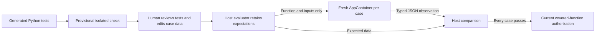

# ADR-0005: provisional tests and human-reviewed host acceptance

Date: 2026-10-19. Status: implemented, with finite-case limits.

The user wants Agentix to generate and initially check its own tests, then present them for human review. Keep generated unittest execution as a provisional development signal. It cannot authorize execution because generated Python can alter the framework and forge its report.

The final authority is maintained application code comparing observations against explicitly approved data. The LLM proposes a bounded declarative contract, the owner edits/approves it through an identified expiring review, and the host evaluator retains expectations. File auto-approval is inapplicable. Rejection/expiry ends automatic review requests for that operation. A new user query can initiate another review.

Neither executable assertions nor expected results enter the isolated implementation's acceptance request. Returned values and exception names remain untrusted observations, not verdicts. Exact comparisons preserve JSON types; approximate comparisons require explicit tolerances. Process/transport/serialization failures cannot count as expected function exceptions. Duplicate keys, nonfinite values, invalid/oversized contracts and unsupported data fail closed.

The ledger separately stores provisional observations and final acceptance. Final acceptance binds owner, operation, source/test bytes, canonical contract digest, covered function names and evaluator version. Current checks happen before dispatch; observed changes revoke records permanently until a fresh check/review. Approval receipts and contracts remain in memory, not silently persisted into artifact storage.

This design establishes agreement with reviewed cases, not universal correctness, semantic coverage, internal execution provenance or account authentication. A malicious implementation can fabricate a value, but that value must still match the expectation held outside the child for the given input. Reviewers must validate the requirements and expected values. Standard-library/JSON tool boundaries and existing native-isolation limits remain. Interactive review is implemented in Gradio; the synchronous legacy CLI has no dedicated review client and cannot bypass authorization.
