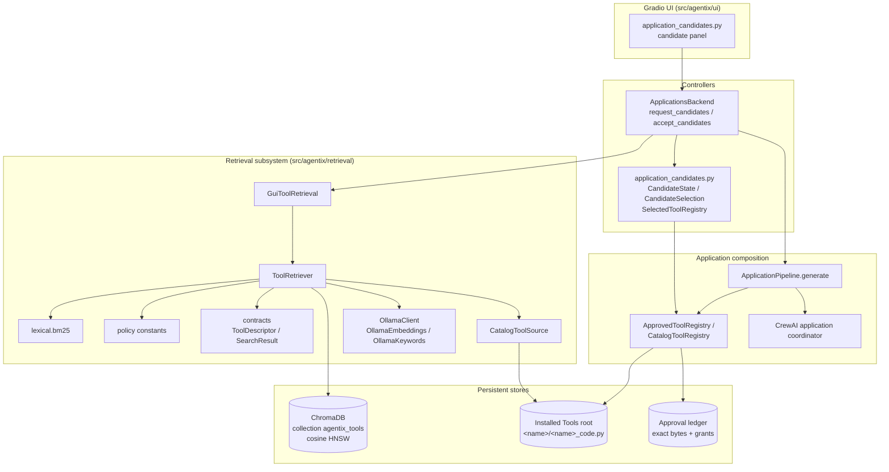
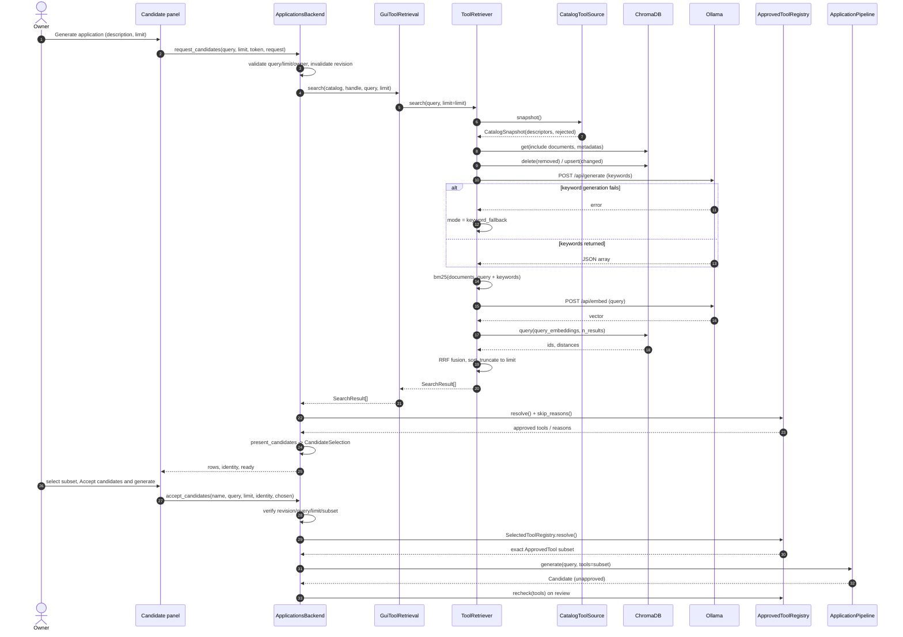

# AgentiX v7 — Tool Retrieval and Ranking Architecture

| Field | Value |
| --- | --- |
| Document | `docs/architecture/TOOL_RETRIEVAL_AND_RANKING.md` |
| Subject | Implemented Tool discovery, indexing, retrieval, ranking and selection architecture of AgentiX v7 |
| Repository root | `D:\AI\AgentiX_v7` |
| Evidence basis | Current source tree, maintained tests, in-repo configuration, existing persistent index directory |
| Change scope | Documentation only; no production code, tests, MDD, database or collection was modified |
| Status | Reverse-engineered from implementation; no redesign is proposed here |

Evidence labels used throughout: **Confirmed** (directly supported by implementation),
**Inferred** (logically derived from implementation, not directly exercised), **Unverified**
(insufficient evidence).

---

## 1. Executive Summary

AgentiX v7 implements a **self-contained hybrid Tool retrieval subsystem** in
`src/agentix/retrieval/` and integrates it into the GUI application-generation flow. The subsystem is
not an agent capability and grants no execution rights.

The confirmed architecture is:

1. **Authoritative catalog** — the installed Tools directory (`Settings.tools_root`, one folder per
   Tool with a conventional `<name>/<name>_code.py`). `ToolCatalog` (`src/agentix/storage/catalog.py:15`)
   owns membership; the approval ledger owns grants. ChromaDB is **not** authoritative.
2. **Index** — a dedicated persistent ChromaDB collection named `agentix_tools`, cosine HNSW space,
   stored beside the Tools root in a sibling `tool_registry` directory. Each record holds the Tool
   identifier, the embedded document text, the vector and one JSON metadata string (`descriptor`).
3. **Synchronization** — `ToolRetriever.synchronize()` (`src/agentix/retrieval/service.py:121`) reads a
   complete bounded AST-only snapshot from `CatalogToolSource` and reconciles additions, changes and
   removals. It runs at construction when a source is bound, and again before **every** search.
4. **Lexical branch** — a from-scratch BM25 implementation (`src/agentix/retrieval/lexical.py:23`) with
   `k1=1.5`, `b=0.75`, IDF smoothing `0.5`, rebuilt in memory from the same stored documents on every
   search. There is no persistent lexical index.
5. **Semantic branch** — Ollama `nomic-embed-text:latest` through `/api/embed`
   (`src/agentix/retrieval/ollama.py:123`), cosine similarity computed as `1.0 - distance`.
6. **Fusion** — equal-weight Reciprocal Rank Fusion with constant `60`, one-based ranks, tie-break by
   `tool_id` (`src/agentix/retrieval/service.py:368`). No weights, thresholds or score normalization
   exist.
7. **Selection** — the GUI presents every returned candidate with an eligibility label, the owner
   accepts an explicit subset, and `SelectedToolRegistry` re-verifies approval and exact source bytes
   before and after generation.

The central architectural fact is that **retrieval output is metadata, never a capability**. A
`SearchResult` carries a `ToolDescriptor` snapshot; the executable bytes are obtained later from the
approval ledger, keyed by Tool name, and are re-hashed against the descriptor digest at acceptance and
again after generation.

Mechanism status summary:

| Mechanism | Status | Evidence |
| --- | --- | --- |
| ChromaDB persistent vector store | **Implemented and integrated** | `service.py:44`, `gui.py:37`, `tools/sync_tool_registry.py` |
| Ollama embeddings (`nomic-embed-text:latest`) | **Implemented and integrated** | `ollama.py:123`, `gui.py:37` |
| BM25 lexical retrieval | **Implemented and integrated** | `lexical.py:23`, `service.py:440` |
| Reciprocal Rank Fusion | **Implemented and integrated** | `service.py:464` |
| Hybrid search | **Implemented and integrated** | `service.py:368` |
| Catalog indexing / synchronization | **Implemented and integrated** | `catalog.py:72`, `service.py:121` |
| GUI candidate selection | **Implemented and integrated** | `controllers/applications.py:222`, `:339` |
| Approval/eligibility verification | **Implemented and integrated** | `storage/application_catalog.py:59`, `:199` |
| LLM-based Tool routing (separate mechanism) | **Implemented and integrated** in the legacy typed workflow | `application/tool_routing.py:58` |
| Cross-encoder / learned reranker | **Not found** | no source reference |
| Score threshold or similarity cutoff | **Not found** (explicitly absent) | `service.py:368` docstring, `specs/051-tool-retrieval.md` |
| Configurable RRF weights or `k` | **Not found** (constants only) | `policy.py:22` |
| Persistent BM25 index | **Not found** (rebuilt per search) | `lexical.py:23` |
| Background filesystem watcher | **Not found** (sync on construction/search) | `service.py:121`, `specs/051-tool-retrieval.md` |
| Multi-process index coordination | **Not found** (explicitly out of scope) | `gui.py:1` |

---

## 2. Scope and Implementation Status

### 2.1 In scope

- Tool discovery from the installed catalog root.
- AST-only descriptor extraction and contract digesting.
- ChromaDB persistence, collection configuration and lifecycle.
- Ollama embedding and keyword-generation boundaries.
- BM25 scoring and tokenization.
- RRF fusion, ranking and truncation.
- GUI candidate search, presentation, acceptance and dependency re-verification.
- Handover of accepted Tools to application composition.
- Eligibility, approval and isolation constraints that affect retrieval.

### 2.2 Out of scope

- Tool creation, validation and approval workflows (documented elsewhere).
- Sandbox/AppContainer execution of Tools.
- Widget design and publication.
- Model acceptance for application generation.

### 2.3 Explicit exclusions honoured

`generated_tools/` was not inspected, executed or indexed during this analysis. The persistent index
directory `tool_registry/` was listed only; no collection was opened, created, mutated or reindexed,
and no embedding was generated. No test was modified and no dependency was installed.

### 2.4 Status of the two selection paths

AgentiX v7 contains **two distinct Tool selection mechanisms** that must not be conflated:

| Path | Mechanism | Integration |
| --- | --- | --- |
| Application generation (GUI) | Hybrid ChromaDB + BM25 + RRF retrieval, then explicit owner acceptance | `bootstrap.py:329`, `controllers/applications.py:222` |
| Legacy typed Tool workflow | Single LLM call over `ToolCatalog.contracts()` JSON, validated by Pydantic routes | `application/tool_routing.py:58` |

Only the first is a retrieval/ranking architecture. The second is a prompt-based classifier with no
index, no embeddings and no ranking scores; it is documented in §10.6 for completeness because it also
"selects Tools".

---

## 3. Retrieval Component Architecture

### 3.1 Component inventory

| Component | Module | Responsibility |
| --- | --- | --- |
| `ToolRetriever` | `src/agentix/retrieval/service.py:36` | Storage, synchronization, both branches, fusion, diagnostics |
| `ToolDescriptor` | `src/agentix/retrieval/contracts.py:37` | Immutable search metadata record |
| `SearchResult` | `src/agentix/retrieval/contracts.py:56` | Ranked candidate with per-branch scores |
| `descriptor_from_source` | `src/agentix/retrieval/contracts.py:116` | AST-only descriptor extraction |
| `bm25` / `tokens` | `src/agentix/retrieval/lexical.py:23`, `:10` | Lexical scoring and tokenization |
| `OllamaClient` | `src/agentix/retrieval/ollama.py:24` | Bounded loopback HTTP boundary |
| `OllamaEmbeddings` | `src/agentix/retrieval/ollama.py:123` | `/api/embed` adapter |
| `OllamaKeywords` | `src/agentix/retrieval/ollama.py:82` | `/api/generate` keyword adapter |
| `CatalogToolSource` | `src/agentix/retrieval/catalog.py:27` | Bounded read-only catalog snapshot |
| `GuiToolRetrieval` | `src/agentix/retrieval/gui.py:48` | GUI composition, startup load, per-owner handles |
| `RetrieverHandle` | `src/agentix/retrieval/gui.py:30` | Session-private retriever and root identity |
| `CandidateState` / `CandidateSelection` | `src/agentix/controllers/application_candidates.py:73`, `:30` | Server-owned search revision and preview |
| `SelectedToolRegistry` | `src/agentix/controllers/application_candidates.py:89` | Exact-subset approval and digest recheck |
| `ApprovedToolRegistry` / `CatalogToolRegistry` | `src/agentix/storage/application_catalog.py:37`, `:118` | Eligibility resolution from catalog + ledger |
| `ToolCatalog` | `src/agentix/storage/catalog.py:15` | Catalog membership and AST rendering |
| `ToolRouter` | `src/agentix/application/tool_routing.py:58` | Separate LLM-based routing (legacy workflow) |

### 3.2 Component diagram (confirmed dependencies)



Persistent stores are drawn as cylinders: ChromaDB, the Tools root and the approval ledger. BM25
counters, the candidate snapshot, the fused score map and the ranked list are transient in-memory
structures created per search.

### 3.3 Layering

- **Adapters** (`ollama.py`, `catalog.py`) own all I/O: HTTP and filesystem.
- **Service** (`service.py`) owns orchestration, validation, ranking and diagnostics.
- **Contracts** (`contracts.py`) own typed data and AST extraction; they perform no I/O.
- **Policy** (`policy.py`) owns numeric constants; it is not a runtime configuration API.
- **GUI composition** (`gui.py`) owns process-level serialization and session handles.
- **Controllers** own session state, revisions and eligibility presentation.
- **Storage adapters** (`storage/application_catalog.py`) own approval-based resolution.

No retrieval module imports CrewAI, Gradio or any generated Tool.

---

## 4. Tool Catalog and Data Ownership

### 4.1 Authoritative sources

| Question | Answer | Evidence |
| --- | --- | --- |
| Who owns Tool definitions? | The installed Tools directory; one folder per Tool | `storage/catalog.py:22` |
| Who owns executable bytes? | The approval ledger snapshot (`ledger.snapshot`) | `security/verification.py:42` |
| Who owns grants? | The approval ledger / durable approval store | `security/verification.py:308`, `security/approval_store.py:209` |
| Is ChromaDB authoritative? | **No.** It is a derived, disposable search index | `service.py:121`, `specs/051-tool-retrieval.md` |
| Does ChromaDB hold executable artifacts? | **No.** Only descriptor JSON, document text and vectors | `service.py:347` |

`ToolCatalog.contains()` (`storage/catalog.py:22`) accepts a name matching
`[A-Za-z][A-Za-z0-9_]{0,127}` and requires both the folder and `<name>_code.py` to exist. Membership
alone never establishes authorization.

### 4.2 Catalog root resolution

- GUI and CLI both derive the root from `Settings.tools_root` (`src/agentix/settings.py`), which is
  mandatory from `AGENTIX_TOOLS_ROOT` and validated by `require_v7_namespace`
  (`storage/locations.py:11`) so a retired v5 namespace is rejected.
- The index path is `Path(catalog.root).parent / "tool_registry"` (`gui.py:37`,
  `tools/sync_tool_registry.py`), i.e. a sibling of the Tools root inside the v7 data root.
- `tools/sync_tool_registry.py` accepts `--tools-root` and `--index` overrides for launcher-resolved
  deployments.

### 4.3 Observed persistent index on disk

`tool_registry/` exists at the repository root with `chroma.sqlite3` and one HNSW segment directory
(`29dc09d6-0eca-426c-becc-7f11676bfc92/` containing `data_level0.bin`, `header.bin`, `length.bin`,
`link_lists.bin`). **Confirmed** by directory listing; the collection was not opened, so record counts
are **Unverified**.

---

## 5. ChromaDB Storage Architecture

### 5.1 Client initialization

`ToolRetriever.__init__` (`service.py:44`) imports `chromadb` lazily inside the constructor, so
importing `agentix.retrieval` performs no database I/O (`retrieval/__init__.py` docstring; test
`tests/test_retrieval_adapters.py::test_import_is_inert_and_independent`).

```python
self._client = chromadb.PersistentClient(
    path=str(path), settings=Settings(anonymized_telemetry=False)
)
self._collection = self._client.get_or_create_collection(
    name=collection_name,
    embedding_function=None,
    metadata={"embedding_model": embeddings.model_id, "schema": policy.INDEX_SCHEMA_VERSION},
    configuration={"hnsw": {"space": "cosine"}},
)
```

| Property | Value | Evidence |
| --- | --- | --- |
| Client type | `chromadb.PersistentClient` | `service.py:70` |
| Telemetry | Disabled (`anonymized_telemetry=False`) | `service.py:71` |
| Mode | Persistent (on-disk), never ephemeral in production | `service.py:70` |
| Default collection name | `agentix_tools` | `service.py:50` |
| Embedding function | `None` — vectors are always supplied explicitly | `service.py:75` |
| Distance space | `cosine` via HNSW configuration | `service.py:80` |
| Pinned library version | `chromadb==1.5.9` | `requirements-retrieval.txt`, `requirements-runtime.txt` |

### 5.2 Collection metadata

| Key | Written when | Meaning |
| --- | --- | --- |
| `embedding_model` | Collection creation | Provider `model_id`; mismatch aborts construction |
| `schema` | Collection creation | `policy.INDEX_SCHEMA_VERSION` = `1` |
| `dimension` | First successful vector write | Vector length; later mismatch aborts |
| `descriptor_source` | First binding of a descriptor source | SHA-256 of the normalized absolute catalog root |

Construction rejects an index whose `embedding_model`, `schema` or `hnsw.space` differs
(`service.py:88`). `_vectors()` re-checks `embedding_model` and `dimension` on every embedding batch
(`service.py:252`).

### 5.3 Record shape

| Chroma field | Content |
| --- | --- |
| `ids` | `[descriptor.tool_id]` |
| `documents` | Concatenated searchable text (see §7.2) |
| `embeddings` | One vector from the injected provider |
| `metadatas` | `[{"descriptor": "<canonical JSON>"}]` |

The JSON payload is produced with `json.dumps(data, allow_nan=False, sort_keys=True)`
(`service.py:311`), so metadata is deterministic and byte-comparable.

### 5.4 Operations

| Operation | Implementation | Notes |
| --- | --- | --- |
| Insert / update | `collection.upsert` (`service.py:347`) | Replace-by-ID semantics |
| Delete | `collection.delete(ids=[...])` (`service.py:365`, `:166`) | Idempotent |
| Full snapshot | `collection.get(include=["documents", "metadatas"])` (`service.py:403`) | Used by BM25 and by reconciliation |
| Vector query | `collection.query(query_embeddings=..., n_results=..., include=["distances"])` (`service.py:454`) | Only distances are requested |
| Count | `collection.count()` (`service.py:92`, `:117`) | Diagnostics and empty-index short-circuit |
| Metadata update | `collection.modify(metadata=...)` (`service.py:119`, `:281`) | Source binding and dimension |

### 5.5 Role of ChromaDB

ChromaDB acts as **an embedding store plus a derived discovery index**, and as a **metadata snapshot
repository** for descriptors. It is explicitly **not** an authoritative catalog, not an approval
record and not an artifact store. Deleting the directory loses only cached descriptors and vectors;
the next synchronization rebuilds them from the Tools root.

### 5.6 Error handling

| Condition | Behaviour |
| --- | --- |
| Model/schema/space mismatch | `ValueError("Index model or schema is incompatible; rebuild into a separate index")` |
| Bound index opened unbound | `ValueError("This index requires its bound descriptor source")` |
| Different source identity | `ValueError("Index descriptor source differs from the requested source")` |
| Binding a non-empty manual index | `ValueError("Binding a source requires a dedicated empty index")` |
| Duplicate tool IDs in a snapshot | `ValueError("Descriptor source returned duplicate tool IDs")` |
| Storage exception | Propagated unchanged; search never degrades to stale results |

---

## 6. Indexed Data and Metadata Schema

### 6.1 `ToolDescriptor` fields (the complete indexed model)

`ToolDescriptor` (`contracts.py:37`) is a frozen dataclass with exactly nine fields. No other field is
persisted.

| Field | Type | Required | Source of value | Retrieval usage |
| --- | --- | --- | --- | --- |
| `tool_id` | `str` | Yes | Canonical function name (equals folder name) | Chroma ID, tie-break key, eligibility key |
| `name` | `str` | Yes | Canonical function name | Document text, display |
| `description` | `str` | Yes | Function docstring, else module docstring, else name | Document text, candidate summary |
| `entrypoint` | `str` | Yes | `f"{name}_code.py:{name}"` | Document text only |
| `input_schema` | `dict[str, Any]` | Yes | AST parameter annotations | Document text, composition contract |
| `output_schema` | `dict[str, Any]` | Yes | AST return annotation | Document text, composition contract |
| `keywords` | `list[str]` | Yes | `[name]` at extraction time | Document text, lexical expansion |
| `artifact_ref` | `str` | Yes | Catalog folder name | Opaque reference; never resolved by retrieval |
| `contract_digest` | `str` | Yes | SHA-256 of source bytes | Staleness detection, acceptance binding |

Validation in `_payload` (`service.py:285`): the six text fields must be nonempty strings of at most
`MAX_DESCRIPTOR_FIELD_CHARACTERS` (32 768); `tool_id` at most `MAX_TOOL_ID_CHARACTERS` (256); both
schemas must be JSON objects; keywords pass `validate_keywords`; the serialized payload must not exceed
`MAX_DESCRIPTOR_BYTES` (256 KiB).

### 6.2 Fields that do **not** exist

| Requested field | Status | Note |
| --- | --- | --- |
| Approval status / grant | **Absent** | Deliberately excluded; `specs/051-tool-retrieval.md` states the descriptor "has no approval, testing or category fields" |
| Tags / categories | **Absent** | No category vocabulary exists |
| Tool version | **Absent** | No semantic version is stored |
| Source path | **Absent** | Only the opaque `artifact_ref` folder name |
| Artifact location | **Absent** | Not a filesystem grant |
| Dependencies / imports | **Absent** | Import policy is evaluated later by `computation_only` |
| Embedding model identifier (per record) | **Absent** | Stored once in collection metadata |
| Index timestamps | **Absent** | No `created_at` / `updated_at` |
| Test bytes | **Absent** | Held only by the approval ledger |
| Reviewed acceptance contract | **Absent** | Held only by the approval ledger |

### 6.3 Representative stored record

Structure **Confirmed** from `_payload` and `_store_descriptor`; the concrete values below are
illustrative of the shape, not a dump of the live database:

```json
{
  "artifact_ref": "count_words_in_text",
  "contract_digest": "<sha256 of source bytes>",
  "description": "Count words in text",
  "entrypoint": "count_words_in_text_code.py:count_words_in_text",
  "input_schema": {"type": "object", "properties": {"text": {"python_type": "str"}}, "required": ["text"]},
  "keywords": ["count_words_in_text"],
  "name": "count_words_in_text",
  "output_schema": {"python_type": "int"},
  "tool_id": "count_words_in_text"
}
```

Chroma metadata for that record is `{"descriptor": "<the JSON above>"}`; the document text is the
concatenation described in §7.2.

### 6.4 Stored versus computed

| Item | Stored | Computed at query time |
| --- | --- | --- |
| Descriptor JSON | Yes | — |
| Document text | Yes | — |
| Embedding vector | Yes | — |
| BM25 term counts and lengths | No | Yes, per search |
| Cosine similarity | No | Yes, from stored distance |
| RRF score | No | Yes |
| Rank | No | Yes |
| Eligibility label | No | Yes, from ledger |
| Candidate summary | No | Yes, truncated first description line |

---

## 7. Embedding Generation

### 7.1 Model and transport

| Property | Value | Evidence |
| --- | --- | --- |
| Provider | Ollama, loopback HTTP only | `ollama.py:31` |
| Default endpoint | `http://127.0.0.1:11434` (`OLLAMA_BASE_URL`) | `ollama.py:33`, `settings.py:68` |
| Default embedding model | `nomic-embed-text:latest` | `ollama.py:126` |
| Route | `POST /api/embed` | `ollama.py:56`, `:130` |
| Request body | `{"model": ..., "input": texts, "truncate": false}` | `ollama.py:133` |
| Response field | `embeddings` | `ollama.py:135` |
| Timeout | 60 s, no retries | `policy.py:46` |
| Request bound | 2 MiB | `policy.py:47` |
| Response bound | 1 MiB, probed with one extra byte | `policy.py:48`, `ollama.py:71` |
| Proxies | Disabled (`ProxyHandler({})`) | `ollama.py:67` |
| Redirects | Rejected by `_NoRedirects` | `ollama.py:14` |
| Model pulls | Never performed | module docstring, `specs/051-tool-retrieval.md` |

Endpoint validation requires scheme `http`, a loopback host (`localhost` or an IP for which
`ip_address(...).is_loopback` holds), no credentials, no path beyond `/`, and no query or fragment
(`ollama.py:37`).

### 7.2 Embedded text construction

`_payload` builds the document as a single space-joined string (`service.py:316`):

```text
name + " " + description + " " + entrypoint
     + " " + json(input_schema) + " " + json(output_schema) + " " + " ".join(keywords)
```

Consequences (**Confirmed**):

- The Tool **name**, **description**, **entrypoint**, **both schemas** and **keywords** contribute.
- The docstring contributes only through `description`.
- `tool_id`, `artifact_ref` and `contract_digest` do **not** contribute.
- Schema JSON keys (`type`, `properties`, `required`, `python_type`, `description`) are embedded as
  literal tokens, so parameter names and type spellings are semantically searchable.

### 7.3 Validation, batching and dimension

- One descriptor is embedded per `upsert` (`_store_descriptor` calls `_vectors([document])`), so
  production indexing is effectively batch size 1. `_vectors` accepts a list and validates the batch
  shape, so a provider may batch internally.
- Each vector must be a nonempty list of finite `int`/`float` values (bools rejected) with a nonzero
  norm; all vectors in a batch must share one dimension (`service.py:252`).
- The first successful write persists `dimension` in collection metadata; a later different dimension
  raises `ValueError("Embedding dimension changed")`.
- **Dimensionality of `nomic-embed-text:latest` is not asserted anywhere in source.** It is recorded
  only as an observed integer in collection metadata. Any specific number would be **Unverified**.
- No explicit L2 normalization is performed by AgentiX; normalization, if any, is the provider's
  behaviour (**Unverified**). Cosine space makes the stored magnitude irrelevant to ranking.

### 7.4 Caching and reindexing triggers

| Trigger | Effect |
| --- | --- |
| Bound construction | Full `synchronize()`, embedding only new/changed descriptors |
| Every valid `search()` on a bound retriever | `synchronize()` again before querying |
| Explicit `synchronize()` | Same reconciliation without a search |
| `upsert()` | Re-embeds that descriptor unconditionally |
| Unchanged descriptor (`existing[key] == item`) | No embedding; counted as `unchanged` |
| Model identity change | Construction fails; a separate rebuilt index is required |
| Schema version change | Construction fails; explicit compatibility decision required |

There is no vector cache beyond Chroma itself and no memoization of query embeddings.

### 7.5 Model change or unavailability

- **Changed model tag**: `ValueError("Index model or schema is incompatible; rebuild into a separate
  index")` at construction, and `ValueError("Embedding model changed")` inside `_vectors`.
- **Same tag, different bytes**: not detected. `specs/051-tool-retrieval.md` records this limitation
  explicitly.
- **Provider unavailable during search**: the exception propagates; the controller converts it to
  `ValueError("Candidate search unavailable. Check local Ollama/catalog and retry Generate
  application.")` (`controllers/applications.py:332`). No stale results and no catalog fallback.
- **Provider unavailable at startup**: `GuiToolRetrieval.initialize` records
  `"Tool index unavailable. Retry with Generate application."` and the GUI still opens
  (`gui.py:57`).

---

## 8. BM25 Lexical Retrieval

### 8.1 Implementation

Custom, dependency-free implementation in `src/agentix/retrieval/lexical.py`. No `rank_bm25`,
`bm25s` or Elasticsearch/Lucene component exists in the repository.

### 8.2 Corpus construction

`bm25(documents, query)` receives `dict[tool_id, document_text]` built from the **same** Chroma
snapshot used for the semantic branch (`service.py:403`, `:440`). Therefore both branches operate over
exactly the same Tool population and the same text, with no divergence window inside one search.

### 8.3 Tokenization and normalization

`tokens()` (`lexical.py:10`):

1. `re.findall(r"\w+", text, flags=re.UNICODE)` keeps complete Unicode identifiers.
2. Each word is case-folded.
3. Camel-case and underscore segmentation adds sub-tokens:
   `([A-Z]+)([A-Z][a-z])` → split, `([a-z0-9])([A-Z])` → split, `_` → space.
4. Sub-tokens are appended only when they differ from the whole folded word.

There is **no stopword list**, no stemming, no lemmatization and no domain vocabulary. The docstring
states the intent: "Keep complete Unicode identifiers and add underscore/camel-case segments."

### 8.4 Scoring formula

For each distinct query term, with `N = |corpus|`, `df` = number of documents containing the term:

```text
idf = ln(1 + (N - df + 0.5) / (df + 0.5))
tf  = term frequency in the document
norm = 1 - b + b * (doc_length / average_doc_length)
score += idf * tf * (k1 + 1) / (tf + k1 * norm)
```

| Parameter | Value | Location |
| --- | --- | --- |
| `k1` | `1.5` | `policy.py:25` |
| `b` | `0.75` | `policy.py:26` |
| IDF smoothing | `0.5` | `policy.py:27` |
| Average length guard | `max(len(counts), 1) or 1` | `lexical.py:31` |

Only documents with `score > 0` are returned (`lexical.py:42`), so a document sharing no query term is
absent from the lexical branch rather than scored zero.

### 8.5 Query processing

The lexical query is `" ".join([query, *supplied_keywords, *generated_keywords])`
(`service.py:440`). Terms are de-duplicated by `sorted(set(tokens(query)))` inside `bm25`, so repeated
terms do not multiply IDF contributions.

### 8.6 Candidate generation and lifecycle

- Scores are sorted by `(-score, tool_id)` and truncated to `candidate_limit` (`service.py:441`).
- The index is rebuilt from scratch on every search; nothing is persisted.
- The module docstring records the trade-off: correctness after updates/reopen is preferred over
  large-corpus performance in the first release.

### 8.7 Observable inconsistencies

| Observation | Status |
| --- | --- |
| Semantic branch embeds only the raw query; lexical branch also uses supplied and generated keywords | **Confirmed** (`service.py:440`, `:444`) — intentional asymmetry |
| BM25 sees full document text; the semantic branch sees the same text but only the query side differs | **Confirmed** |
| BM25 rebuild cost grows linearly with corpus size on every search | **Confirmed** by code; no benchmark evidence exists |
| No lexical index persistence means no staleness risk but repeated CPU cost | **Inferred** |

---

## 9. Hybrid Retrieval and RRF

### 9.1 Branch budgets

```python
candidate_limit = min(count, max(policy.MIN_BRANCH_CANDIDATES,
                                 policy.BRANCH_CANDIDATE_MULTIPLIER * limit))
```

| Constant | Value | Meaning |
| --- | --- | --- |
| `MIN_BRANCH_CANDIDATES` | `20` | Floor per branch |
| `BRANCH_CANDIDATE_MULTIPLIER` | `4` | Branch budget relative to requested results |
| `DEFAULT_SEARCH_LIMIT` | `5` | GUI default |
| `MIN_SEARCH_LIMIT` / `MAX_SEARCH_LIMIT` | `1` / `100` | Accepted `limit` range |

With the default `limit=5` the branch budget is `max(20, 20) = 20`; with `limit=100` it is `400`,
capped by collection size.

### 9.2 Semantic scoring

```python
semantic = {key: 1.0 - distance for key, distance in zip(ids, distances)}
semantic_ids = sorted(semantic, key=lambda key: (-semantic[key], key))
```

- Score is cosine similarity derived from Chroma's cosine distance.
- Values are **not clamped**; a cosine distance above 1.0 yields a negative similarity.
- Chroma's cosine distance range is `[0, 2]`, so similarity lies in `[-1, 1]` — **Inferred** from the
  configured space, not asserted in AgentiX source.
- The score is explicitly documented as "not a probability or authorization" (`contracts.py:56`).

### 9.3 Fusion formula

```python
scores: dict[str, float] = {}
for branch in (semantic_ids, lexical_ids):
    for rank, key in enumerate(branch, 1):
        scores[key] = scores.get(key, 0) + 1 / (policy.RRF_RANK_CONSTANT + rank)
ranked = sorted(scores, key=lambda key: (-scores[key], key))[:limit]
```

Implemented formula, with `w_i = 1` for both branches and `k = 60`:

```text
RRF(d) = Σ_i 1 / (60 + rank_i(d))
```

| Property | Implemented value | Evidence |
| --- | --- | --- |
| Source lists | Semantic ranking, lexical ranking | `service.py:464` |
| Rank convention | One-based (`enumerate(branch, 1)`) | `service.py:466` |
| Constant `k` | `60` (`RRF_RANK_CONSTANT`) | `policy.py:22` |
| Weights | None; both branches contribute `1/(60+rank)` | `service.py:467` |
| Configurable weights | **Not implemented** | no parameter or setting exists |
| Duplicate handling | Contributions accumulate per `tool_id` | `scores.get(key, 0) + ...` |
| Missing candidate | Contributes nothing from that branch; `SearchResult` score is `None` | `service.py:500` |
| Tie-breaking | `(-score, tool_id)` ascending | `service.py:468` |
| Truncation | After fusion, to `limit` | `service.py:468` |
| Filtering before fusion | None | full snapshot feeds BM25; top-`candidate_limit` feeds semantic |
| Filtering after fusion | None (eligibility is presentation-only) | `application_candidates.py:130` |
| Score normalization | **Not implemented** | raw RRF only |

This is genuine reciprocal-rank fusion, not weighted score addition and not min-max normalization.
Because both branches use the same `k` and unit weight, a document ranked first in both branches scores
`2/61 ≈ 0.032787`.

### 9.4 Determinism

Ranking is deterministic for a fixed index, fixed providers and fixed query: BM25 is a pure function,
Chroma returns a deterministic neighbour set for a fixed vector and collection, and ties are broken by
`tool_id`. `tests/test_tool_retrieval.py::test_real_tool_snapshots` asserts identical ordering across
two identical searches, and `tests/test_retrieval_adapters.py::test_rrf_ties_are_stable` pins tie
behaviour.

---

## 10. End-to-End Tool Selection Workflow

### 10.1 Verified stage sequence

The hypothesised sequence in the task was checked stage by stage. The implemented sequence is:

| # | Stage | Component | Input | Output | Validation | Error behaviour | Consumer |
| --- | --- | --- | --- | --- | --- | --- | --- |
| 1 | Startup composition | `bootstrap.get_default_ui` (`bootstrap.py:329`) | `runtime.catalog` | `GuiToolRetrieval` | factory injection | safe status message | `ApplicationsBackend` |
| 2 | Startup index load | `GuiToolRetrieval.initialize` (`gui.py:57`) | catalog | status string | exception capture | `"Tool index unavailable..."` | candidate panel |
| 3 | Request validation | `ApplicationsBackend.request_candidates` (`applications.py:222`) | description, limit, token, request | validated values | nonempty, ≤32 KiB, limit 1..100, owner/token, idle | `ValueError` with owner text | retrieval |
| 4 | Revision invalidation | `CandidateState.invalidate` (`application_candidates.py:82`) | — | new revision hex | — | — | supersession checks |
| 5 | Catalog snapshot | `CatalogToolSource.snapshot` (`catalog.py:72`) | catalog root | `CatalogSnapshot` | entry bound, alias, regular file, size, stable read | `ValueError`/`OSError`/`OverflowError` | synchronize |
| 6 | Reconciliation | `ToolRetriever.synchronize` (`service.py:121`) | snapshot | `SyncReport` | duplicate IDs, payload validation | propagates | index |
| 7 | Index snapshot | `collection.get` (`service.py:403`) | — | ids, documents, metadatas | — | propagates | BM25 + results |
| 8 | Empty short-circuit | `search` (`service.py:406`) | count | `[]` | `count == 0` | no model call | controller |
| 9 | Keyword generation | `OllamaKeywords.generate` (`ollama.py:89`) | query | ≤20 terms | JSON schema, length, `validate_keywords` | degrade to `keyword_fallback` | lexical query |
| 10 | Lexical retrieval | `bm25` (`lexical.py:23`) | documents, query+keywords | scores | positive only | — | fusion |
| 11 | Query embedding | `OllamaEmbeddings.embed` (`ollama.py:130`) | query | vector | finite, nonzero, dimension | propagates | Chroma query |
| 12 | Semantic retrieval | `collection.query` (`service.py:454`) | vector, `n_results` | ids, distances | — | propagates | fusion |
| 13 | Fusion and truncation | `search` (`service.py:464`) | two ranked lists | `SearchResult[]` | `limit` | — | controller |
| 14 | Eligibility presentation | `present_candidates` (`application_candidates.py:130`) | results, registry | `CandidateSelection` | digest + approval per row | reasons captured | UI |
| 15 | Owner acceptance | `accept_candidates` (`applications.py:339`) | identity, query, limit, subset | `AcceptedCandidates` | revision/query/limit/owner, subset, eligibility | `ValueError` | generation |
| 16 | Dependency resolution | `SelectedToolRegistry.resolve` (`application_candidates.py:96`) | expected digests | `dict[role, ApprovedTool]` | approval + SHA-256 equality | `CatalogDependencyError` | pipeline |
| 17 | Composition | `ApplicationPipeline.generate` (`app_workflow.py:91`) | query, tools | `Candidate` | nonempty tools, schemas present | `ValueError` | review |
| 18 | Post-generation recheck | `recheck_dependencies` (`applications.py:651`) | expected tools | — | `registry.recheck(tools)` | `CatalogDependencyError` | review gate |

Omitted from the hypothesis: there is **no** separate "ranking subsystem" process, no reranker stage,
no threshold filter and no post-fusion eligibility filter. Added stages: startup load, revision
invalidation, empty short-circuit, keyword generation, eligibility presentation and post-generation
recheck.

### 10.2 Sequence diagram (actual execution)



### 10.3 Data formats per stage

| Stage | Format |
| --- | --- |
| Snapshot | `CatalogSnapshot(descriptors: tuple[ToolDescriptor, ...], rejected: tuple[CatalogRejection, ...])` |
| Sync report | `SyncReport(added, updated, removed, unchanged, rejected)` |
| Search output | `list[SearchResult]` |
| Presentation | `CandidateSelection(identity, query, limit, results, rows, ready, message, eligible_ids)` |
| Acceptance | `AcceptedCandidates(query, expected: dict[str, str], identity)` |
| Resolution | `dict[str, ApprovedTool]` |
| Composition input | `dict[str, ApprovedTool]` plus `schemas = {name: tool.schema}` |

### 10.4 Concurrency and supersession

- `ToolRetriever._operation` holds an `RLock` for the whole operation (`service.py:205`), so
  synchronize/upsert/delete/search are serialized per instance.
- `GuiToolRetrieval.lock` serializes all owner handles inside one GUI process (`gui.py:54`).
- Each search carries a revision; a result whose revision no longer matches is discarded
  (`applications.py:288`), and the UI uses `concurrency_id="application-candidate-search"` with
  `concurrency_limit=1` (`ui/application_candidates.py`).
- Cross-process coordination is explicitly unsupported.

### 10.5 Downstream consumer contract

`ApplicationPipeline.generate` requires a nonempty `tools` mapping and rejects any entry whose
`schema` is `None` (`app_workflow.py:101`). `general_pipeline.generate` then passes only
`{name: tool.schema}` to the coordinator's `plan(query, schemas, feedback)`
(`general_pipeline.py:35`), so the model sees contracts, not source. After planning, the tool set is
narrowed to the widgets actually selected (`general_pipeline.py:39`).

### 10.6 The separate LLM routing path

`ToolRouter.select` (`application/tool_routing.py:65`) sends `ToolCatalog.contracts()` as JSON to a
model with `tools=[]`, then validates the returned `ToolRoute`/`CreateRoute` with Pydantic, rejects
unknown or duplicate arguments, and validates argument values against the reviewed contract. It has no
index, no embeddings, no BM25 and no rank scores; it is a classification step in the legacy typed Tool
workflow, not part of the retrieval architecture.

---

## 11. Retrieval Contracts and Data Structures

### 11.1 Protocols

| Protocol | Members | Purpose |
| --- | --- | --- |
| `EmbeddingProvider` (`contracts.py:16`) | `model_id: str`, `embed(texts) -> list[list[float]]` | Injected embedding boundary |
| `KeywordProvider` (`contracts.py:26`) | `model_id: str`, `generate(query) -> list[str]` | Injected keyword boundary |
| `DescriptorSource` (`contracts.py:169`) | `identity: str`, `snapshot() -> CatalogSnapshot` | Injected authoritative snapshot |

All three are structural `Protocol`s, so tests inject deterministic doubles without inheritance.

### 11.2 `SearchResult`

| Field | Type | Meaning |
| --- | --- | --- |
| `descriptor` | `ToolDescriptor` | Snapshot metadata copied from the index |
| `rank` | `int` | One-based position in this search |
| `score` | `float` | Equal-weight RRF score |
| `semantic_score` | `float \| None` | Cosine similarity, `None` outside semantic candidates |
| `lexical_score` | `float \| None` | BM25 score, `None` outside lexical candidates |
| `mode` | `str` | `"hybrid"` or `"keyword_fallback"` |
| `keyword_model` | `str` (default `""`, `repr=False`) | Keyword provider identity |

### 11.3 What retrieval returns — and what it does not

| Returned | Not returned |
| --- | --- |
| Tool identifiers (`tool_id`) | Executable Tool objects |
| Metadata records (`ToolDescriptor`) | Source code bytes |
| Opaque `artifact_ref` | Resolved filesystem paths |
| Contract digest | Approval grants |
| Rank, RRF score, branch scores | Test bytes or acceptance contracts |

Resolution to executable bytes happens only in `ApprovedToolRegistry.resolve` /
`CatalogToolRegistry.resolve`, which read `ledger.snapshot(name)` and `ledger.acceptance_context(name)`
(`storage/application_catalog.py:59`, `:121`).

### 11.4 Validation and error responses

| Contract | Invalid input | Result |
| --- | --- | --- |
| `search` query | empty, non-`str`, >32 KiB UTF-8 | `ValueError` with the KiB bound in the message |
| `search` limit | bool, non-int, outside 1..100 | `ValueError` naming the range |
| caller keywords | non-list, >20 items, empty/non-str, >100 chars | `ValueError` |
| generated keywords | same rules | degraded to `keyword_fallback`, never raised |
| descriptor | non-`ToolDescriptor`, empty/bounded text, non-dict schema, oversized payload | `ValueError` |
| `delete` id | empty, non-`str`, >256 chars | `ValueError` |
| vectors | non-list, empty, non-finite, zero norm, mixed dimensions | `ValueError` |
| provider HTTP | any failure | `RuntimeError("Local Ollama request failed or returned invalid data")` with no cause chain |
| storage | any Chroma failure | propagated unchanged |

`validate_keywords` (`contracts.py:72`) de-duplicates case-insensitively while preserving the first
spelling and order.

### 11.5 Candidate identity and provenance

- `CandidateSelection.identity` is a revision hex generated by `CandidateState.invalidate`
  (`application_candidates.py:82`); it is a correlation token, never a capability.
- `CandidateSelection.expected` maps `tool_id -> contract_digest` from the returned descriptors.
- `AcceptedCandidates.expected` is the accepted subset of that mapping, held server-side.
- `SelectedToolRegistry` compares `sha256(ledger bytes)` against each expected digest
  (`application_candidates.py:96`), so a changed source invalidates the acceptance.

---

## 12. Security, Integrity and Eligibility

### 12.1 Enforcement points

| Point | Check | Component |
| --- | --- | --- |
| Indexing | AST parse only; no import, no execution, no annotation evaluation | `contracts.py:116` |
| Indexing | Alias/reparse, regular file, single hard link, size bound, stable read | `catalog.py:46` |
| Indexing | Canonical single public function; else `unsupported_contract` rejection | `contracts.py:116` |
| Indexing | Payload bounds and JSON validity | `service.py:285` |
| Retrieval | No eligibility filter; every candidate is returned | `service.py:368` |
| Presentation | Per-row approval + digest check, labelled but not filtered | `application_candidates.py:130` |
| Acceptance | Revision/query/limit/owner equality, nonempty unique subset, subset of eligible IDs | `application_candidates.py:54` |
| Acceptance | `SelectedToolRegistry.resolve()` re-resolves grants and hashes | `application_candidates.py:96` |
| Generation | `SelectedToolRegistry` again inside `_generate` | `applications.py:616` |
| Review | `registry.recheck(tools)` after generation | `applications.py:651` |
| Execution | Separate AppContainer/job path; retrieval never executes | out of scope here |

### 12.2 Approval semantics

`prepare_reuse` (`security/verification.py:308`) rebinds a reviewed Tool to the current query without
rerunning tests. It requires: an open security context owned by the same owner, exact current bytes
equal to the granted bytes, and a durable store entry when a store is configured. Any drift or
revocation removes trust.

`CatalogToolRegistry._skip_reason` (`storage/application_catalog.py:199`) produces the bounded,
owner-actionable reasons used by the candidate table:

| Reason | Meaning |
| --- | --- |
| `no current reusable approval; execute and approve it in Tools first` | Membership or grant missing |
| `no current acceptance context; complete its approval in Tools first` | Acceptance context absent |
| `imports outside the portable module list (...)` | `computation_only` rejected imports |
| `no canonical Annotated contract; ...` | `extract_tool_schema` failed |
| `approved functions do not cover the canonical tool function` | Approval scope mismatch |

Presentation uses `store.peek` (`security/approval_store.py:209`), which never revokes, so opening the
catalog cannot destroy a grant.

### 12.3 Retrieved is not trusted

- `SearchResult.score` is documented as "not a probability or authorization".
- `CandidateSelection.ready` means "all candidates currently eligible", not "approved to run".
- `AcceptedCandidates` is "a generation constraint, not an approval grant"
  (`application_candidates.py:3`).
- The pipeline produces an unapproved `Candidate`; human review and native acceptance remain separate.

### 12.4 v7 isolation from v5

| Control | Implementation |
| --- | --- |
| Storage namespace | `require_v7_namespace` rejects resolved paths inside retired v5 namespaces (`storage/locations.py:11`) |
| Index placement | `tool_registry` is a sibling of the v7 Tools root, never a v5 path |
| Source identity | `sha256(normcase(resolve(root)))` persisted as `descriptor_source`; a different root is refused |
| Cross-catalog pruning | Binding requires a dedicated empty index; a non-empty manual index is not adopted |
| Root mutation | `snapshot()` raises `ValueError("Catalog source root changed; bind a new source")` |
| Generated artifacts | `generated_tools/` is excluded from engineering inspection and is never imported by retrieval |

---

## 13. Index Lifecycle and Consistency

### 13.1 Reconciliation algorithm

`synchronize()` (`service.py:121`):

1. Take one complete `snapshot()`; reject duplicate IDs.
2. Validate every desired descriptor through `_payload` before touching storage.
3. Log the scan (`catalog_scan`) and each rejection (`catalog_entry`, WARNING).
4. Read all stored ids and metadata; reconstruct `ToolDescriptor` objects from JSON.
5. Compute `removed = stored - desired`; delete them first (`catalog_delete`).
6. For each desired descriptor in sorted order: skip when equal, else upsert (`added`/`updated`).
7. Build and store `SyncReport`; log `catalog_reconcile`.

Removals precede new embeddings, and a completed scan always precedes reconciliation, so a failed scan
can never be mistaken for an empty catalog.

### 13.2 Change matrix

| Change | Detection | Effect |
| --- | --- | --- |
| New Tool folder | Present in snapshot, absent in index | `added`, embedded |
| Updated source | `contract_digest` differs (SHA-256 of raw bytes) | `updated`, re-embedded |
| Same size and mtime | Digest still differs | `updated` (test `test_same_size_and_mtime_change_is_detected`) |
| Deleted folder | Absent from snapshot | `removed`, deleted from index |
| Renamed Tool | Old id removed, new id added | delete + insert |
| Changed metadata only | Descriptor inequality | `updated` |
| Invalidated approval | Not visible to retrieval | Candidate row becomes ineligible; acceptance blocked |
| Stale embedding | Not detected for an unchanged tag | Documented limitation |
| Missing source file | `missing_or_invalid_entry` rejection | Stale descriptor removed |
| Duplicate records | Duplicate snapshot IDs | `ValueError`, sync aborts |
| Corrupted index | Chroma exception | Propagated; search fails, no fallback |
| Unavailable index directory | Chroma exception at construction | Startup status `unavailable`, retry on search |

### 13.3 Synchronous versus asynchronous

Indexing is **synchronous and incremental**, executed inside the caller's thread under the instance
lock. There is no queue, no worker, no watcher and no scheduled rebuild. A full rebuild is achieved by
pointing at a new empty index directory.

### 13.4 Consistency limits

| Limitation | Status |
| --- | --- |
| Writes are not transactional; a failed reconciliation may be partially applied | **Confirmed** (`specs/051-tool-retrieval.md`) |
| Next sync retries a partial reconciliation | **Confirmed** |
| No atomicity with external GUI catalog mutations | **Confirmed** |
| No multi-writer or multi-process coordination | **Confirmed** |
| Changes after a snapshot appear only on the next sync | **Confirmed** |
| No race-proof isolation against a hostile filesystem writer | **Confirmed** (docstring of `CatalogToolSource`) |

---

## 14. Configuration and Parameters

### 14.1 Retrieval parameters

| Parameter | Value | Source | Override | Role | Boundary validation |
| --- | --- | --- | --- | --- | --- |
| `DEFAULT_SEARCH_LIMIT` | `5` | `policy.py:17` | GUI spinner default | Default result count | — |
| `MIN_SEARCH_LIMIT` | `1` | `policy.py:18` | — | Lower bound | `search`, controller |
| `MAX_SEARCH_LIMIT` | `100` | `policy.py:19` | — | Upper bound | `search`, controller |
| `MIN_BRANCH_CANDIDATES` | `20` | `policy.py:20` | — | Per-branch floor | derived |
| `BRANCH_CANDIDATE_MULTIPLIER` | `4` | `policy.py:21` | — | Branch budget factor | derived |
| `RRF_RANK_CONSTANT` | `60` | `policy.py:22` | — | RRF smoothing | — |
| `BM25_K1` | `1.5` | `policy.py:25` | — | Term saturation | — |
| `BM25_B` | `0.75` | `policy.py:26` | — | Length normalization | — |
| `BM25_IDF_SMOOTHING` | `0.5` | `policy.py:27` | — | IDF smoothing | — |
| `INDEX_SCHEMA_VERSION` | `1` | `policy.py:39` | — | Collection compatibility | construction |
| `MAX_TOOL_ID_CHARACTERS` | `256` | `policy.py:40` | — | ID bound | `_payload`, `delete`, binding |
| `MAX_DESCRIPTOR_FIELD_CHARACTERS` | `32 768` | `policy.py:41` | — | Text field bound | `_payload` |
| `MAX_DESCRIPTOR_BYTES` | `262 144` | `policy.py:42` | — | Payload bound | `_payload` |
| `MAX_QUERY_BYTES` | `32 768` | `policy.py:43` | — | Query bound | `search`, controller |
| `MAX_KEYWORD_COUNT` | `20` | `policy.py:30` | — | Keyword count | `validate_keywords`, JSON schema |
| `MAX_KEYWORD_CHARACTERS` | `100` | `policy.py:31` | — | Keyword length | `validate_keywords`, JSON schema |
| `MAX_KEYWORD_RESPONSE_CHARACTERS` | `8 192` | `policy.py:32` | — | Raw response bound | `OllamaKeywords.generate` |
| `KEYWORD_GENERATION_MAX_TOKENS` | `512` | `policy.py:33` | — | Output budget | request |
| `KEYWORD_GENERATION_TEMPERATURE` | `0.0` | `policy.py:34` | — | Determinism | request |
| `DEFAULT_OLLAMA_TIMEOUT_SECONDS` | `60.0` | `policy.py:46` | constructor arg | HTTP timeout | positive finite |
| `MAX_HTTP_REQUEST_BYTES` | `2 MiB` | `policy.py:47` | — | Request bound | `OllamaClient.post` |
| `MAX_HTTP_RESPONSE_BYTES` | `1 MiB` | `policy.py:48` | — | Response bound | `OllamaClient.post` |
| `MAX_CATALOG_ENTRIES` | `512` | `policy.py:55` | — | Immediate entries | `snapshot` |
| `MAX_CATALOG_SOURCE_BYTES` | `65 536` | `policy.py:56` | — | Per-source read bound | `_read` |
| `MAX_LOG_MODEL_ID_CHARACTERS` | `120` | `policy.py:51` | — | Log truncation | `_model_tag` |
| `LOG_TOOL_HASH_CHARACTERS` | `16` | `policy.py:52` | — | Tool hash prefix | logging |

### 14.2 Composition parameters

| Parameter | Default | Source | Override |
| --- | --- | --- | --- |
| Collection name | `agentix_tools` | `service.py:50` | constructor keyword |
| Index path | `<tools_root>/../tool_registry` | `gui.py:37` | `--index` (CLI), constructor `path` |
| Tools root | `AGENTIX_TOOLS_ROOT` | `settings.py:54` | `--tools-root` (CLI) |
| Ollama endpoint | `http://127.0.0.1:11434` | `settings.py:68` | `OLLAMA_BASE_URL` |
| Embedding model | `nomic-embed-text:latest` | `ollama.py:126` | constructor `model` |
| Keyword model | `qwen3:14b` | `ollama.py:85` | constructor `model` |

### 14.3 Absent parameters

There is **no** similarity threshold, distance cutoff, relevance floor, RRF weight, per-branch weight,
reranker toggle, cache size or top-k override beyond `limit`. `policy.py` states these constants are
"not a runtime configuration API".

---

## 15. Performance and Observability

### 15.1 Implemented measurements

| Measurement | Where | Fields |
| --- | --- | --- |
| Operation duration | `_operation` (`service.py:205`) | `operation`, `stage`, `outcome`, `duration_ms` |
| Stage durations | `_event` with `started` (`service.py:227`) | `catalog_scan`, `catalog_delete`, `catalog_reconcile`, `snapshot`, `keyword_generation`, `lexical`, `embedding`, `semantic`, `ranking`, `persistence` |
| Candidate counts | `catalog_scan`, `snapshot`, `ranking` | `count` |
| Sync counts | `catalog_reconcile` | `added`, `updated`, `removed`, `unchanged`, `rejected` |
| Rejections | `catalog_entry` (WARNING) | hashed `tool_hash`, `reason` |
| Per-candidate scores | `ranking` (DEBUG) | `rank`, hashed `tool_hash`, `rrf`, `semantic`, `lexical` |
| Selected candidate | `ranking` (INFO) | `rank`, hashed `tool_hash`, `rrf` |
| Mode | `ranking` | `mode` = `hybrid` / `keyword_fallback` |
| Model identity | `embedding`, `keyword_generation` | sanitized `model` |
| GUI startup | `GuiToolRetrieval.initialize` | `outcome`, `duration_ms`, `error_type` |
| Handle transitions | `GuiToolRetrieval.search` (DEBUG) | `retrieval_handle_creating` / `_ready` / `_reused` |
| Controller search | `applications.py:297` | `limit`, `count`, `ready`, `duration_ms` |
| Controller ranking | `applications.py:307` | `tool`, `rank`, `score` |

### 15.2 Privacy properties

- Queries, prompts, model responses, source text and exception bodies are never logged by the
  retrieval package.
- Tool identifiers are hashed to 16 hex characters in retrieval DEBUG/INFO candidate logs.
- `_model_tag` escapes and truncates model identifiers to 120 characters.
- `SearchResult.keyword_model` is `repr=False`, so dataclass reprs do not leak it.
- `tests/test_tool_retrieval.py::test_degraded_and_private_logs` asserts that a secret query string
  does not appear in captured logs.

### 15.3 Index size and cache behaviour

- Index size is observable only through `collection.count()` in `index_opened` and `snapshot` events.
- There is no embedding cache, no query cache and no result cache.
- BM25 cost is `O(corpus)` per search; no benchmark evidence exists in the repository, so no
  performance claim is made here.

---

## 16. Architectural Assessment

| Dimension | Assessment |
| --- | --- |
| Separation of indexing, retrieval and resolution | **Strong.** Three distinct layers with no shared mutable state; resolution lives in `storage/application_catalog.py`, not in retrieval. |
| Data ownership | **Clear.** Catalog root owns definitions, ledger owns bytes and grants, Chroma owns a disposable derived index. |
| Ranking determinism | **Strong.** Pure BM25, deterministic neighbour query, explicit `tool_id` tie-break, no randomness. |
| Index consistency | **Adequate with documented limits.** Synchronous incremental reconciliation before every search; non-transactional writes and no multi-writer support. |
| Security boundaries | **Strong at the retrieval boundary.** AST-only extraction, no imports, no execution, digest-bound acceptance, repeated eligibility checks. Residual risk is a hostile filesystem writer racing metadata checks. |
| Contract stability | **Good.** Frozen dataclasses, structural protocols, schema version in collection metadata, explicit rebuild requirement on model change. |
| Coupling with CrewAI | **None inside retrieval.** Coupling appears only downstream in `ApplicationPipeline`, which receives plain `ApprovedTool` mappings. |
| Observability | **Good.** Correlated operation IDs, stage durations, counts, hashed identifiers, safe error types; no payload leakage. |
| Known limitations | No threshold, no reranker, no weights, no persistent lexical index, no watcher, no multi-process coordination, no detection of changed bytes behind an unchanged model tag, non-transactional sync. |

No redesign is proposed. The assessment records the implementation as found.

---

## 17. Source and Test Traceability

### 17.1 Source references

| Concern | File:line |
| --- | --- |
| Retriever construction and collection config | `src/agentix/retrieval/service.py:44` |
| Source binding | `src/agentix/retrieval/service.py:99` |
| Synchronization | `src/agentix/retrieval/service.py:121` |
| Serialization and diagnostics | `src/agentix/retrieval/service.py:205`, `:227` |
| Vector validation and dimension | `src/agentix/retrieval/service.py:252` |
| Payload and document text | `src/agentix/retrieval/service.py:285` |
| Upsert / delete | `src/agentix/retrieval/service.py:328`, `:355` |
| Search, branches, RRF | `src/agentix/retrieval/service.py:368` |
| Descriptor and result contracts | `src/agentix/retrieval/contracts.py:37`, `:56` |
| Keyword validation | `src/agentix/retrieval/contracts.py:72` |
| AST extraction | `src/agentix/retrieval/contracts.py:116` |
| Snapshot/report contracts | `src/agentix/retrieval/contracts.py:154`, `:162`, `:180` |
| Tokenization and BM25 | `src/agentix/retrieval/lexical.py:10`, `:23` |
| Numeric policy | `src/agentix/retrieval/policy.py:17`–`:56` |
| HTTP boundary | `src/agentix/retrieval/ollama.py:24`, `:56` |
| Keyword adapter | `src/agentix/retrieval/ollama.py:82`, `:89` |
| Embedding adapter | `src/agentix/retrieval/ollama.py:123`, `:130` |
| Catalog snapshot adapter | `src/agentix/retrieval/catalog.py:27`, `:46`, `:72` |
| GUI composition | `src/agentix/retrieval/gui.py:30`, `:37`, `:48`, `:57`, `:78` |
| Startup wiring | `src/agentix/bootstrap.py:329` |
| Candidate state and presentation | `src/agentix/controllers/application_candidates.py:21`, `:30`, `:73`, `:89`, `:130` |
| Search/accept/generate | `src/agentix/controllers/applications.py:222`, `:339`, `:501` |
| Approval-based resolution | `src/agentix/storage/application_catalog.py:37`, `:59`, `:118`, `:199` |
| Catalog membership | `src/agentix/storage/catalog.py:15`, `:22` |
| Alias rejection | `src/agentix/storage/catalog_lock.py:12` |
| Reuse grant | `src/agentix/security/verification.py:308` |
| Composition entry | `src/agentix/application/app_workflow.py:91`, `src/agentix/application/general_pipeline.py:20` |
| Separate LLM routing | `src/agentix/application/tool_routing.py:58`, `:65` |
| Standalone sync CLI | `tools/sync_tool_registry.py` |

### 17.2 Test references

| Test | Establishes |
| --- | --- |
| `tests/test_tool_retrieval.py::test_empty_and_validation` | Empty index avoids inference; bounds enforced |
| `tests/test_tool_retrieval.py::test_persistence_update_delete` | Reopen persistence, replacement, idempotent delete |
| `tests/test_tool_retrieval.py::test_hybrid_identifiers_and_generated_keywords` | Identifier and synonym retrieval, `limit` |
| `tests/test_tool_retrieval.py::test_degraded_and_private_logs` | `keyword_fallback` and log privacy |
| `tests/test_tool_retrieval.py::test_invalid_keyword_output_degrades` | Malformed generation degrades |
| `tests/test_tool_retrieval.py::test_embedding_mismatch` | Model identity incompatibility |
| `tests/test_tool_retrieval.py::test_embedding_failure_is_not_empty_result` | Provider failure is explicit |
| `tests/test_tool_retrieval.py::test_real_tool_snapshots` | Four static snapshots, hash provenance, stable ordering |
| `tests/test_retrieval_adapters.py::test_rrf_ties_are_stable` | Tie-break determinism |
| `tests/test_retrieval_adapters.py::test_lexical_segmentation_and_zero_match` | Tokenization and zero-match behaviour |
| `tests/test_retrieval_adapters.py::test_bad_embeddings_rejected` | Vector validation |
| `tests/test_retrieval_adapters.py::test_dimension_change_and_invalid_descriptors` | Dimension and payload rejection |
| `tests/test_retrieval_adapters.py::test_import_is_inert_and_independent` | Import performs no I/O |
| `tests/test_retrieval_adapters.py::test_remote_endpoint_rejected` | Loopback-only endpoint |
| `tests/test_retrieval_adapters.py::test_http_boundary_is_bounded_and_sanitizes_errors` | Size bounds and sanitized errors |
| `tests/test_retrieval_policy.py::test_bm25_scores_preserve_approved_formula` | BM25 numeric characterization |
| `tests/test_retrieval_policy.py::test_query_bytes_and_default_result_limit` | Query/limit boundaries |
| `tests/test_retrieval_policy.py::test_descriptor_text_character_boundary` | Field bound |
| `tests/test_retrieval_catalog.py::test_initial_load_and_unchanged_sync` | Initial load and unchanged reuse |
| `tests/test_retrieval_catalog.py::test_search_reflects_add_modify_delete` | Incremental reconciliation |
| `tests/test_retrieval_catalog.py::test_invalid_modified_source_removes_stale_entry` | Rejection removes stale entry |
| `tests/test_retrieval_catalog.py::test_missing_root_is_failure_not_empty_snapshot` | Failed scan is not an empty catalog |
| `tests/test_retrieval_catalog.py::test_source_binding_survives_reopen` | Persisted source identity |
| `tests/test_retrieval_catalog.py::test_hardlinked_tool_source_rejected` | Hard-link rejection |
| `tests/test_retrieval_catalog.py::test_embedding_failure_blocks_search_and_retries` | Failure blocks search |
| `tests/test_retrieval_catalog.py::test_same_size_and_mtime_change_is_detected` | Digest-based change detection |
| `tests/test_retrieval_catalog.py::test_deleted_directory_is_removed` | Deletion reconciliation |
| `tests/test_retrieval_catalog.py::test_reject_oversized_and_noncanonical_sources` | Size and contract rejection |
| `tests/test_retrieval_catalog.py::test_nonempty_manual_index_is_not_adopted` | Dedicated empty index requirement |
| `tests/test_retrieval_catalog.py::test_cli_uses_gui_settings_root` | CLI uses `Settings.tools_root` |
| `tests/test_retrieval_catalog.py::test_bound_catalog_root_cannot_change_silently` | Root mutation refusal |
| `tests/test_retrieval_catalog.py::test_catalog_stage_durations_are_measured` | Stage timing |
| `tests/test_application_candidates.py::test_acceptance_passes_only_server_snapshot` | Server-owned acceptance scope |
| `tests/test_application_candidates.py::test_changed_or_foreign_selection_cannot_generate` | Stale/foreign rejection |
| `tests/test_application_candidates.py::test_candidate_subset_excludes_unchecked_tool` | Explicit subset |
| `tests/test_application_candidates.py::test_unchecked_ineligible_candidate_does_not_block_valid_subset` | Subset eligibility semantics |
| `tests/test_application_candidates.py::test_bootstrap_initializes_retrieval_once_before_view` | Startup ordering |
| `tests/test_application_candidates.py::test_retrieval_serializes_owner_index_operations` | Serialization |
| `tests/test_application_candidates.py::test_candidate_logs_omit_description` | Log privacy |
| `tests/test_application_catalog_skip_reasons.py` | Owner-actionable skip reasons |
| `tests/test_retrieval_ollama.py::test_local_ollama_retrieval` | Opt-in real local inference (`-m ollama_retrieval`) |

### 17.3 Secondary documentation

`docs/specs/051-tool-retrieval.md` (RAG-001…RAG-009), `docs/TOOL_RETRIEVAL.md`,
`docs/specs/052-application-tool-candidates.md` (RAG-010) and `docs/specs/053-candidate-checkboxes.md`
(RAG-011) agree with the source inspected here. They are used as corroboration only.

---

## 18. Unknowns and Unverified Behavior

| Item | Status | Reason |
| --- | --- | --- |
| Live record count of `tool_registry/` | **Unverified** | Collection was not opened (read-only constraint) |
| Embedding dimension of `nomic-embed-text:latest` | **Unverified** | Only persisted at runtime; no source constant |
| Whether the provider L2-normalizes vectors | **Unverified** | Provider behaviour, not asserted in AgentiX |
| Chroma cosine distance range in the pinned version | **Inferred** | Derived from the configured `cosine` space, not measured |
| Retrieval quality on the real installed catalog | **Unverified** | No benchmark was run; only static fixture evidence exists |
| BM25 cost at production corpus size | **Unverified** | No measurement in repository |
| Behaviour when two GUI processes share one index | **Unverified** | Explicitly unsupported; no test exercises it |
| Behaviour when model bytes change behind an unchanged tag | **Documented limitation** | Not detected automatically |
| Partial-write recovery after a mid-sync crash | **Inferred** | Next sync retries; no crash-injection test found |
| Whether `n_results` can return fewer than `candidate_limit` | **Inferred** | Chroma returns at most the collection size; code tolerates short lists |
| Effect of `truncate: false` on over-long documents | **Unverified** | Provider-side behaviour; descriptor payload is bounded to 256 KiB |

No improvement, redesign or remediation is proposed by this document.
