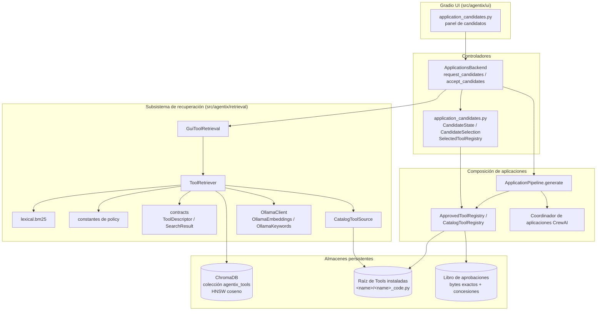
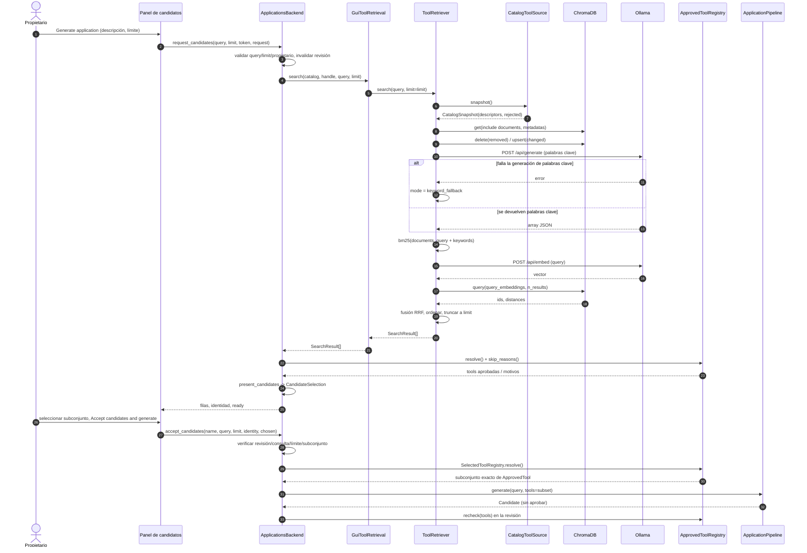

# AgentiX v7 — Arquitectura de recuperación y ranking de herramientas

| Campo | Valor |
| --- | --- |
| Documento | `docs/architecture/TOOL_RETRIEVAL_AND_RANKING.md` |
| Asunto | Arquitectura implementada de descubrimiento, indexación, recuperación, ranking y selección de herramientas (Tools) de AgentiX v7 |
| Raíz del repositorio | `D:\AI\AgentiX_v7` |
| Base de evidencia | Árbol de código fuente actual, pruebas mantenidas, configuración del repositorio, directorio de índice persistente existente |
| Alcance del cambio | Solo documentación; no se modificó código de producción, pruebas, MDD, base de datos ni colección |
| Estado | Obtenido por ingeniería inversa a partir de la implementación; aquí no se propone ningún rediseño |

Etiquetas de evidencia usadas en todo el documento: **Confirmed** (respaldado directamente por la implementación),
**Inferred** (derivado lógicamente de la implementación, no ejercitado directamente), **Unverified**
(evidencia insuficiente).

---

## 1. Resumen ejecutivo

AgentiX v7 implementa un **subsistema autónomo de recuperación híbrida de herramientas (Tools)** en
`src/agentix/retrieval/` y lo integra en el flujo de generación de aplicaciones de la GUI. El subsistema no
es una capacidad de agente y no concede derechos de ejecución.

La arquitectura confirmada es:

1. **Catálogo autoritativo** — el directorio de Tools instaladas (`Settings.tools_root`, una carpeta por
   Tool con un `<name>/<name>_code.py` convencional). `ToolCatalog` (`src/agentix/storage/catalog.py:15`)
   es dueño de la pertenencia; el libro de aprobaciones es dueño de las concesiones. ChromaDB **no** es autoritativo.
2. **Índice** — una colección ChromaDB persistente dedicada llamada `agentix_tools`, espacio HNSW coseno,
   almacenada junto a la raíz de Tools en un directorio hermano `tool_registry`. Cada registro contiene el
   identificador de la Tool, el texto del documento embebido, el vector y una cadena JSON de metadatos (`descriptor`).
3. **Sincronización** — `ToolRetriever.synchronize()` (`src/agentix/retrieval/service.py:121`) lee una
   instantánea completa, acotada y solo-AST desde `CatalogToolSource` y reconcilia altas, cambios y
   bajas. Se ejecuta en la construcción cuando hay una fuente enlazada, y de nuevo antes de **cada** búsqueda.
4. **Rama léxica** — una implementación BM25 desde cero (`src/agentix/retrieval/lexical.py:23`) con
   `k1=1.5`, `b=0.75`, suavizado de IDF `0.5`, reconstruida en memoria a partir de los mismos documentos almacenados en cada
   búsqueda. No existe índice léxico persistente.
5. **Rama semántica** — Ollama `nomic-embed-text:latest` a través de `/api/embed`
   (`src/agentix/retrieval/ollama.py:123`), con similitud coseno calculada como `1.0 - distance`.
6. **Fusión** — Reciprocal Rank Fusion con pesos iguales y constante `60`, rangos que comienzan en uno, desempate por
   `tool_id` (`src/agentix/retrieval/service.py:368`). No existen pesos, umbrales ni normalización de puntuaciones.
7. **Selección** — la GUI presenta cada candidato devuelto con una etiqueta de elegibilidad, el propietario
   acepta un subconjunto explícito, y `SelectedToolRegistry` vuelve a verificar la aprobación y los bytes exactos del código fuente
   antes y después de la generación.

El hecho arquitectónico central es que **la salida de la recuperación son metadatos, nunca una capacidad**. Un
`SearchResult` lleva una instantánea de `ToolDescriptor`; los bytes ejecutables se obtienen más tarde del
libro de aprobaciones, indexados por nombre de Tool, y se vuelven a calcular su hash frente al digest del descriptor en la aceptación y
de nuevo tras la generación.

Resumen del estado de los mecanismos:

| Mecanismo | Estado | Evidencia |
| --- | --- | --- |
| Almacén vectorial persistente ChromaDB | **Implementado e integrado** | `service.py:44`, `gui.py:37`, `tools/sync_tool_registry.py` |
| Embeddings de Ollama (`nomic-embed-text:latest`) | **Implementado e integrado** | `ollama.py:123`, `gui.py:37` |
| Recuperación léxica BM25 | **Implementado e integrado** | `lexical.py:23`, `service.py:440` |
| Reciprocal Rank Fusion | **Implementado e integrado** | `service.py:464` |
| Búsqueda híbrida | **Implementado e integrado** | `service.py:368` |
| Indexación / sincronización del catálogo | **Implementado e integrado** | `catalog.py:72`, `service.py:121` |
| Selección de candidatos en la GUI | **Implementado e integrado** | `controllers/applications.py:222`, `:339` |
| Verificación de aprobación/elegibilidad | **Implementado e integrado** | `storage/application_catalog.py:59`, `:199` |
| Enrutamiento de Tools basado en LLM (mecanismo separado) | **Implementado e integrado** en el flujo tipado heredado | `application/tool_routing.py:58` |
| Cross-encoder / reranker aprendido | **No encontrado** | sin referencia en el código fuente |
| Umbral de puntuación o corte de similitud | **No encontrado** (ausente de forma explícita) | docstring de `service.py:368`, `specs/051-tool-retrieval.md` |
| Pesos o `k` de RRF configurables | **No encontrado** (solo constantes) | `policy.py:22` |
| Índice BM25 persistente | **No encontrado** (se reconstruye en cada búsqueda) | `lexical.py:23` |
| Vigilante del sistema de archivos en segundo plano | **No encontrado** (sincronización en construcción/búsqueda) | `service.py:121`, `specs/051-tool-retrieval.md` |
| Coordinación de índice multiproceso | **No encontrado** (fuera de alcance de forma explícita) | `gui.py:1` |

---

## 2. Alcance y estado de la implementación

### 2.1 Dentro del alcance

- Descubrimiento de Tools desde la raíz del catálogo instalado.
- Extracción de descriptores solo-AST y cálculo de digest del contrato.
- Persistencia de ChromaDB, configuración y ciclo de vida de la colección.
- Fronteras de embedding y generación de palabras clave de Ollama.
- Puntuación y tokenización BM25.
- Fusión RRF, ranking y truncamiento.
- Búsqueda de candidatos en la GUI, presentación, aceptación y reverificación de dependencias.
- Traspaso de las Tools aceptadas a la composición de aplicaciones.
- Restricciones de elegibilidad, aprobación y aislamiento que afectan a la recuperación.

### 2.2 Fuera del alcance

- Flujos de creación, validación y aprobación de Tools (documentados en otro lugar).
- Ejecución de Tools en sandbox/AppContainer.
- Diseño y publicación de widgets.
- Aceptación de modelos para la generación de aplicaciones.

### 2.3 Exclusiones explícitas respetadas

`generated_tools/` no se inspeccionó, ejecutó ni indexó durante este análisis. El directorio de índice persistente
`tool_registry/` solo se listó; no se abrió, creó, modificó ni reindexó ninguna colección,
y no se generó ningún embedding. No se modificó ninguna prueba ni se instaló ninguna dependencia.

### 2.4 Estado de las dos rutas de selección

AgentiX v7 contiene **dos mecanismos distintos de selección de Tools** que no deben confundirse:

| Ruta | Mecanismo | Integración |
| --- | --- | --- |
| Generación de aplicaciones (GUI) | Recuperación híbrida ChromaDB + BM25 + RRF, luego aceptación explícita del propietario | `bootstrap.py:329`, `controllers/applications.py:222` |
| Flujo tipado heredado de Tools | Una única llamada LLM sobre el JSON de `ToolCatalog.contracts()`, validada por rutas Pydantic | `application/tool_routing.py:58` |

Solo la primera es una arquitectura de recuperación/ranking. La segunda es un clasificador basado en prompts sin
índice, sin embeddings y sin puntuaciones de ranking; se documenta en §10.6 por completitud porque también
"selecciona Tools".

---

## 3. Arquitectura de componentes de recuperación

### 3.1 Inventario de componentes

| Componente | Módulo | Responsabilidad |
| --- | --- | --- |
| `ToolRetriever` | `src/agentix/retrieval/service.py:36` | Almacenamiento, sincronización, ambas ramas, fusión, diagnósticos |
| `ToolDescriptor` | `src/agentix/retrieval/contracts.py:37` | Registro inmutable de metadatos de búsqueda |
| `SearchResult` | `src/agentix/retrieval/contracts.py:56` | Candidato clasificado con puntuaciones por rama |
| `descriptor_from_source` | `src/agentix/retrieval/contracts.py:116` | Extracción de descriptores solo-AST |
| `bm25` / `tokens` | `src/agentix/retrieval/lexical.py:23`, `:10` | Puntuación léxica y tokenización |
| `OllamaClient` | `src/agentix/retrieval/ollama.py:24` | Frontera HTTP de loopback acotada |
| `OllamaEmbeddings` | `src/agentix/retrieval/ollama.py:123` | Adaptador de `/api/embed` |
| `OllamaKeywords` | `src/agentix/retrieval/ollama.py:82` | Adaptador de palabras clave de `/api/generate` |
| `CatalogToolSource` | `src/agentix/retrieval/catalog.py:27` | Instantánea acotada de solo lectura del catálogo |
| `GuiToolRetrieval` | `src/agentix/retrieval/gui.py:48` | Composición de la GUI, carga al inicio, manejadores por propietario |
| `RetrieverHandle` | `src/agentix/retrieval/gui.py:30` | Retriever privado de sesión e identidad de raíz |
| `CandidateState` / `CandidateSelection` | `src/agentix/controllers/application_candidates.py:73`, `:30` | Revisión de búsqueda y vista previa propiedad del servidor |
| `SelectedToolRegistry` | `src/agentix/controllers/application_candidates.py:89` | Aprobación de subconjunto exacto y recomprobación de digest |
| `ApprovedToolRegistry` / `CatalogToolRegistry` | `src/agentix/storage/application_catalog.py:37`, `:118` | Resolución de elegibilidad a partir del catálogo + libro |
| `ToolCatalog` | `src/agentix/storage/catalog.py:15` | Pertenencia al catálogo y renderizado por AST |
| `ToolRouter` | `src/agentix/application/tool_routing.py:58` | Enrutamiento separado basado en LLM (flujo heredado) |

### 3.2 Diagrama de componentes (dependencias confirmadas)



Los almacenes persistentes se dibujan como cilindros: ChromaDB, la raíz de Tools y el libro de aprobaciones. Los contadores
de BM25, la instantánea de candidatos, el mapa de puntuaciones fusionadas y la lista clasificada son estructuras transitorias
en memoria creadas por búsqueda.

### 3.3 Capas

- Los **adaptadores** (`ollama.py`, `catalog.py`) son dueños de toda la E/S: HTTP y sistema de archivos.
- El **servicio** (`service.py`) es dueño de la orquestación, validación, ranking y diagnósticos.
- Los **contratos** (`contracts.py`) son dueños de los datos tipados y la extracción por AST; no realizan E/S.
- La **política** (`policy.py`) es dueña de las constantes numéricas; no es una API de configuración en tiempo de ejecución.
- La **composición de la GUI** (`gui.py`) es dueña de la serialización a nivel de proceso y de los manejadores de sesión.
- Los **controladores** son dueños del estado de sesión, las revisiones y la presentación de elegibilidad.
- Los **adaptadores de almacenamiento** (`storage/application_catalog.py`) son dueños de la resolución basada en aprobaciones.

Ningún módulo de recuperación importa CrewAI, Gradio ni ninguna Tool generada.

---

## 4. Catálogo de Tools y propiedad de los datos

### 4.1 Fuentes autoritativas

| Pregunta | Respuesta | Evidencia |
| --- | --- | --- |
| ¿Quién es dueño de las definiciones de Tools? | El directorio de Tools instaladas; una carpeta por Tool | `storage/catalog.py:22` |
| ¿Quién es dueño de los bytes ejecutables? | La instantánea del libro de aprobaciones (`ledger.snapshot`) | `security/verification.py:42` |
| ¿Quién es dueño de las concesiones? | El libro de aprobaciones / almacén de aprobaciones duradero | `security/verification.py:308`, `security/approval_store.py:209` |
| ¿Es ChromaDB autoritativo? | **No.** Es un índice de búsqueda derivado y desechable | `service.py:121`, `specs/051-tool-retrieval.md` |
| ¿Contiene ChromaDB artefactos ejecutables? | **No.** Solo JSON de descriptor, texto del documento y vectores | `service.py:347` |

`ToolCatalog.contains()` (`storage/catalog.py:22`) acepta un nombre que cumpla
`[A-Za-z][A-Za-z0-9_]{0,127}` y requiere que existan tanto la carpeta como `<name>_code.py`. La pertenencia
por sí sola nunca establece autorización.

### 4.2 Resolución de la raíz del catálogo

- Tanto la GUI como la CLI derivan la raíz de `Settings.tools_root` (`src/agentix/settings.py`), que es
  obligatoria desde `AGENTIX_TOOLS_ROOT` y validada por `require_v7_namespace`
  (`storage/locations.py:11`), de modo que se rechaza un espacio de nombres v5 retirado.
- La ruta del índice es `Path(catalog.root).parent / "tool_registry"` (`gui.py:37`,
  `tools/sync_tool_registry.py`), es decir, un hermano de la raíz de Tools dentro de la raíz de datos v7.
- `tools/sync_tool_registry.py` acepta las sobrescrituras `--tools-root` e `--index` para
  despliegues resueltos por el lanzador.

### 4.3 Índice persistente observado en disco

`tool_registry/` existe en la raíz del repositorio con `chroma.sqlite3` y un directorio de segmento HNSW
(`29dc09d6-0eca-426c-becc-7f11676bfc92/` que contiene `data_level0.bin`, `header.bin`, `length.bin`,
`link_lists.bin`). **Confirmed** mediante listado del directorio; la colección no se abrió, por lo que los
recuentos de registros son **Unverified**.

---

## 5. Arquitectura de almacenamiento de ChromaDB

### 5.1 Inicialización del cliente

`ToolRetriever.__init__` (`service.py:44`) importa `chromadb` de forma diferida dentro del constructor, de modo que
importar `agentix.retrieval` no realiza E/S de base de datos (docstring de `retrieval/__init__.py`; prueba
`tests/test_retrieval_adapters.py::test_import_is_inert_and_independent`).

```python
self._client = chromadb.PersistentClient(
    path=str(path), settings=Settings(anonymized_telemetry=False)
)
self._collection = self._client.get_or_create_collection(
    name=collection_name,
    embedding_function=None,
    metadata={"embedding_model": embeddings.model_id, "schema": policy.INDEX_SCHEMA_VERSION},
    configuration={"hnsw": {"space": "cosine"}},
)
```

| Propiedad | Valor | Evidencia |
| --- | --- | --- |
| Tipo de cliente | `chromadb.PersistentClient` | `service.py:70` |
| Telemetría | Desactivada (`anonymized_telemetry=False`) | `service.py:71` |
| Modo | Persistente (en disco), nunca efímero en producción | `service.py:70` |
| Nombre de colección por defecto | `agentix_tools` | `service.py:50` |
| Función de embedding | `None` — los vectores siempre se suministran explícitamente | `service.py:75` |
| Espacio de distancia | `cosine` mediante configuración HNSW | `service.py:80` |
| Versión de biblioteca fijada | `chromadb==1.5.9` | `requirements-retrieval.txt`, `requirements-runtime.txt` |

### 5.2 Metadatos de la colección

| Clave | Se escribe cuando | Significado |
| --- | --- | --- |
| `embedding_model` | Creación de la colección | `model_id` del proveedor; una discrepancia aborta la construcción |
| `schema` | Creación de la colección | `policy.INDEX_SCHEMA_VERSION` = `1` |
| `dimension` | Primera escritura de vector exitosa | Longitud del vector; una discrepancia posterior aborta |
| `descriptor_source` | Primer enlace de una fuente de descriptores | SHA-256 de la raíz absoluta normalizada del catálogo |

La construcción rechaza un índice cuyo `embedding_model`, `schema` o `hnsw.space` difiera
(`service.py:88`). `_vectors()` vuelve a comprobar `embedding_model` y `dimension` en cada lote de embeddings
(`service.py:252`).

### 5.3 Forma del registro

| Campo de Chroma | Contenido |
| --- | --- |
| `ids` | `[descriptor.tool_id]` |
| `documents` | Texto buscable concatenado (véase §7.2) |
| `embeddings` | Un vector del proveedor inyectado |
| `metadatas` | `[{"descriptor": "<canonical JSON>"}]` |

La carga JSON se produce con `json.dumps(data, allow_nan=False, sort_keys=True)`
(`service.py:311`), de modo que los metadatos son deterministas y comparables byte a byte.

### 5.4 Operaciones

| Operación | Implementación | Notas |
| --- | --- | --- |
| Inserción / actualización | `collection.upsert` (`service.py:347`) | Semántica de reemplazo por ID |
| Eliminación | `collection.delete(ids=[...])` (`service.py:365`, `:166`) | Idempotente |
| Instantánea completa | `collection.get(include=["documents", "metadatas"])` (`service.py:403`) | Usada por BM25 y por la reconciliación |
| Consulta vectorial | `collection.query(query_embeddings=..., n_results=..., include=["distances"])` (`service.py:454`) | Solo se solicitan las distancias |
| Recuento | `collection.count()` (`service.py:92`, `:117`) | Diagnósticos y atajo de índice vacío |
| Actualización de metadatos | `collection.modify(metadata=...)` (`service.py:119`, `:281`) | Enlace de fuente y dimensión |

### 5.5 Papel de ChromaDB

ChromaDB actúa como **un almacén de embeddings más un índice de descubrimiento derivado**, y como **repositorio de
instantáneas de metadatos** de descriptores. Explícitamente **no** es un catálogo autoritativo, ni un registro de aprobación,
ni un almacén de artefactos. Eliminar el directorio solo pierde los descriptores y vectores en caché;
la siguiente sincronización los reconstruye desde la raíz de Tools.

### 5.6 Gestión de errores

| Condición | Comportamiento |
| --- | --- |
| Discrepancia de modelo/esquema/espacio | `ValueError("Index model or schema is incompatible; rebuild into a separate index")` |
| Índice enlazado abierto sin enlace | `ValueError("This index requires its bound descriptor source")` |
| Identidad de fuente distinta | `ValueError("Index descriptor source differs from the requested source")` |
| Enlazar un índice manual no vacío | `ValueError("Binding a source requires a dedicated empty index")` |
| IDs de Tool duplicados en una instantánea | `ValueError("Descriptor source returned duplicate tool IDs")` |
| Excepción de almacenamiento | Se propaga sin cambios; la búsqueda nunca se degrada a resultados obsoletos |

---

## 6. Datos indexados y esquema de metadatos

### 6.1 Campos de `ToolDescriptor` (el modelo indexado completo)

`ToolDescriptor` (`contracts.py:37`) es una dataclass inmutable con exactamente nueve campos. No se persiste ningún otro campo.

| Campo | Tipo | Obligatorio | Origen del valor | Uso en la recuperación |
| --- | --- | --- | --- | --- |
| `tool_id` | `str` | Sí | Nombre canónico de la función (igual al nombre de la carpeta) | ID de Chroma, clave de desempate, clave de elegibilidad |
| `name` | `str` | Sí | Nombre canónico de la función | Texto del documento, visualización |
| `description` | `str` | Sí | Docstring de la función; si no, docstring del módulo; si no, el nombre | Texto del documento, resumen del candidato |
| `entrypoint` | `str` | Sí | `f"{name}_code.py:{name}"` | Solo texto del documento |
| `input_schema` | `dict[str, Any]` | Sí | Anotaciones de parámetros por AST | Texto del documento, contrato de composición |
| `output_schema` | `dict[str, Any]` | Sí | Anotación de retorno por AST | Texto del documento, contrato de composición |
| `keywords` | `list[str]` | Sí | `[name]` en el momento de la extracción | Texto del documento, expansión léxica |
| `artifact_ref` | `str` | Sí | Nombre de la carpeta del catálogo | Referencia opaca; nunca resuelta por la recuperación |
| `contract_digest` | `str` | Sí | SHA-256 de los bytes del código fuente | Detección de obsolescencia, vínculo de aceptación |

Validación en `_payload` (`service.py:285`): los seis campos de texto deben ser cadenas no vacías de como máximo
`MAX_DESCRIPTOR_FIELD_CHARACTERS` (32 768); `tool_id` como máximo `MAX_TOOL_ID_CHARACTERS` (256); ambos
esquemas deben ser objetos JSON; las palabras clave pasan por `validate_keywords`; la carga serializada no debe superar
`MAX_DESCRIPTOR_BYTES` (256 KiB).

### 6.2 Campos que **no** existen

| Campo solicitado | Estado | Nota |
| --- | --- | --- |
| Estado de aprobación / concesión | **Ausente** | Excluido deliberadamente; `specs/051-tool-retrieval.md` establece que el descriptor "has no approval, testing or category fields" |
| Etiquetas / categorías | **Ausente** | No existe vocabulario de categorías |
| Versión de la Tool | **Ausente** | No se almacena ninguna versión semántica |
| Ruta del código fuente | **Ausente** | Solo el nombre de carpeta opaco `artifact_ref` |
| Ubicación del artefacto | **Ausente** | No es una concesión del sistema de archivos |
| Dependencias / importaciones | **Ausente** | La política de importaciones se evalúa más tarde mediante `computation_only` |
| Identificador del modelo de embedding (por registro) | **Ausente** | Se almacena una vez en los metadatos de la colección |
| Marcas de tiempo del índice | **Ausente** | Sin `created_at` / `updated_at` |
| Bytes de pruebas | **Ausente** | Solo en el libro de aprobaciones |
| Contrato de aceptación revisado | **Ausente** | Solo en el libro de aprobaciones |

### 6.3 Registro almacenado representativo

Estructura **Confirmed** a partir de `_payload` y `_store_descriptor`; los valores concretos siguientes son
ilustrativos de la forma, no un volcado de la base de datos real:

```json
{
  "artifact_ref": "count_words_in_text",
  "contract_digest": "<sha256 of source bytes>",
  "description": "Count words in text",
  "entrypoint": "count_words_in_text_code.py:count_words_in_text",
  "input_schema": {"type": "object", "properties": {"text": {"python_type": "str"}}, "required": ["text"]},
  "keywords": ["count_words_in_text"],
  "name": "count_words_in_text",
  "output_schema": {"python_type": "int"},
  "tool_id": "count_words_in_text"
}
```

Los metadatos de Chroma para ese registro son `{"descriptor": "<the JSON above>"}`; el texto del documento es la
concatenación descrita en §7.2.

### 6.4 Almacenado frente a calculado

| Elemento | Almacenado | Calculado en el momento de la consulta |
| --- | --- | --- |
| JSON del descriptor | Sí | — |
| Texto del documento | Sí | — |
| Vector de embedding | Sí | — |
| Conteos de términos y longitudes de BM25 | No | Sí, por búsqueda |
| Similitud coseno | No | Sí, a partir de la distancia almacenada |
| Puntuación RRF | No | Sí |
| Rango | No | Sí |
| Etiqueta de elegibilidad | No | Sí, a partir del libro |
| Resumen del candidato | No | Sí, primera línea de descripción truncada |

---

## 7. Generación de embeddings

### 7.1 Modelo y transporte

| Propiedad | Valor | Evidencia |
| --- | --- | --- |
| Proveedor | Ollama, solo HTTP de loopback | `ollama.py:31` |
| Endpoint por defecto | `http://127.0.0.1:11434` (`OLLAMA_BASE_URL`) | `ollama.py:33`, `settings.py:68` |
| Modelo de embedding por defecto | `nomic-embed-text:latest` | `ollama.py:126` |
| Ruta | `POST /api/embed` | `ollama.py:56`, `:130` |
| Cuerpo de la solicitud | `{"model": ..., "input": texts, "truncate": false}` | `ollama.py:133` |
| Timeout | 60 s, sin reintentos | `policy.py:46` |
| Límite de la solicitud | 2 MiB | `policy.py:47` |
| Límite de la respuesta | 1 MiB, sondeado con un byte extra | `policy.py:48`, `ollama.py:71` |
| Proxies | Desactivados (`ProxyHandler({})`) | `ollama.py:67` |
| Redirecciones | Rechazadas por `_NoRedirects` | `ollama.py:14` |
| Descargas de modelos | Nunca se realizan | docstring del módulo, `specs/051-tool-retrieval.md` |

La validación del endpoint requiere el esquema `http`, un host de loopback (`localhost` o una IP para la cual
`ip_address(...).is_loopback` sea verdadero), sin credenciales, sin ruta más allá de `/` y sin query ni fragmento
(`ollama.py:37`).

### 7.2 Construcción del texto embebido

`_payload` construye el documento como una única cadena unida por espacios (`service.py:316`):

```text
name + " " + description + " " + entrypoint
     + " " + json(input_schema) + " " + json(output_schema) + " " + " ".join(keywords)
```

Consecuencias (**Confirmed**):

- Contribuyen el **nombre** de la Tool, la **descripción**, el **entrypoint**, **ambos esquemas** y las **palabras clave**.
- El docstring contribuye solo a través de `description`.
- `tool_id`, `artifact_ref` y `contract_digest` **no** contribuyen.
- Las claves del JSON de esquema (`type`, `properties`, `required`, `python_type`, `description`) se embeben como
  tokens literales, de modo que los nombres de parámetros y las grafías de tipos son buscables semánticamente.

### 7.3 Validación, procesamiento por lotes y dimensión

- Se embebe un descriptor por `upsert` (`_store_descriptor` llama a `_vectors([document])`), por lo que
  la indexación en producción tiene en la práctica un tamaño de lote de 1. `_vectors` acepta una lista y valida la forma del lote,
  de modo que un proveedor puede procesar por lotes internamente.
- Cada vector debe ser una lista no vacía de valores `int`/`float` finitos (se rechazan los bool) con una norma distinta de cero;
  todos los vectores de un lote deben compartir una dimensión (`service.py:252`).
- La primera escritura exitosa persiste `dimension` en los metadatos de la colección; una dimensión distinta posterior
  lanza `ValueError("Embedding dimension changed")`.
- **La dimensionalidad de `nomic-embed-text:latest` no se afirma en ningún lugar del código fuente.** Se registra
  solo como un entero observado en los metadatos de la colección. Cualquier número concreto sería **Unverified**.
- AgentiX no realiza ninguna normalización L2 explícita; la normalización, si la hay, es comportamiento del proveedor
  (**Unverified**). El espacio coseno hace irrelevante la magnitud almacenada para el ranking.

### 7.4 Desencadenantes de caché y reindexación

| Desencadenante | Efecto |
| --- | --- |
| Construcción enlazada | `synchronize()` completo, embebiendo solo los descriptores nuevos/cambiados |
| Cada `search()` válido en un retriever enlazado | `synchronize()` de nuevo antes de consultar |
| `synchronize()` explícito | La misma reconciliación sin búsqueda |
| `upsert()` | Vuelve a embeber ese descriptor incondicionalmente |
| Descriptor sin cambios (`existing[key] == item`) | Sin embedding; se contabiliza como `unchanged` |
| Cambio de identidad del modelo | La construcción falla; se requiere un índice separado reconstruido |
| Cambio de versión de esquema | La construcción falla; se requiere una decisión explícita de compatibilidad |

No existe caché de vectores más allá del propio Chroma ni memoización de embeddings de consultas.

### 7.5 Cambio o indisponibilidad del modelo

- **Etiqueta de modelo cambiada**: `ValueError("Index model or schema is incompatible; rebuild into a separate
  index")` en la construcción, y `ValueError("Embedding model changed")` dentro de `_vectors`.
- **Misma etiqueta, bytes distintos**: no se detecta. `specs/051-tool-retrieval.md` registra esta limitación
  de forma explícita.
- **Proveedor no disponible durante la búsqueda**: la excepción se propaga; el controlador la convierte en
  `ValueError("Candidate search unavailable. Check local Ollama/catalog and retry Generate
  application.")` (`controllers/applications.py:332`). Sin resultados obsoletos y sin alternativa de catálogo.
- **Proveedor no disponible al inicio**: `GuiToolRetrieval.initialize` registra
  `"Tool index unavailable. Retry with Generate application."` y la GUI se abre igualmente
  (`gui.py:57`).

---

## 8. Recuperación léxica BM25

### 8.1 Implementación

Implementación propia y sin dependencias en `src/agentix/retrieval/lexical.py`. En el repositorio no existe ningún componente
`rank_bm25`, `bm25s` ni Elasticsearch/Lucene.

### 8.2 Construcción del corpus

`bm25(documents, query)` recibe `dict[tool_id, document_text]` construido a partir de la **misma** instantánea de Chroma
usada para la rama semántica (`service.py:403`, `:440`). Por lo tanto, ambas ramas operan sobre
exactamente la misma población de Tools y el mismo texto, sin ventana de divergencia dentro de una búsqueda.

### 8.3 Tokenización y normalización

`tokens()` (`lexical.py:10`):

1. `re.findall(r"\w+", text, flags=re.UNICODE)` conserva identificadores Unicode completos.
2. Cada palabra se pasa a minúsculas con case-fold.
3. La segmentación por camel-case y guion bajo añade subtokens:
   `([A-Z]+)([A-Z][a-z])` → dividir, `([a-z0-9])([A-Z])` → dividir, `_` → espacio.
4. Los subtokens se añaden solo cuando difieren de la palabra completa con case-fold.

**No** hay lista de stopwords, ni stemming, ni lematización ni vocabulario de dominio. El docstring
establece la intención: "Keep complete Unicode identifiers and add underscore/camel-case segments."

### 8.4 Fórmula de puntuación

Para cada término distinto de la consulta, con `N = |corpus|`, `df` = número de documentos que contienen el término:

```text
idf = ln(1 + (N - df + 0.5) / (df + 0.5))
tf  = frecuencia del término en el documento
norm = 1 - b + b * (doc_length / average_doc_length)
score += idf * tf * (k1 + 1) / (tf + k1 * norm)
```

| Parámetro | Valor | Ubicación |
| --- | --- | --- |
| `k1` | `1.5` | `policy.py:25` |
| `b` | `0.75` | `policy.py:26` |
| Suavizado de IDF | `0.5` | `policy.py:27` |
| Protección de longitud media | `max(len(counts), 1) or 1` | `lexical.py:31` |

Solo se devuelven los documentos con `score > 0` (`lexical.py:42`), de modo que un documento que no comparte ningún término de la consulta
está ausente de la rama léxica en lugar de puntuarse con cero.

### 8.5 Procesamiento de la consulta

La consulta léxica es `" ".join([query, *supplied_keywords, *generated_keywords])`
(`service.py:440`). Los términos se deduplican mediante `sorted(set(tokens(query)))` dentro de `bm25`, de modo que los
términos repetidos no multiplican las contribuciones de IDF.

### 8.6 Generación de candidatos y ciclo de vida

- Las puntuaciones se ordenan por `(-score, tool_id)` y se truncan a `candidate_limit` (`service.py:441`).
- El índice se reconstruye desde cero en cada búsqueda; no se persiste nada.
- El docstring del módulo registra el compromiso: se prefiere la corrección tras actualizaciones/reapertura frente al
  rendimiento con corpus grandes en la primera versión.

### 8.7 Inconsistencias observables

| Observación | Estado |
| --- | --- |
| La rama semántica embebe solo la consulta en bruto; la rama léxica también usa palabras clave suministradas y generadas | **Confirmed** (`service.py:440`, `:444`) — asimetría intencionada |
| BM25 ve el texto completo del documento; la rama semántica ve el mismo texto pero solo difiere el lado de la consulta | **Confirmed** |
| El coste de reconstrucción de BM25 crece linealmente con el tamaño del corpus en cada búsqueda | **Confirmed** por el código; no existe evidencia de benchmarks |
| La falta de persistencia del índice léxico implica ausencia de riesgo de obsolescencia pero coste de CPU repetido | **Inferred** |

---

## 9. Recuperación híbrida y RRF

### 9.1 Presupuestos por rama

```python
candidate_limit = min(count, max(policy.MIN_BRANCH_CANDIDATES,
                                 policy.BRANCH_CANDIDATE_MULTIPLIER * limit))
```

| Constante | Valor | Significado |
| --- | --- | --- |
| `MIN_BRANCH_CANDIDATES` | `20` | Mínimo por rama |
| `BRANCH_CANDIDATE_MULTIPLIER` | `4` | Presupuesto de rama relativo a los resultados solicitados |
| `DEFAULT_SEARCH_LIMIT` | `5` | Valor por defecto de la GUI |
| `MIN_SEARCH_LIMIT` / `MAX_SEARCH_LIMIT` | `1` / `100` | Rango aceptado de `limit` |

Con el `limit=5` por defecto, el presupuesto de rama es `max(20, 20) = 20`; con `limit=100` es `400`,
limitado por el tamaño de la colección.

### 9.2 Puntuación semántica

```python
semantic = {key: 1.0 - distance for key, distance in zip(ids, distances)}
semantic_ids = sorted(semantic, key=lambda key: (-semantic[key], key))
```

- La puntuación es la similitud coseno derivada de la distancia coseno de Chroma.
- Los valores **no se acotan**; una distancia coseno superior a 1.0 produce una similitud negativa.
- El rango de la distancia coseno de Chroma es `[0, 2]`, de modo que la similitud está en `[-1, 1]` — **Inferred** a partir del
  espacio configurado, no afirmado en el código fuente de AgentiX.
- La puntuación está documentada explícitamente como "not a probability or authorization" (`contracts.py:56`).

### 9.3 Fórmula de fusión

```python
scores: dict[str, float] = {}
for branch in (semantic_ids, lexical_ids):
    for rank, key in enumerate(branch, 1):
        scores[key] = scores.get(key, 0) + 1 / (policy.RRF_RANK_CONSTANT + rank)
ranked = sorted(scores, key=lambda key: (-scores[key], key))[:limit]
```

Fórmula implementada, con `w_i = 1` para ambas ramas y `k = 60`:

```text
RRF(d) = Σ_i 1 / (60 + rank_i(d))
```

| Propiedad | Valor implementado | Evidencia |
| --- | --- | --- |
| Listas de origen | Ranking semántico, ranking léxico | `service.py:464` |
| Convención de rango | Base uno (`enumerate(branch, 1)`) | `service.py:466` |
| Constante `k` | `60` (`RRF_RANK_CONSTANT`) | `policy.py:22` |
| Pesos | Ninguno; ambas ramas aportan `1/(60+rank)` | `service.py:467` |
| Pesos configurables | **No implementado** | no existe parámetro ni ajuste |
| Gestión de duplicados | Las contribuciones se acumulan por `tool_id` | `scores.get(key, 0) + ...` |
| Candidato ausente | No aporta nada desde esa rama; la puntuación de `SearchResult` es `None` | `service.py:500` |
| Desempate | `(-score, tool_id)` ascendente | `service.py:468` |
| Truncamiento | Tras la fusión, a `limit` | `service.py:468` |
| Filtrado antes de la fusión | Ninguno | la instantánea completa alimenta BM25; los top-`candidate_limit` alimentan la rama semántica |
| Filtrado después de la fusión | Ninguno (la elegibilidad es solo de presentación) | `application_candidates.py:130` |
| Normalización de puntuaciones | **No implementada** | solo RRF en bruto |

Esto es una fusión por rango recíproco genuina, no una suma ponderada de puntuaciones ni una normalización min-max.
Dado que ambas ramas usan el mismo `k` y peso unitario, un documento clasificado primero en ambas ramas puntúa
`2/61 ≈ 0.032787`.

### 9.4 Determinismo

El ranking es determinista para un índice fijo, proveedores fijos y una consulta fija: BM25 es una función pura,
Chroma devuelve un conjunto de vecinos determinista para un vector y una colección fijos, y los empates se resuelven por
`tool_id`. `tests/test_tool_retrieval.py::test_real_tool_snapshots` afirma un orden idéntico en
dos búsquedas idénticas, y `tests/test_retrieval_adapters.py::test_rrf_ties_are_stable` fija el comportamiento
de los empates.

---

## 10. Flujo de selección de Tools de extremo a extremo

### 10.1 Secuencia de etapas verificada

La secuencia hipotética de la tarea se comprobó etapa por etapa. La secuencia implementada es:

| # | Etapa | Componente | Entrada | Salida | Validación | Comportamiento ante error | Consumidor |
| --- | --- | --- | --- | --- | --- | --- | --- |
| 1 | Composición al inicio | `bootstrap.get_default_ui` (`bootstrap.py:329`) | `runtime.catalog` | `GuiToolRetrieval` | inyección de factoría | mensaje de estado seguro | `ApplicationsBackend` |
| 2 | Carga del índice al inicio | `GuiToolRetrieval.initialize` (`gui.py:57`) | catálogo | cadena de estado | captura de excepciones | `"Tool index unavailable..."` | panel de candidatos |
| 3 | Validación de la solicitud | `ApplicationsBackend.request_candidates` (`applications.py:222`) | descripción, límite, token, solicitud | valores validados | no vacío, ≤32 KiB, límite 1..100, propietario/token, inactivo | `ValueError` con texto para el propietario | recuperación |
| 4 | Invalidación de revisión | `CandidateState.invalidate` (`application_candidates.py:82`) | — | nuevo hex de revisión | — | — | comprobaciones de sustitución |
| 5 | Instantánea del catálogo | `CatalogToolSource.snapshot` (`catalog.py:72`) | raíz del catálogo | `CatalogSnapshot` | límite de entradas, alias, archivo regular, tamaño, lectura estable | `ValueError`/`OSError`/`OverflowError` | synchronize |
| 6 | Reconciliación | `ToolRetriever.synchronize` (`service.py:121`) | instantánea | `SyncReport` | IDs duplicados, validación de la carga | se propaga | índice |
| 7 | Instantánea del índice | `collection.get` (`service.py:403`) | — | ids, documentos, metadatos | — | se propaga | BM25 + resultados |
| 8 | Atajo de índice vacío | `search` (`service.py:406`) | recuento | `[]` | `count == 0` | sin llamada al modelo | controlador |
| 9 | Generación de palabras clave | `OllamaKeywords.generate` (`ollama.py:89`) | consulta | ≤20 términos | esquema JSON, longitud, `validate_keywords` | degrada a `keyword_fallback` | consulta léxica |
| 10 | Recuperación léxica | `bm25` (`lexical.py:23`) | documentos, consulta+palabras clave | puntuaciones | solo positivas | — | fusión |
| 11 | Embedding de la consulta | `OllamaEmbeddings.embed` (`ollama.py:130`) | consulta | vector | finito, no nulo, dimensión | se propaga | consulta a Chroma |
| 12 | Recuperación semántica | `collection.query` (`service.py:454`) | vector, `n_results` | ids, distancias | — | se propaga | fusión |
| 13 | Fusión y truncamiento | `search` (`service.py:464`) | dos listas clasificadas | `SearchResult[]` | `limit` | — | controlador |
| 14 | Presentación de elegibilidad | `present_candidates` (`application_candidates.py:130`) | resultados, registro | `CandidateSelection` | digest + aprobación por fila | motivos capturados | UI |
| 15 | Aceptación por el propietario | `accept_candidates` (`applications.py:339`) | identidad, consulta, límite, subconjunto | `AcceptedCandidates` | revisión/consulta/límite/propietario, subconjunto, elegibilidad | `ValueError` | generación |
| 16 | Resolución de dependencias | `SelectedToolRegistry.resolve` (`application_candidates.py:96`) | digests esperados | `dict[role, ApprovedTool]` | aprobación + igualdad de SHA-256 | `CatalogDependencyError` | pipeline |
| 17 | Composición | `ApplicationPipeline.generate` (`app_workflow.py:91`) | consulta, tools | `Candidate` | tools no vacías, esquemas presentes | `ValueError` | revisión |
| 18 | Recomprobación posterior a la generación | `recheck_dependencies` (`applications.py:651`) | tools esperadas | — | `registry.recheck(tools)` | `CatalogDependencyError` | compuerta de revisión |

Omitido respecto a la hipótesis: **no** existe un proceso de "subsistema de ranking" separado, ni etapa de reranker,
ni filtro de umbral, ni filtro de elegibilidad posterior a la fusión. Etapas añadidas: carga al inicio, invalidación de revisión,
atajo de índice vacío, generación de palabras clave, presentación de elegibilidad y recomprobación posterior a la generación.

### 10.2 Diagrama de secuencia (ejecución real)



### 10.3 Formatos de datos por etapa

| Etapa | Formato |
| --- | --- |
| Instantánea | `CatalogSnapshot(descriptors: tuple[ToolDescriptor, ...], rejected: tuple[CatalogRejection, ...])` |
| Informe de sincronización | `SyncReport(added, updated, removed, unchanged, rejected)` |
| Salida de búsqueda | `list[SearchResult]` |
| Presentación | `CandidateSelection(identity, query, limit, results, rows, ready, message, eligible_ids)` |
| Aceptación | `AcceptedCandidates(query, expected: dict[str, str], identity)` |
| Resolución | `dict[str, ApprovedTool]` |
| Entrada de composición | `dict[str, ApprovedTool]` más `schemas = {name: tool.schema}` |

### 10.4 Concurrencia y sustitución

- `ToolRetriever._operation` mantiene un `RLock` durante toda la operación (`service.py:205`), de modo que
  synchronize/upsert/delete/search se serializan por instancia.
- `GuiToolRetrieval.lock` serializa todos los manejadores de propietarios dentro de un proceso de GUI (`gui.py:54`).
- Cada búsqueda lleva una revisión; un resultado cuya revisión ya no coincide se descarta
  (`applications.py:288`), y la UI usa `concurrency_id="application-candidate-search"` con
  `concurrency_limit=1` (`ui/application_candidates.py`).
- La coordinación entre procesos no está soportada de forma explícita.

### 10.5 Contrato del consumidor posterior

`ApplicationPipeline.generate` requiere un mapeo `tools` no vacío y rechaza cualquier entrada cuyo
`schema` sea `None` (`app_workflow.py:101`). `general_pipeline.generate` pasa entonces solo
`{name: tool.schema}` a `plan(query, schemas, feedback)` del coordinador
(`general_pipeline.py:35`), de modo que el modelo ve contratos, no código fuente. Tras la planificación, el conjunto de tools
se reduce a los widgets realmente seleccionados (`general_pipeline.py:39`).

### 10.6 La ruta separada de enrutamiento por LLM

`ToolRouter.select` (`application/tool_routing.py:65`) envía `ToolCatalog.contracts()` como JSON a un
modelo con `tools=[]`, luego valida con Pydantic el `ToolRoute`/`CreateRoute` devuelto, rechaza argumentos
desconocidos o duplicados y valida los valores de los argumentos contra el contrato revisado. No tiene
índice, ni embeddings, ni BM25 ni puntuaciones de ranking; es un paso de clasificación en el flujo tipado heredado
de Tools, no parte de la arquitectura de recuperación.

---

## 11. Contratos y estructuras de datos de recuperación

### 11.1 Protocolos

| Protocolo | Miembros | Propósito |
| --- | --- | --- |
| `EmbeddingProvider` (`contracts.py:16`) | `model_id: str`, `embed(texts) -> list[list[float]]` | Frontera de embedding inyectada |
| `KeywordProvider` (`contracts.py:26`) | `model_id: str`, `generate(query) -> list[str]` | Frontera de palabras clave inyectada |
| `DescriptorSource` (`contracts.py:169`) | `identity: str`, `snapshot() -> CatalogSnapshot` | Instantánea autoritativa inyectada |

Los tres son `Protocol`s estructurales, de modo que las pruebas inyectan dobles deterministas sin herencia.

### 11.2 `SearchResult`

| Campo | Tipo | Significado |
| --- | --- | --- |
| `descriptor` | `ToolDescriptor` | Metadatos de instantánea copiados del índice |
| `rank` | `int` | Posición base uno en esta búsqueda |
| `score` | `float` | Puntuación RRF de pesos iguales |
| `semantic_score` | `float \| None` | Similitud coseno, `None` fuera de los candidatos semánticos |
| `lexical_score` | `float \| None` | Puntuación BM25, `None` fuera de los candidatos léxicos |
| `mode` | `str` | `"hybrid"` o `"keyword_fallback"` |
| `keyword_model` | `str` (por defecto `""`, `repr=False`) | Identidad del proveedor de palabras clave |

### 11.3 Qué devuelve la recuperación — y qué no

| Devuelto | No devuelto |
| --- | --- |
| Identificadores de Tool (`tool_id`) | Objetos Tool ejecutables |
| Registros de metadatos (`ToolDescriptor`) | Bytes de código fuente |
| `artifact_ref` opaco | Rutas resueltas del sistema de archivos |
| Digest del contrato | Concesiones de aprobación |
| Rango, puntuación RRF, puntuaciones por rama | Bytes de pruebas o contratos de aceptación |

La resolución a bytes ejecutables ocurre solo en `ApprovedToolRegistry.resolve` /
`CatalogToolRegistry.resolve`, que leen `ledger.snapshot(name)` y `ledger.acceptance_context(name)`
(`storage/application_catalog.py:59`, `:121`).

### 11.4 Validación y respuestas de error

| Contrato | Entrada inválida | Resultado |
| --- | --- | --- |
| consulta de `search` | vacía, no `str`, >32 KiB UTF-8 | `ValueError` con el límite en KiB en el mensaje |
| límite de `search` | bool, no entero, fuera de 1..100 | `ValueError` que nombra el rango |
| palabras clave del llamador | no lista, >20 elementos, vacías/no str, >100 caracteres | `ValueError` |
| palabras clave generadas | mismas reglas | degradadas a `keyword_fallback`, nunca se lanza excepción |
| descriptor | no `ToolDescriptor`, texto vacío/acotado, esquema que no es dict, carga sobredimensionada | `ValueError` |
| id de `delete` | vacío, no `str`, >256 caracteres | `ValueError` |
| vectores | no lista, vacíos, no finitos, norma cero, dimensiones mixtas | `ValueError` |
| HTTP del proveedor | cualquier fallo | `RuntimeError("Local Ollama request failed or returned invalid data")` sin cadena de causa |
| almacenamiento | cualquier fallo de Chroma | propagado sin cambios |

`validate_keywords` (`contracts.py:72`) deduplica sin distinguir mayúsculas y minúsculas conservando la primera
grafía y el orden.

### 11.5 Identidad y procedencia de los candidatos

- `CandidateSelection.identity` es un hex de revisión generado por `CandidateState.invalidate`
  (`application_candidates.py:82`); es un token de correlación, nunca una capacidad.
- `CandidateSelection.expected` mapea `tool_id -> contract_digest` a partir de los descriptores devueltos.
- `AcceptedCandidates.expected` es el subconjunto aceptado de ese mapeo, mantenido del lado del servidor.
- `SelectedToolRegistry` compara `sha256(ledger bytes)` con cada digest esperado
  (`application_candidates.py:96`), de modo que un código fuente modificado invalida la aceptación.

---

## 12. Seguridad, integridad y elegibilidad

### 12.1 Puntos de aplicación

| Punto | Comprobación | Componente |
| --- | --- | --- |
| Indexación | Solo análisis AST; sin importación, sin ejecución, sin evaluación de anotaciones | `contracts.py:116` |
| Indexación | Alias/reparse, archivo regular, un único enlace físico, límite de tamaño, lectura estable | `catalog.py:46` |
| Indexación | Una única función pública canónica; en caso contrario rechazo `unsupported_contract` | `contracts.py:116` |
| Indexación | Límites de la carga y validez JSON | `service.py:285` |
| Recuperación | Sin filtro de elegibilidad; se devuelven todos los candidatos | `service.py:368` |
| Presentación | Comprobación de aprobación + digest por fila, etiquetada pero no filtrada | `application_candidates.py:130` |
| Aceptación | Igualdad de revisión/consulta/límite/propietario, subconjunto único no vacío, subconjunto de IDs elegibles | `application_candidates.py:54` |
| Aceptación | `SelectedToolRegistry.resolve()` vuelve a resolver concesiones y hashes | `application_candidates.py:96` |
| Generación | `SelectedToolRegistry` de nuevo dentro de `_generate` | `applications.py:616` |
| Revisión | `registry.recheck(tools)` tras la generación | `applications.py:651` |
| Ejecución | Ruta separada AppContainer/job; la recuperación nunca ejecuta | fuera de alcance aquí |

### 12.2 Semántica de aprobación

`prepare_reuse` (`security/verification.py:308`) revincula una Tool revisada a la consulta actual sin
volver a ejecutar las pruebas. Requiere: un contexto de seguridad abierto propiedad del mismo propietario, bytes actuales exactos
iguales a los bytes concedidos y una entrada en el almacén duradero cuando hay un almacén configurado. Cualquier deriva
o revocación elimina la confianza.

`CatalogToolRegistry._skip_reason` (`storage/application_catalog.py:199`) produce los motivos acotados y
accionables por el propietario usados en la tabla de candidatos:

| Motivo | Significado |
| --- | --- |
| `no current reusable approval; execute and approve it in Tools first` | Falta pertenencia o concesión |
| `no current acceptance context; complete its approval in Tools first` | Contexto de aceptación ausente |
| `imports outside the portable module list (...)` | `computation_only` rechazó importaciones |
| `no canonical Annotated contract; ...` | `extract_tool_schema` falló |
| `approved functions do not cover the canonical tool function` | Discrepancia de alcance de la aprobación |

La presentación usa `store.peek` (`security/approval_store.py:209`), que nunca revoca, de modo que abrir el
catálogo no puede destruir una concesión.

### 12.3 Recuperado no es confiable

- `SearchResult.score` está documentado como "not a probability or authorization".
- `CandidateSelection.ready` significa "todos los candidatos son actualmente elegibles", no "aprobado para ejecutar".
- `AcceptedCandidates` es "a generation constraint, not an approval grant"
  (`application_candidates.py:3`).
- El pipeline produce un `Candidate` sin aprobar; la revisión humana y la aceptación nativa siguen siendo independientes.

### 12.4 Aislamiento de v7 respecto a v5

| Control | Implementación |
| --- | --- |
| Espacio de nombres de almacenamiento | `require_v7_namespace` rechaza rutas resueltas dentro de espacios de nombres v5 retirados (`storage/locations.py:11`) |
| Ubicación del índice | `tool_registry` es hermano de la raíz de Tools de v7, nunca una ruta de v5 |
| Identidad de la fuente | `sha256(normcase(resolve(root)))` persistido como `descriptor_source`; se rechaza una raíz distinta |
| Poda entre catálogos | El enlace requiere un índice dedicado vacío; no se adopta un índice manual no vacío |
| Mutación de la raíz | `snapshot()` lanza `ValueError("Catalog source root changed; bind a new source")` |
| Artefactos generados | `generated_tools/` está excluido de la inspección de ingeniería y la recuperación nunca lo importa |

---

## 13. Ciclo de vida y consistencia del índice

### 13.1 Algoritmo de reconciliación

`synchronize()` (`service.py:121`):

1. Tomar una `snapshot()` completa; rechazar IDs duplicados.
2. Validar cada descriptor deseado mediante `_payload` antes de tocar el almacenamiento.
3. Registrar el escaneo (`catalog_scan`) y cada rechazo (`catalog_entry`, WARNING).
4. Leer todos los ids y metadatos almacenados; reconstruir objetos `ToolDescriptor` a partir del JSON.
5. Calcular `removed = stored - desired`; eliminarlos primero (`catalog_delete`).
6. Para cada descriptor deseado en orden: omitir si es igual, en caso contrario upsert (`added`/`updated`).
7. Construir y almacenar `SyncReport`; registrar `catalog_reconcile`.

Las bajas preceden a los nuevos embeddings, y un escaneo completado siempre precede a la reconciliación, de modo que un escaneo fallido
nunca puede confundirse con un catálogo vacío.

### 13.2 Matriz de cambios

| Cambio | Detección | Efecto |
| --- | --- | --- |
| Nueva carpeta de Tool | Presente en la instantánea, ausente en el índice | `added`, embebida |
| Código fuente actualizado | `contract_digest` difiere (SHA-256 de los bytes en bruto) | `updated`, re-embebida |
| Mismo tamaño y mtime | El digest sigue difiriendo | `updated` (prueba `test_same_size_and_mtime_change_is_detected`) |
| Carpeta eliminada | Ausente de la instantánea | `removed`, eliminada del índice |
| Tool renombrada | Id antiguo eliminado, id nuevo añadido | eliminación + inserción |
| Solo cambian los metadatos | Desigualdad de descriptor | `updated` |
| Aprobación invalidada | No visible para la recuperación | La fila del candidato pasa a no elegible; aceptación bloqueada |
| Embedding obsoleto | No se detecta con una etiqueta sin cambios | Limitación documentada |
| Archivo de código fuente ausente | Rechazo `missing_or_invalid_entry` | Descriptor obsoleto eliminado |
| Registros duplicados | IDs duplicados en la instantánea | `ValueError`, la sincronización aborta |
| Índice corrupto | Excepción de Chroma | Se propaga; la búsqueda falla, sin alternativa |
| Directorio de índice no disponible | Excepción de Chroma en la construcción | Estado de inicio `unavailable`, reintento en la búsqueda |

### 13.3 Síncrono frente a asíncrono

La indexación es **síncrona e incremental**, ejecutada en el hilo del llamador bajo el bloqueo de la instancia. No hay
cola, ni worker, ni vigilante ni reconstrucción programada. Una reconstrucción completa se logra
apuntando a un nuevo directorio de índice vacío.

### 13.4 Límites de consistencia

| Limitación | Estado |
| --- | --- |
| Las escrituras no son transaccionales; una reconciliación fallida puede aplicarse parcialmente | **Confirmed** (`specs/051-tool-retrieval.md`) |
| La siguiente sincronización reintenta una reconciliación parcial | **Confirmed** |
| Sin atomicidad con mutaciones externas del catálogo de la GUI | **Confirmed** |
| Sin coordinación multiescritor ni multiproceso | **Confirmed** |
| Los cambios posteriores a una instantánea aparecen solo en la siguiente sincronización | **Confirmed** |
| Sin aislamiento a prueba de condiciones de carrera frente a un escritor hostil del sistema de archivos | **Confirmed** (docstring de `CatalogToolSource`) |

---

## 14. Configuración y parámetros

### 14.1 Parámetros de recuperación

| Parámetro | Valor | Origen | Sobrescritura | Papel | Validación en la frontera |
| --- | --- | --- | --- | --- | --- |
| `DEFAULT_SEARCH_LIMIT` | `5` | `policy.py:17` | valor por defecto del spinner de la GUI | Número de resultados por defecto | — |
| `MIN_SEARCH_LIMIT` | `1` | `policy.py:18` | — | Límite inferior | `search`, controlador |
| `MAX_SEARCH_LIMIT` | `100` | `policy.py:19` | — | Límite superior | `search`, controlador |
| `MIN_BRANCH_CANDIDATES` | `20` | `policy.py:20` | — | Mínimo por rama | derivado |
| `BRANCH_CANDIDATE_MULTIPLIER` | `4` | `policy.py:21` | — | Factor del presupuesto de rama | derivado |
| `RRF_RANK_CONSTANT` | `60` | `policy.py:22` | — | Suavizado de RRF | — |
| `BM25_K1` | `1.5` | `policy.py:25` | — | Saturación de términos | — |
| `BM25_B` | `0.75` | `policy.py:26` | — | Normalización de longitud | — |
| `BM25_IDF_SMOOTHING` | `0.5` | `policy.py:27` | — | Suavizado de IDF | — |
| `INDEX_SCHEMA_VERSION` | `1` | `policy.py:39` | — | Compatibilidad de la colección | construcción |
| `MAX_TOOL_ID_CHARACTERS` | `256` | `policy.py:40` | — | Límite de ID | `_payload`, `delete`, enlace |
| `MAX_DESCRIPTOR_FIELD_CHARACTERS` | `32 768` | `policy.py:41` | — | Límite de campo de texto | `_payload` |
| `MAX_DESCRIPTOR_BYTES` | `262 144` | `policy.py:42` | — | Límite de carga | `_payload` |
| `MAX_QUERY_BYTES` | `32 768` | `policy.py:43` | — | Límite de consulta | `search`, controlador |
| `MAX_KEYWORD_COUNT` | `20` | `policy.py:30` | — | Número de palabras clave | `validate_keywords`, esquema JSON |
| `MAX_KEYWORD_CHARACTERS` | `100` | `policy.py:31` | — | Longitud de palabra clave | `validate_keywords`, esquema JSON |
| `MAX_KEYWORD_RESPONSE_CHARACTERS` | `8 192` | `policy.py:32` | — | Límite de respuesta en bruto | `OllamaKeywords.generate` |
| `KEYWORD_GENERATION_MAX_TOKENS` | `512` | `policy.py:33` | — | Presupuesto de salida | solicitud |
| `KEYWORD_GENERATION_TEMPERATURE` | `0.0` | `policy.py:34` | — | Determinismo | solicitud |
| `DEFAULT_OLLAMA_TIMEOUT_SECONDS` | `60.0` | `policy.py:46` | argumento del constructor | Timeout HTTP | positivo y finito |
| `MAX_HTTP_REQUEST_BYTES` | `2 MiB` | `policy.py:47` | — | Límite de solicitud | `OllamaClient.post` |
| `MAX_HTTP_RESPONSE_BYTES` | `1 MiB` | `policy.py:48` | — | Límite de respuesta | `OllamaClient.post` |
| `MAX_CATALOG_ENTRIES` | `512` | `policy.py:55` | — | Entradas inmediatas | `snapshot` |
| `MAX_CATALOG_SOURCE_BYTES` | `65 536` | `policy.py:56` | — | Límite de lectura por fuente | `_read` |
| `MAX_LOG_MODEL_ID_CHARACTERS` | `120` | `policy.py:51` | — | Truncamiento en registros | `_model_tag` |
| `LOG_TOOL_HASH_CHARACTERS` | `16` | `policy.py:52` | — | Prefijo del hash de la Tool | registro |

### 14.2 Parámetros de composición

| Parámetro | Valor por defecto | Origen | Sobrescritura |
| --- | --- | --- | --- |
| Nombre de la colección | `agentix_tools` | `service.py:50` | argumento nombrado del constructor |
| Ruta del índice | `<tools_root>/../tool_registry` | `gui.py:37` | `--index` (CLI), `path` del constructor |
| Raíz de Tools | `AGENTIX_TOOLS_ROOT` | `settings.py:54` | `--tools-root` (CLI) |
| Endpoint de Ollama | `http://127.0.0.1:11434` | `settings.py:68` | `OLLAMA_BASE_URL` |
| Modelo de embedding | `nomic-embed-text:latest` | `ollama.py:126` | `model` del constructor |
| Modelo de palabras clave | `qwen3:14b` | `ollama.py:85` | `model` del constructor |

### 14.3 Parámetros ausentes

**No** existe umbral de similitud, corte de distancia, mínimo de relevancia, peso de RRF, peso por rama,
conmutador de reranker, tamaño de caché ni sobrescritura de top-k más allá de `limit`. `policy.py` establece que estas constantes son
"not a runtime configuration API".

---

## 15. Rendimiento y observabilidad

### 15.1 Mediciones implementadas

| Medición | Dónde | Campos |
| --- | --- | --- |
| Duración de la operación | `_operation` (`service.py:205`) | `operation`, `stage`, `outcome`, `duration_ms` |
| Duraciones por etapa | `_event` con `started` (`service.py:227`) | `catalog_scan`, `catalog_delete`, `catalog_reconcile`, `snapshot`, `keyword_generation`, `lexical`, `embedding`, `semantic`, `ranking`, `persistence` |
| Recuentos de candidatos | `catalog_scan`, `snapshot`, `ranking` | `count` |
| Recuentos de sincronización | `catalog_reconcile` | `added`, `updated`, `removed`, `unchanged`, `rejected` |
| Rechazos | `catalog_entry` (WARNING) | `tool_hash` con hash, `reason` |
| Puntuaciones por candidato | `ranking` (DEBUG) | `rank`, `tool_hash` con hash, `rrf`, `semantic`, `lexical` |
| Candidato seleccionado | `ranking` (INFO) | `rank`, `tool_hash` con hash, `rrf` |
| Modo | `ranking` | `mode` = `hybrid` / `keyword_fallback` |
| Identidad del modelo | `embedding`, `keyword_generation` | `model` saneado |
| Inicio de la GUI | `GuiToolRetrieval.initialize` | `outcome`, `duration_ms`, `error_type` |
| Transiciones del manejador | `GuiToolRetrieval.search` (DEBUG) | `retrieval_handle_creating` / `_ready` / `_reused` |
| Búsqueda del controlador | `applications.py:297` | `limit`, `count`, `ready`, `duration_ms` |
| Ranking del controlador | `applications.py:307` | `tool`, `rank`, `score` |

### 15.2 Propiedades de privacidad

- El paquete de recuperación nunca registra consultas, prompts, respuestas del modelo, texto de código fuente ni cuerpos de excepciones.
- Los identificadores de Tool se convierten en hash de 16 caracteres hexadecimales en los registros DEBUG/INFO de candidatos de la recuperación.
- `_model_tag` escapa y trunca los identificadores de modelo a 120 caracteres.
- `SearchResult.keyword_model` es `repr=False`, de modo que las representaciones de la dataclass no lo filtran.
- `tests/test_tool_retrieval.py::test_degraded_and_private_logs` afirma que una cadena de consulta secreta
  no aparece en los registros capturados.

### 15.3 Tamaño del índice y comportamiento de caché

- El tamaño del índice solo es observable mediante `collection.count()` en los eventos `index_opened` y `snapshot`.
- No existe caché de embeddings, ni de consultas ni de resultados.
- El coste de BM25 es `O(corpus)` por búsqueda; no hay evidencia de benchmarks en el repositorio, por lo que aquí no se
  hace ninguna afirmación de rendimiento.

---

## 16. Evaluación arquitectónica

| Dimensión | Evaluación |
| --- | --- |
| Separación entre indexación, recuperación y resolución | **Sólida.** Tres capas distintas sin estado mutable compartido; la resolución vive en `storage/application_catalog.py`, no en la recuperación. |
| Propiedad de los datos | **Clara.** La raíz del catálogo es dueña de las definiciones, el libro es dueño de los bytes y las concesiones, Chroma es dueño de un índice derivado desechable. |
| Determinismo del ranking | **Sólido.** BM25 puro, consulta de vecinos determinista, desempate explícito por `tool_id`, sin aleatoriedad. |
| Consistencia del índice | **Adecuada con límites documentados.** Reconciliación incremental síncrona antes de cada búsqueda; escrituras no transaccionales y sin soporte multiescritor. |
| Fronteras de seguridad | **Sólidas en la frontera de recuperación.** Extracción solo-AST, sin importaciones, sin ejecución, aceptación vinculada al digest, comprobaciones de elegibilidad repetidas. El riesgo residual es un escritor hostil del sistema de archivos que compita con las comprobaciones de metadatos. |
| Estabilidad de los contratos | **Buena.** Dataclasses inmutables, protocolos estructurales, versión de esquema en los metadatos de la colección, requisito explícito de reconstrucción ante un cambio de modelo. |
| Acoplamiento con CrewAI | **Ninguno dentro de la recuperación.** El acoplamiento aparece solo aguas abajo en `ApplicationPipeline`, que recibe mapeos `ApprovedTool` simples. |
| Observabilidad | **Buena.** IDs de operación correlacionados, duraciones por etapa, recuentos, identificadores con hash, tipos de error seguros; sin fuga de cargas útiles. |
| Limitaciones conocidas | Sin umbral, sin reranker, sin pesos, sin índice léxico persistente, sin vigilante, sin coordinación multiproceso, sin detección de bytes cambiados tras una etiqueta de modelo sin cambios, sincronización no transaccional. |

No se propone ningún rediseño. La evaluación registra la implementación tal como se encontró.

---

## 17. Trazabilidad de código fuente y pruebas

### 17.1 Referencias de código fuente

| Asunto | Archivo:línea |
| --- | --- |
| Construcción del retriever y configuración de la colección | `src/agentix/retrieval/service.py:44` |
| Enlace de la fuente | `src/agentix/retrieval/service.py:99` |
| Sincronización | `src/agentix/retrieval/service.py:121` |
| Serialización y diagnósticos | `src/agentix/retrieval/service.py:205`, `:227` |
| Validación de vectores y dimensión | `src/agentix/retrieval/service.py:252` |
| Carga y texto del documento | `src/agentix/retrieval/service.py:285` |
| Upsert / delete | `src/agentix/retrieval/service.py:328`, `:355` |
| Búsqueda, ramas, RRF | `src/agentix/retrieval/service.py:368` |
| Contratos de descriptor y resultado | `src/agentix/retrieval/contracts.py:37`, `:56` |
| Validación de palabras clave | `src/agentix/retrieval/contracts.py:72` |
| Extracción por AST | `src/agentix/retrieval/contracts.py:116` |
| Contratos de instantánea/informe | `src/agentix/retrieval/contracts.py:154`, `:162`, `:180` |
| Tokenización y BM25 | `src/agentix/retrieval/lexical.py:10`, `:23` |
| Política numérica | `src/agentix/retrieval/policy.py:17`–`:56` |
| Frontera HTTP | `src/agentix/retrieval/ollama.py:24`, `:56` |
| Adaptador de palabras clave | `src/agentix/retrieval/ollama.py:82`, `:89` |
| Adaptador de embeddings | `src/agentix/retrieval/ollama.py:123`, `:130` |
| Adaptador de instantánea del catálogo | `src/agentix/retrieval/catalog.py:27`, `:46`, `:72` |
| Composición de la GUI | `src/agentix/retrieval/gui.py:30`, `:37`, `:48`, `:57`, `:78` |
| Cableado al inicio | `src/agentix/bootstrap.py:329` |
| Estado y presentación de candidatos | `src/agentix/controllers/application_candidates.py:21`, `:30`, `:73`, `:89`, `:130` |
| Buscar/aceptar/generar | `src/agentix/controllers/applications.py:222`, `:339`, `:501` |
| Resolución basada en aprobación | `src/agentix/storage/application_catalog.py:37`, `:59`, `:118`, `:199` |
| Pertenencia al catálogo | `src/agentix/storage/catalog.py:15`, `:22` |
| Rechazo de alias | `src/agentix/storage/catalog_lock.py:12` |
| Concesión de reutilización | `src/agentix/security/verification.py:308` |
| Entrada de composición | `src/agentix/application/app_workflow.py:91`, `src/agentix/application/general_pipeline.py:20` |
| Enrutamiento LLM separado | `src/agentix/application/tool_routing.py:58`, `:65` |
| CLI de sincronización independiente | `tools/sync_tool_registry.py` |

### 17.2 Referencias de pruebas

| Prueba | Establece |
| --- | --- |
| `tests/test_tool_retrieval.py::test_empty_and_validation` | Un índice vacío evita la inferencia; se aplican los límites |
| `tests/test_tool_retrieval.py::test_persistence_update_delete` | Persistencia tras reabrir, reemplazo, eliminación idempotente |
| `tests/test_tool_retrieval.py::test_hybrid_identifiers_and_generated_keywords` | Recuperación por identificadores y sinónimos, `limit` |
| `tests/test_tool_retrieval.py::test_degraded_and_private_logs` | `keyword_fallback` y privacidad de los registros |
| `tests/test_tool_retrieval.py::test_invalid_keyword_output_degrades` | La generación malformada se degrada |
| `tests/test_tool_retrieval.py::test_embedding_mismatch` | Incompatibilidad de identidad del modelo |
| `tests/test_tool_retrieval.py::test_embedding_failure_is_not_empty_result` | El fallo del proveedor es explícito |
| `tests/test_tool_retrieval.py::test_real_tool_snapshots` | Cuatro instantáneas estáticas, procedencia de hash, orden estable |
| `tests/test_retrieval_adapters.py::test_rrf_ties_are_stable` | Determinismo del desempate |
| `tests/test_retrieval_adapters.py::test_lexical_segmentation_and_zero_match` | Tokenización y comportamiento sin coincidencias |
| `tests/test_retrieval_adapters.py::test_bad_embeddings_rejected` | Validación de vectores |
| `tests/test_retrieval_adapters.py::test_dimension_change_and_invalid_descriptors` | Rechazo de dimensión y de carga |
| `tests/test_retrieval_adapters.py::test_import_is_inert_and_independent` | La importación no realiza E/S |
| `tests/test_retrieval_adapters.py::test_remote_endpoint_rejected` | Endpoint solo de loopback |
| `tests/test_retrieval_adapters.py::test_http_boundary_is_bounded_and_sanitizes_errors` | Límites de tamaño y errores saneados |
| `tests/test_retrieval_policy.py::test_bm25_scores_preserve_approved_formula` | Caracterización numérica de BM25 |
| `tests/test_retrieval_policy.py::test_query_bytes_and_default_result_limit` | Límites de consulta/límite |
| `tests/test_retrieval_policy.py::test_descriptor_text_character_boundary` | Límite de campo |
| `tests/test_retrieval_catalog.py::test_initial_load_and_unchanged_sync` | Carga inicial y reutilización sin cambios |
| `tests/test_retrieval_catalog.py::test_search_reflects_add_modify_delete` | Reconciliación incremental |
| `tests/test_retrieval_catalog.py::test_invalid_modified_source_removes_stale_entry` | El rechazo elimina la entrada obsoleta |
| `tests/test_retrieval_catalog.py::test_missing_root_is_failure_not_empty_snapshot` | Un escaneo fallido no es un catálogo vacío |
| `tests/test_retrieval_catalog.py::test_source_binding_survives_reopen` | Identidad de fuente persistida |
| `tests/test_retrieval_catalog.py::test_hardlinked_tool_source_rejected` | Rechazo de enlaces físicos |
| `tests/test_retrieval_catalog.py::test_embedding_failure_blocks_search_and_retries` | El fallo bloquea la búsqueda |
| `tests/test_retrieval_catalog.py::test_same_size_and_mtime_change_is_detected` | Detección de cambios basada en digest |
| `tests/test_retrieval_catalog.py::test_deleted_directory_is_removed` | Reconciliación de eliminaciones |
| `tests/test_retrieval_catalog.py::test_reject_oversized_and_noncanonical_sources` | Rechazo por tamaño y contrato |
| `tests/test_retrieval_catalog.py::test_nonempty_manual_index_is_not_adopted` | Requisito de índice dedicado vacío |
| `tests/test_retrieval_catalog.py::test_cli_uses_gui_settings_root` | La CLI usa `Settings.tools_root` |
| `tests/test_retrieval_catalog.py::test_bound_catalog_root_cannot_change_silently` | Rechazo de mutación de la raíz |
| `tests/test_retrieval_catalog.py::test_catalog_stage_durations_are_measured` | Medición de tiempos por etapa |
| `tests/test_application_candidates.py::test_acceptance_passes_only_server_snapshot` | Alcance de aceptación propiedad del servidor |
| `tests/test_application_candidates.py::test_changed_or_foreign_selection_cannot_generate` | Rechazo de obsoletos/ajenos |
| `tests/test_application_candidates.py::test_candidate_subset_excludes_unchecked_tool` | Subconjunto explícito |
| `tests/test_application_candidates.py::test_unchecked_ineligible_candidate_does_not_block_valid_subset` | Semántica de elegibilidad del subconjunto |
| `tests/test_application_candidates.py::test_bootstrap_initializes_retrieval_once_before_view` | Orden de arranque |
| `tests/test_application_candidates.py::test_retrieval_serializes_owner_index_operations` | Serialización |
| `tests/test_application_candidates.py::test_candidate_logs_omit_description` | Privacidad de los registros |
| `tests/test_application_catalog_skip_reasons.py` | Motivos de omisión accionables por el propietario |
| `tests/test_retrieval_ollama.py::test_local_ollama_retrieval` | Inferencia local real opcional (`-m ollama_retrieval`) |

### 17.3 Documentación secundaria

`docs/specs/051-tool-retrieval.md` (RAG-001...RAG-009), `docs/TOOL_RETRIEVAL.md`,
`docs/specs/052-application-tool-candidates.md` (RAG-010) y `docs/specs/053-candidate-checkboxes.md`
(RAG-011) concuerdan con el código fuente inspeccionado aquí. Se usan únicamente como corroboración.

---

## 18. Incógnitas y comportamiento no verificado

| Elemento | Estado | Motivo |
| --- | --- | --- |
| Recuento real de registros de `tool_registry/` | **Unverified** | La colección no se abrió (restricción de solo lectura) |
| Dimensión de embedding de `nomic-embed-text:latest` | **Unverified** | Solo se persiste en tiempo de ejecución; sin constante en el código fuente |
| Si el proveedor normaliza L2 los vectores | **Unverified** | Comportamiento del proveedor, no afirmado en AgentiX |
| Rango de la distancia coseno de Chroma en la versión fijada | **Inferred** | Derivado del espacio `cosine` configurado, no medido |
| Calidad de la recuperación sobre el catálogo instalado real | **Unverified** | No se ejecutó ningún benchmark; solo existe evidencia de fixtures estáticos |
| Coste de BM25 con el tamaño de corpus de producción | **Unverified** | Sin medición en el repositorio |
| Comportamiento cuando dos procesos de GUI comparten un índice | **Unverified** | Explícitamente no soportado; ninguna prueba lo ejercita |
| Comportamiento cuando cambian los bytes del modelo con una etiqueta sin cambios | **Limitación documentada** | No se detecta automáticamente |
| Recuperación de escritura parcial tras un fallo a mitad de sincronización | **Inferred** | La siguiente sincronización reintenta; no se encontró prueba de inyección de fallos |
| Si `n_results` puede devolver menos que `candidate_limit` | **Inferred** | Chroma devuelve como máximo el tamaño de la colección; el código tolera listas cortas |
| Efecto de `truncate: false` en documentos demasiado largos | **Unverified** | Comportamiento del lado del proveedor; la carga del descriptor está limitada a 256 KiB |

Este documento no propone ninguna mejora, rediseño ni remediación.
