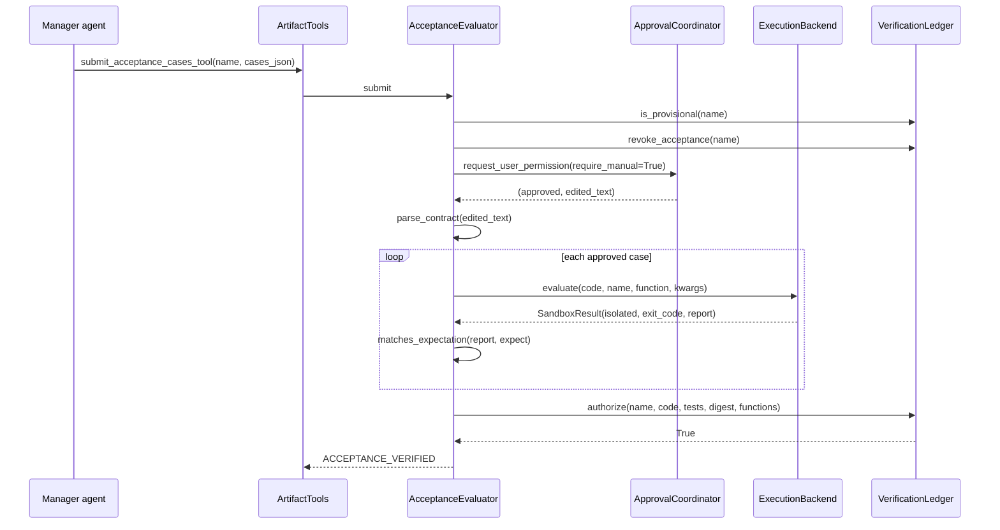

# MDD — Acceptance & Verification Evidence

Criticality score **98.0 / 100** (centrality 5, security 5, business 5, complexity 5,
persistence 5, extensibility 4). Terminology: see [README](README.md#shared-terminology).

## 1. Purpose and Responsibilities

This component is the only place in AgentiX v7 where an observation made by
untrusted generated code becomes host-held execution authorization. It owns the
declarative acceptance contract, the human review request that precedes it, the
host-side comparison of expected against observed values, and the ledger that
binds authorization to exact bytes.

Responsibilities:

- Parse and validate acceptance contracts (`parse_contract`) with a bounded,
  duplicate-free JSON schema.
- Publish a mandatory manual review request carrying the provisional result and
  the generated tests as read-only context (`AcceptanceEvaluator._submit`).
- Re-evaluate every approved case in a fresh isolated child and compare results
  in the host process (`matches_expectation`).
- Bind authorization to code bytes, test bytes, contract digest and the approved
  function set (`VerificationLedger.authorize`).
- Revoke authorization when bytes, policy, owner, operation or durable record
  change (`invalidate`, `revoke_acceptance`, `_revoke_stored`).
- Persist optional durable approvals outside tool storage (`ApprovalStore`).
- Decide portable-call eligibility from source alone (`computation_only`,
  `unapproved_imports`, `allowed_modules`).

Explicit non-responsibilities:

- It does not write artifacts. Writes belong to `ArtifactStore` and
  `ApprovalCoordinator` ([MDD-approval-and-containment.md](MDD-approval-and-containment.md)).
- It does not provision the OS boundary. It calls `ExecutionBackend.evaluate`
  ([MDD-isolated-execution.md](MDD-isolated-execution.md)).
- It does not publish drafts to the catalog. `Orchestrator` does that after
  `is_verified` returns true ([MDD-tool-creation-pipeline.md](MDD-tool-creation-pipeline.md)).
- It does not decide which tool to create or reuse.

Layer: domain-adjacent security service. It depends on `domain/contracts.py`
protocols and on no application, controller or UI module.

## 2. Source Code Mapping

| File | Symbols |
| --- | --- |
| `src/agentix/security/acceptance.py` | `parse_contract`, `validate_json`, `matches_expectation`, `AcceptanceEvaluator` (`status`, `note_provisional`, `submit`, `_submit`) |
| `src/agentix/security/verification.py` | `VerificationLedger` (`snapshot`, `invalidate`, `record`, `is_provisional`, `authorize`, `revoke_acceptance`, `acceptance_context`, `begin_execution`, `has_execution_activity`, `record_execution`, `prepare_reuse`, `execution_result`, `is_verified`, `matches`, `matches_authorized`) |
| `src/agentix/security/reuse_policy.py` | `allowed_modules`, `unapproved_imports`, `computation_only` |
| `src/agentix/security/approval_store.py` | `ApprovalStore`, `policy_fingerprint`, `user_approval_store`, `DataProtector` |
| `src/agentix/domain/contracts.py` | `SecurityBoundary`, `ExecutionBackend` |
| `src/agentix/domain/tool_schema.py` | `extract_tool_schema`, `validate_value` |

Entry points, in call order:

1. `ArtifactTools.run_and_save_tests_tool` → `TestRunner` → `AcceptanceEvaluator.note_provisional`.
2. `ArtifactTools.submit_acceptance_cases_tool` → `AcceptanceEvaluator.submit`.
3. `ArtifactTools.verify_existing_tool_tool` → `VerificationLedger.prepare_reuse`.
4. `ToolExecutor.execute_generated_tool_tool` → `is_verified` / `matches_authorized`.

## 3. Architecture and Dependencies

Internal dependencies: `domain/contracts.py` (protocols only), `diagnostics.py`
(payload-free events), `security/paths.py` indirectly through the boundary.

External dependencies: standard library plus `WindowsDataProtection` for sealing.
No model, framework or network call occurs in this component.

Dependency direction is inward: `application` and `adapters` depend on this
component; it depends on nothing above `domain`. No violation observed.

Ports and adapters:

- `SecurityBoundary` (port) — implemented by `ApprovalCoordinator` and
  `SecurityManager`. This component consumes it, never implements it.
- `ExecutionBackend` (port) — implemented by `WindowsSandbox`. Injected into
  `AcceptanceEvaluator`, so offline tests substitute a double.
- `DataProtector` (port) — implemented by `WindowsDataProtection`; tests inject a
  double, which is why `ApprovalStore` takes `protector` explicitly.

One coupling worth naming: `VerificationLedger` holds mutable per-owner state in
instance attributes but `ApprovalCoordinator` holds its state in class
attributes. A ledger must therefore be constructed per owner, which
`ArtifactTools.__init__` does.

## 4. Execution and Data Flow

Inputs: tool name, contract JSON (≤ 64 KiB), current code and test bytes read from
storage by the ledger.

Outputs: a fixed result string (`ACCEPTANCE_VERIFIED`, `ACCEPTANCE_REJECTED`,
`ACCEPTANCE_FAILED`), a status snapshot for the UI, and ledger state.

State transitions in `AcceptanceEvaluator._status["stage"]`:
`not_started` → `provisional_passed`/`provisional_failed` → `pending_review` →
`evaluating` → `verified`, with `rejected`, `failed` and `invalidated` as
terminal or display-only states. `status()` downgrades `verified` to
`invalidated` when the ledger no longer verifies the tool.

Error handling: `submit` catches every exception, invalidates the ledger, sets
`failed` and returns a fixed string. Case-level failure raises inside `_submit`
and is converted by the outer handler, so a partial pass never authorizes. A
rejection is remembered per `(owner_id, operation_id)` in `_rejected_operation`,
which blocks a reprompt in the same operation.

## 5. Contracts and Invariants

Public interfaces: `AcceptanceEvaluator.submit(tool_name, cases_json) -> str`,
`AcceptanceEvaluator.status() -> dict`, `VerificationLedger.authorize(...) -> bool`,
`VerificationLedger.is_verified(tool_name, function_name=None) -> bool`.

Preconditions for `authorize`: the boundary is open; `functions` is non-empty;
`contract_digest` is non-empty; `is_provisional(tool_name)` is true; and
`matches(tool_name, code, tests)` is true for the exact bytes passed in.

Postconditions: acceptance, contract and execution slots are cleared and then
repopulated for exactly one tool; `acceptance_context` returns `None` unless
`is_verified` still holds.

Data contract (`parse_contract`): object with `version == 1` and `cases` of 1–32
entries; each case has exactly `id`, `purpose`, `function`, `kwargs`, `expect`;
`expect` is `{"kind": "value", "value": <json>}` or
`{"kind": "raises", "type": "<exception name>"}`; duplicate keys are rejected by
`_unique`; depth and size are bounded by `validate_json`.

Security invariants:

- Expected values never leave the host process. The child receives only
  `function` and `kwargs`; the comparison happens in `matches_expectation`.
- A child report is data. `decode_report` requires exactly one
  `AGENTIX_REPORT:` frame with an exact key set per `kind`.
- `authorize` is not reachable from any model-facing tool. `ArtifactTools`
  exposes no method that calls it directly.
- Durable records bind `root`, `tool`, `code` hash, `tests` hash, `policy`,
  `digest`, `functions` and `contract`; any mismatch revokes the record
  (`ApprovalStore.load`).

Persistence constraint: `policy_fingerprint()` hashes 17 maintained files, so any
edit to the approval, acceptance, verification, sandbox, path or publication
sources invalidates every durable approval by construction.

## 6. Security and Reliability

Trust boundaries crossed: model output → review text (untrusted, bounded,
displayed); human decision → host verdict (trusted only after re-parse);
host → child (code and kwargs only); child → host (one framed JSON report).

Authorization and human review: `require_manual=True` bypasses `auto_approve`, so
acceptance review can never be satisfied by the session toggle. `resolve_pending_request`
requires both `request_id` and `owner_id` and a live deadline.

Sensitive data: `status()` returns a deep copy and never a capability token;
`review_context` carries tests and provisional output but no credentials; log
events are payload-free (`acceptance_*`, `durable_approval_invalid`).

Failure modes and recovery:

| Failure | Behaviour |
| --- | --- |
| Malformed proposal JSON | Displayed for correction; approval still required; no auto-repair |
| Human denial or timeout | `ACCEPTANCE_REJECTED`, ledger invalidated, no reprompt in the same operation |
| Case mismatch | `ACCEPTANCE_FAILED`, ledger invalidated |
| Bytes changed during evaluation | `ValueError("Reviewed work changed")` before the next case |
| Durable record unreadable | Record revoked, `None` returned, warning logged |
| Concurrent review | `_busy` lock returns `ACCEPTANCE_FAILED: Another review is active.` |

## 7. Testing and Verification

| Test file | Coverage |
| --- | --- |
| `tests/unit/test_human_acceptance.py` | Contract parsing, review gating, verdict comparison |
| `tests/unit/test_durable_approvals.py` | Sealed record binding, revocation on mismatch |
| `tests/unit/test_reviewed_reuse.py` | `prepare_reuse`, reuse eligibility |
| `tests/unit/test_portable_modules.py` | `allowed_modules`, `computation_only` |
| `tests/unit/test_pipeline_verification.py` | Ledger state across pipeline stages |
| `tests/test_application_catalog.py`, `tests/test_application_catalog_skip_reasons.py` | Ledger consumption by the application catalog |
| `tests/test_v5_tool_contracts.py` | Schema extraction and contract shape |

Focused command: `python -m pytest tests/unit/test_human_acceptance.py tests/unit/test_durable_approvals.py tests/unit/test_reviewed_reuse.py`

Weak verification, stated as observation: no test in this set exercises a real
`WindowsDataProtection` seal/unseal round trip together with a real AppContainer
child in one flow; those are covered separately by
`tests/integration/test_windows_isolation.py` and the `windows_credentials`
marker. The combination is asserted by construction, not by a single test.

## 8. Architectural Findings

Strengths, evidenced:

- Authorization is content-addressed, not name-addressed: `authorize` takes bytes
  and a digest, so renaming or rewriting a tool cannot inherit a grant.
- The rejection memory (`_rejected_operation`) implements the no-reprompt rule in
  code rather than in prompt text.
- Policy binding is mechanical: 17 files are hashed, so a security edit cannot
  silently preserve old approvals.

Technical debt, evidenced:

- `VerificationLedger` carries eleven mutable dictionaries and a lock in one
  class (`security/verification.py:25`), mixing acceptance, reuse, execution and
  durable-record concerns. It is the widest single state holder in the security
  package.
- `acceptance.py` imports `_unique` from itself into `sandbox/__init__.py`
  (`decode_report`), a private-symbol cross-package import that couples the
  sandbox to an acceptance helper.
- `ApprovalStore._path` is used by `InstalledApps`, `CatalogMigration` and
  `WidgetStore` as a de facto public primitive despite the leading underscore.

Risks:

- Authorization is per-process. Two GUI processes sharing one tools root each
  hold independent ledgers; a durable record is the only cross-process signal,
  and it is re-read only on `prepare_reuse`.
- `record_execution` accepts a child-authored `result` value; correctness of that
  value rests on the isolated child, not on host recomputation.

Extension points: `DataProtector` and `ExecutionBackend` are injectable, so an
alternative sealing backend or a non-Windows boundary can be substituted without
touching acceptance logic. `parse_contract` is the single place a new case kind
would be added.

## 9. Traceability

Source: `security/acceptance.py` (`AcceptanceEvaluator`, `parse_contract`,
`matches_expectation`), `security/verification.py` (`VerificationLedger`),
`security/reuse_policy.py`, `security/approval_store.py` (`ApprovalStore`,
`policy_fingerprint`), `domain/contracts.py`, `domain/tool_schema.py`.

Tests: as listed in section 7.

Related documentation: [`ACCEPTANCE_REVIEW.md`](../ACCEPTANCE_REVIEW.md),
[`LLM_SECURITY_2026.md`](../LLM_SECURITY_2026.md), ADR
[0005](../adr/0005-human-reviewed-host-acceptance.md), ADR
[0008](../adr/0008-observed-execution-handoffs.md), specs
[045](../specs/045-proposed-acceptance-cases.md),
[054](../specs/054-acceptance-approval-readiness.md),
[`docs/reference/src__agentix__security__acceptance.md`](../reference/src__agentix__security__acceptance.md),
[`docs/reference/src__agentix__security__verification.md`](../reference/src__agentix__security__verification.md).

## 10. Open Questions

- Whether a durable approval should be re-validated on every execution rather
  than only on `prepare_reuse` is a policy choice the repository does not settle;
  `ApprovalStore.load` is called from `prepare_reuse` only.
- The intended upper bound for `VerificationLedger` growth per long-lived session
  is not stated anywhere in code or documentation.
