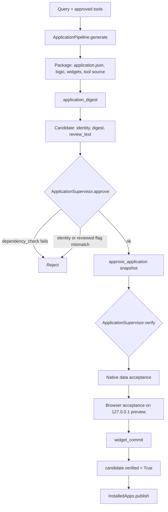

# MDD — Application Composition & Supervision

Criticality score **93.0 / 100** (centrality 5, security 4, business 5, complexity 5,
persistence 4, extensibility 5). Terminology: see [README](README.md#shared-terminology).

## 1. Purpose and Responsibilities

This component turns a natural-language request plus an approved tool catalog into
a reviewable application package, then gates its installation behind independent
native and browser verification. It owns the schema-3 manifest, the package
digest, the review snapshot, the approval/verification state machine and the
preview lifecycle.

Responsibilities:

- Plan a composition from approved catalog tool schemas only
  (`ApplicationPipeline.generate` → `general_pipeline.generate`).
- Materialise an exact package: approved tool source, maintained runtime
  templates, model-generated connection code, per-tool widget files and
  `application.json`.
- Build a complete review snapshot including file provenance, tool acceptance
  contracts and proposed acceptance cases.
- Bind human approval to the displayed candidate identity and unchanged bytes
  (`ApplicationSupervisor.approve`).
- Run independent native and real-browser acceptance before any publication
  (`ApplicationSupervisor.verify`, `general_acceptance.verify`).
- Recheck the dependency closure before every permitted operation (`_snapshot`).
- Expose reviewed file editing with per-file identity (`ApplicationReview`).
- Serve preview control messages (`ApplicationControls`).

Explicit non-responsibilities:

- It does not authorize tool execution. Tool grants come from
  [MDD-acceptance-and-verification.md](MDD-acceptance-and-verification.md).
- It does not write install records. `InstalledApps.publish` does
  ([MDD-installed-application-catalog.md](MDD-installed-application-catalog.md)).
- It does not resolve catalog membership or approval state. `ApprovedToolRegistry`
  does.
- It does not provision the OS boundary; it calls the injected `native` callable.

Layer: application. It depends on `domain`, `security` and `storage` contracts and
on `lab` preview adapters; it is consumed by `controllers/applications.py`.

## 2. Source Code Mapping

| File | Symbols |
| --- | --- |
| `src/agentix/application/app_workflow.py` | `Candidate`, `ApplicationPipeline` (`generate`, `bind_widget_publication`, `set_model_client`), `ApplicationSupervisor` (`approve`, `verify`, `open_verified`, `run_data`, `_snapshot`), `browser_origin_allowed` |
| `src/agentix/application/general_pipeline.py` | `generate` |
| `src/agentix/application/general_package.py` | `RuntimeSourceChanged`, `capture`, `capture_with_current_runtime`, `validate_manifest`, `validate_payload`, `validate_results`, `runtime_template` |
| `src/agentix/application/code_package.py` | `SHARED`, `validate_manifest`, `validate_payload`, `validate_results`, `validate_acceptance` |
| `src/agentix/application/general_acceptance.py` | `verify`, `browser_verify`, `launch_acceptance_browser`, `fill_input`, `click_and_wait`, `assert_output`, `display_expectation` |
| `src/agentix/application/code_cases.py` | `propose_cases`, `acceptance_status` |
| `src/agentix/application/app_review.py` | `ApplicationReview` (`entries`, `read`, `save`, `panes`, `save_group`) |
| `src/agentix/application/app_controls.py` | `PreviewControl`, `ApplicationControls.handle` |
| `src/agentix/domain/application_code.py` | `WidgetInstance`, `ApplicationCode`, `validate_input_shape`, `validate_connection_source` |
| `src/agentix/lab/application_artifacts.py` | `ApprovedApplication`, `approve_application`, `application_digest`, `validate_result`, `LOCK_PATH` |
| `src/agentix/agents/catalog_agents.py` | `ApplicationCoordinator`, `CallableCoordinator`, `CatalogWidgetDesigner` |
| `src/agentix/adapters/application_crewai.py` | `make_application_coordinator` |

Entry points: `ApplicationPipeline.generate`, `ApplicationSupervisor.approve`,
`ApplicationSupervisor.verify`, `ApplicationReview.save`, `ApplicationControls.handle`.

## 3. Architecture and Dependencies

Internal: `domain/application_code.py` (manifest and connection-code validation),
`domain/tool_schema.py` (schemas), `storage/application_catalog.py` (approved
tools), `lab/application_artifacts.py` (digest and snapshot), `lab/application_panel.py`
and `lab/application_session.py` (preview), `security/verification.py` indirectly
through tool contracts.

External: `crewai` only inside `adapters/application_crewai.py`; Playwright only
inside `general_acceptance.py`. Neither is imported at module import time by the
pipeline itself.

Dependency direction: `controllers` → `application` → `domain`/`storage`/`lab`.
`lab/application_artifacts.py` is imported by `storage/installed_apps.py`, which is
an upward edge from `storage` into `lab`; see findings.

Ports and adapters:

- `ApplicationCoordinator` (port) with `CallableCoordinator` and the CrewAI
  coordinator as adapters. `ApplicationPipeline` rejects injecting both a legacy
  client and a coordinator factory.
- `native` and `browser` callables injected into `ApplicationSupervisor`, which is
  what makes offline tests possible without a real AppContainer or browser.

## 4. Execution and Data Flow

Inputs: query (≤ 16000 characters), `dict[str, ApprovedTool]` with non-`None`
schemas, optional feedback dict.

Outputs: a `Candidate` holding `identity`, `folder`, `package`, `digest`,
`review_text`, `approved`, `verified`, `snapshot`, `preview`.

State transitions on `Candidate`: created → `approved` (after `approve`) →
`verified` (after `verify`). `close()` releases only the owned preview and lease.
`verify` writes `validation.json` with `status: passed|failed` and the failing
stage, so a failed attempt leaves durable evidence.

Error handling: `verify` wraps every stage in `try/except BaseException`, records
the stage name (`native_data`, `catalog_native_browser_acceptance`,
`native_gui_startup`, `browser`, `widget_publication`), closes the preview, clears
`verified` and re-raises. No stage is retried automatically.

## 5. Contracts and Invariants

Public interfaces: `ApplicationPipeline.generate(query, *, feedback, tools) -> Candidate`,
`ApplicationSupervisor.approve(candidate, identity, reviewed) -> None`,
`ApplicationSupervisor.verify(candidate, parent_origin) -> object`,
`ApplicationSupervisor.run_data(candidate, text) -> dict`,
`ApplicationReview.save(item, name, text, identity) -> None`.

Preconditions: `generate` requires a non-empty query, a non-empty tool mapping and
a canonical schema per tool. `approve` requires `reviewed is True` and
`identity == candidate.identity`. `verify` requires an approved candidate whose
digest still matches. `run_data` requires `candidate.verified`.

Postconditions: `approve` sets `snapshot`, `approved`; `verify` sets `verified`
and writes `validation.json`; `_snapshot` raises rather than returning a stale
candidate.

Data contract (`application.json`, schema 3): `schema_version`, `name`,
`gui_entry`, `data_entry`, `permissions`, `runtime_lock_sha256`, `files`,
`tools`, `inputs`, `widgets`. `validate_manifest` enforces the entry-point shape
and the file map; `validate_payload` and `validate_results` enforce the declared
input and output shapes; `validate_acceptance` checks the reviewed
`payload`/`expected` pair against the manifest.

Security invariants:

- `browser_origin_allowed` permits only `http` to `127.0.0.1` with the same
  netloc, no userinfo and a URL ≤ 8192 characters.
- `approve_application` recomputes the digest and raises
  `RuntimeSourceChanged` when only maintained runtime members drifted, keeping
  tampering distinguishable from host drift.
- Model output is written as data; no generated module is imported by the host.
- `Candidate` is never serialised to the browser; the UI receives opaque IDs.

Persistence constraint: the package digest covers every member, so any edit after
review invalidates approval. `config.json` layout is validated separately by
`validate_layout` and never becomes executable CSS.

## 6. Security and Reliability

Trust boundaries: model → package files (untrusted, reviewed); package → host
import (never); host → preview server (loopback only); preview → browser
(Playwright drives real controls).

Authorization and human review: `approve` requires an explicit `reviewed` flag and
a matching candidate identity, so a stale UI selection cannot approve a different
candidate. `ApplicationReview.save` requires the per-file `identity` and
recomputes the review key.

Sensitive data: review text carries full source, which is intended for the owner;
logs record `draft=<id>`, stage names and counts, never source bodies.

Failure modes and recovery:

| Failure | Behaviour |
| --- | --- |
| No approved tools | `ValueError` before any model call |
| Coordinator returns unknown widget identity | `ValueError` |
| Widget validation fails | Exception logged with tool name, draft retained |
| Digest mismatch after review | `ValueError("Application is unapproved or changed after review")` |
| Native acceptance mismatch | `validation.json` stage `native_data`, preview closed |
| Browser acceptance failure | stage `browser`, preview closed, `verified` cleared |
| Widget drift during review | `dependency_check` raises before approval or publication |

## 7. Testing and Verification

| Test file | Coverage |
| --- | --- |
| `tests/test_application_pipeline.py` | Generation, manifest, review snapshot |
| `tests/test_general_application_pipeline.py` | Schema-3 catalog-driven flow |
| `tests/test_application_supervisor.py` | Approve/verify gates, stage recording |
| `tests/test_application_review.py`, `tests/test_application_review_browser.py` | Reviewed file editing, browser review |
| `tests/test_application_browser_policy.py` | `browser_origin_allowed` |
| `tests/test_code_application.py`, `tests/test_code_cases.py` | Connection code and proposed cases |
| `tests/test_composite_application.py`, `tests/test_composite_browser.py`, `tests/test_composite_launch.py` | Composition and launch |
| `tests/test_application_crews.py` | Real CrewAI schemas with inference replaced |
| `tests/test_application_update.py` | Re-approval and update path |

Focused command: `python -m pytest tests/test_application_pipeline.py tests/test_application_supervisor.py tests/test_application_browser_policy.py`

Framework and browser evidence requires the `frameworks`, `browser` and
`windows_isolation` markers per [`docs/specs/TEST_PLAN.md`](../specs/TEST_PLAN.md);
the default suite uses doubles and does not establish real isolation.

## 8. Architectural Findings

Strengths, evidenced:

- The digest is computed over the whole package, and `approve_application`
  distinguishes runtime drift from source tampering instead of collapsing both
  into one error.
- Stage names are recorded in `validation.json`, so a failure is diagnosable
  without re-running.
- Injection of `native`, `browser` and `preview_factory` keeps the production path
  native-only while making the gates testable.

Technical debt, evidenced:

- `app_workflow.py` mixes three responsibilities: pipeline orchestration,
  supervisor gating and legacy fixed-composition compatibility
  (`schema_version != 3` branch with literal `{"words": 2, "vowels": 3}`).
- `ApplicationPipeline.generate` delegates immediately to a module-level function
  in `general_pipeline.py`, so the class is a thin façade over a procedural core.
- `Candidate` has 15 fields including three callables, which makes it a
  service-locator for the review flow rather than a value object.
- The draft folder name and `Candidate.identity` are two different `uuid4` values
  (`general_pipeline.py`), so folder identity and approval identity are not the
  same string.

Risks:

- `ApplicationSupervisor.verify` catches `BaseException`, which also swallows
  `KeyboardInterrupt` and `SystemExit` until re-raised; the re-raise keeps
  behaviour correct but makes the handler easy to misuse.
- Legacy schema compatibility keeps a second acceptance path alive in the same
  class as the schema-3 path.

Extension points: `ApplicationCoordinator` accepts a new planner without touching
the supervisor; `validate_manifest` is the single gate for a new schema version;
`ApplicationControls.handle` is the extension point for new preview commands.

## 9. Traceability

Source: as listed in section 2. Tests: section 7.

Related documentation: [`V7_ARCHITECTURE.md`](../V7_ARCHITECTURE.md),
[`LAB_ARCHITECTURE.md`](../LAB_ARCHITECTURE.md), ADR
[0002](../adr/0002-explicit-composition.md), ADR
[0006](../adr/0006-terminal-review-and-browser-tests.md), specs
[030](../specs/030-maintained-application-composition.md),
[039](../specs/039-general-applications-and-tool-contracts.md),
[041](../specs/041-general-workflow-bindings.md),
[042](../specs/042-crewai-application-coordination.md),
[043](../specs/043-generated-application-code.md),
[`docs/reference/src__agentix__application__app_workflow.md`](../reference/src__agentix__application__app_workflow.md),
[`docs/reference/src__agentix__application__general_pipeline.md`](../reference/src__agentix__application__general_pipeline.md).

## 10. Open Questions

- Whether the legacy non-schema-3 acceptance branch is still reachable in
  production is not stated; the code keeps it and tests exercise it, but no
  current specification requires it.
- The intended retention period for draft folders under `ApplicationPipeline.root`
  is not defined in code.
