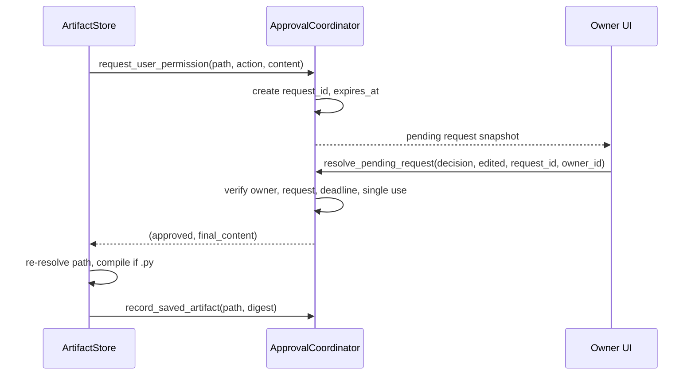

# MDD — Approval Coordination & Artifact Containment

Criticality score **84.0 / 100** (centrality 5, security 5, business 5, complexity 4,
persistence 2, extensibility 3). Terminology: see [README](README.md#shared-terminology).

## 1. Purpose and Responsibilities

This component owns two things that must never be conflated: the single-use human
decision channel, and the filesystem containment that decides where an approved
write may land. It is the only path by which a human decision reaches host code,
and the only path by which a model-influenced write reaches disk.

Responsibilities:

- Publish one pending request per owner with a unique `request_id` and deadline
  (`ApprovalCoordinator.request_user_permission`).
- Accept exactly one resolution, bound to `request_id` and `owner_id`
  (`resolve_pending_request`).
- Deny on timeout, session close, duplicate response or cross-owner response.
- Record host-observed writes with a random receipt (`record_saved_artifact`,
  `get_artifact_receipt`).
- Resolve and confine artifact paths, rejecting traversal, aliases, ADS and
  reserved names (`resolve_artifact_path`).
- Separate draft and public tool roots and switch between them
  (`SecurityManager.begin_tool_draft`, `publish_current_draft`,
  `restore_public_tool_storage`).
- Perform the approved write with syntax validation (`ArtifactStore.write`).

Explicit non-responsibilities:

- It does not decide whether acceptance passed
  ([MDD-acceptance-and-verification.md](MDD-acceptance-and-verification.md)).
- It does not execute code ([MDD-isolated-execution.md](MDD-isolated-execution.md)).
- It does not choose catalog membership
  ([MDD-persistence-and-namespace.md](MDD-persistence-and-namespace.md)).
- It does not authenticate a human account; it is workflow ownership.

Layer: security, with one storage adapter (`ArtifactStore`). It depends on
`settings.py` for the tool root and on `domain/contracts.py` for its protocol.

## 2. Source Code Mapping

| File | Symbols |
| --- | --- |
| `src/agentix/security/approvals.py` | `ApprovalCoordinator` (`for_owner`, `record_saved_artifact`, `get_artifact_receipt`, `request_user_permission`, `is_closed`, `get_pending_request`, `resolve_pending_request`, `cancel_pending`) |
| `src/agentix/security/__init__.py` | `SecurityManager` (`_own_root`, `_tools_root`, `configure_tool_storage`, `begin_tool_draft`, `publish_current_draft`, `restore_public_tool_storage`, `validate_and_resolve_path`, `safe_write_file`) |
| `src/agentix/security/paths.py` | `SecurityViolationError`, `resolve_artifact_path` |
| `src/agentix/storage/artifacts.py` | `ArtifactStore.write` |

Entry points: `request_user_permission`, `resolve_pending_request`,
`ArtifactStore.write`, `SecurityManager.begin_tool_draft`.

## 3. Architecture and Dependencies

Internal: `settings.py` (lazy tool root), `domain/contracts.py`
(`SecurityBoundary`), `storage/tool_publication.py` (called by
`publish_current_draft`), `domain/tool_schema.py` (strict contract check).

External: standard library only. `threading.Event` is the synchronisation
primitive; no queue, socket or IPC is involved.

Dependency direction: `application`, `storage` and `controllers` depend on this
component; it depends only on `domain` and `settings`. No violation observed.

Ports and adapters: `SecurityBoundary` is the port; `ApprovalCoordinator` and
`SecurityManager` are the implementations; `ArtifactStore` is the storage adapter
that consumes the port. `ArtifactStore` takes the boundary by injection, so a test
double can assert the exact approval calls.

One structural note: `ApprovalCoordinator` keeps its state in class attributes and
`for_owner` builds a subclass with fresh class state. `SecurityManager` extends
that pattern with storage roots and `_own_root` reads `cls.__dict__` so a subclass
cannot inherit another owner's roots.

## 4. Execution and Data Flow

Inputs: target path, action label, content, `require_manual`, `review_context`.

Outputs: `(approved: bool, final_content: str)`; a receipt tuple
`(receipt_id, digest)`; a written path or a fixed refusal string.

State transitions of a request: absent → pending → resolved (approved or denied) →
cleared. `cancel_pending` moves pending → denied and sets `_closed`, which makes
every later request deny immediately.

Error handling: `resolve_pending_request` returns `False` for every rejection and
logs `approval_response_rejected`; it never raises. `ArtifactStore.write` returns
`Operation aborted: ...` strings for denial and `Error validating Python: ...` for
a syntax failure, leaving existing bytes intact. `resolve_artifact_path` raises
`SecurityViolationError`, which is not converted to a string.

## 5. Contracts and Invariants

Public interfaces: `request_user_permission(...) -> tuple[bool, str]`,
`resolve_pending_request(decision, edited_content=None, *, request_id, owner_id) -> bool`,
`get_pending_request() -> dict | None`, `cancel_pending() -> None`,
`validate_and_resolve_path(tool_name, filename) -> str`,
`safe_write_file(tool_name, filename, content, mode="w") -> str`.

Preconditions: `for_owner` requires a non-empty owner and a positive timeout.
`begin_tool_draft` requires a name matching `[A-Za-z][A-Za-z0-9_]{0,127}` and
owner/operation matching `[A-Za-z0-9_-]{1,128}`.

Postconditions: exactly one resolution per request; the pending slot is cleared
only by the owning waiter; `publish_current_draft` restores the public root and
clears the active draft.

Data contracts: a pending request carries `request_id`, `owner_id`, `filepath`,
`action`, `content`, `expires_at`, and optionally `review_context`. A receipt is
`(owner_id, operation_id, receipt_id, digest)`; at most 64 are retained.

Security invariants:

- `resolve_pending_request` requires `type(decision) is bool`, so a truthy
  non-boolean cannot approve.
- A cross-owner or stale `request_id` is rejected, not queued.
- `_own_root` reads `cls.__dict__`, so a subclass cannot inherit another owner's
  storage roots.
- `begin_tool_draft` refuses a draft root inside the public catalog.
- `resolve_artifact_path` rejects `..`, absolute segments, drive letters,
  alternate data streams, reserved device names and symlink/hard-link escapes.
- `ArtifactStore.write` re-resolves the path after approval and refuses if the
  destination changed while waiting.
- A receipt is bound to the current operation, so an old save cannot satisfy a new
  stage.

## 6. Security and Reliability

Trust boundaries: model → write request (untrusted content, human-gated); human →
decision (single use, owner bound); path string → filesystem (confined); draft
root → public root (explicit publication only).

Authorization and human review: `require_manual=True` ignores `auto_approve`.
`auto_approve` exists for tests and non-manual actions only.

Sensitive data: `review_context` may carry tests and provisional output but never
credentials; log events carry `request_id` and outcome, not content.

Failure modes and recovery:

| Failure | Behaviour |
| --- | --- |
| Second request while one is pending | `approval_busy`, returns `(False, content)` |
| Timeout | waiter wakes with denial, `approval_expired` |
| Duplicate or late response | `approval_response_rejected`, first result stands |
| Session close | `cancel_pending` denies and closes the channel |
| Path escape attempt | `SecurityViolationError` |
| Destination changed during approval | `SecurityViolationError("Artifact destination changed during approval")` |
| Invalid Python after approval | refusal string, existing file untouched |

## 7. Testing and Verification

| Test file | Coverage |
| --- | --- |
| `tests/unit/test_security.py` | Single use, owner binding, timeout, close, path containment, write/append, syntax rejection |
| `tests/unit/test_approval_identity.py` | Owner and request identity binding |
| `tests/unit/test_security_storage_isolation.py` | Draft/public root separation, `_own_root` |
| `tests/unit/test_storage_isolation_policy.py` | Storage isolation policy |
| `tests/integration/test_artifact_workflow.py` | End-to-end approved write and destination change |
| `tests/unit/test_tool_publication.py` | Draft-to-public publication, no overwrite |
| `tests/unit/test_sessions.py` | Owner-scoped coordinator lifecycle |
| `tests/integration/test_windows_approval_protection.py` | Sealed approval records |

Focused command: `python -m pytest tests/unit/test_security.py tests/unit/test_approval_identity.py tests/unit/test_security_storage_isolation.py`

## 8. Architectural Findings

Strengths, evidenced:

- The decision channel is genuinely single-use and owner-bound, with the deadline
  checked inside the same lock that accepts the decision.
- `_own_root` closes a real inheritance hazard: class-level roots would otherwise
  leak between owners.
- The post-approval path re-resolution closes the time-of-check/time-of-use gap
  that a long human review would otherwise open.

Technical debt, evidenced:

- `ApprovalCoordinator` holds nine class attributes of mutable state plus a lock,
  and `for_owner` rebuilds them by string keys in a `type(...)` call, which is
  hard to type-check and easy to extend incorrectly.
- `SecurityManager` mixes approval inheritance with storage-root management, so a
  reader must understand both to reason about either.
- `ArtifactStore.write` is a 90-line method performing four distinct checks in
  sequence.

Risks:

- `auto_approve` is a class attribute; a subclass that sets it true disables the
  gate for every non-manual action in that owner.
- Receipts are in-memory only, so a restart loses stage evidence; the pipeline
  therefore cannot resume a partially completed creation across processes.

Extension points: `SecurityBoundary` allows an alternative coordinator;
`resolve_artifact_path` is the single place to add a new containment rule;
`ArtifactStore` accepts any boundary implementation.

## 9. Traceability

Source: as listed in section 2. Tests: section 7.

Related documentation: ADR [0003](../adr/0003-owned-sessions-and-approvals.md),
[`LLM_SECURITY_2026.md`](../LLM_SECURITY_2026.md), specs
[037](../specs/037-v5-structure-and-workspace.md),
[`docs/reference/src__agentix__security__approvals.md`](../reference/src__agentix__security__approvals.md),
[`docs/reference/src__agentix__security__paths.md`](../reference/src__agentix__security__paths.md),
[`docs/reference/src__agentix__storage__artifacts.md`](../reference/src__agentix__storage__artifacts.md).

## 10. Open Questions

- Whether `auto_approve` is intended to remain reachable in any production
  configuration is not stated; no current specification requires it.
- The intended behaviour for two GUI processes resolving the same request is
  undefined, because the pending slot is per process.
