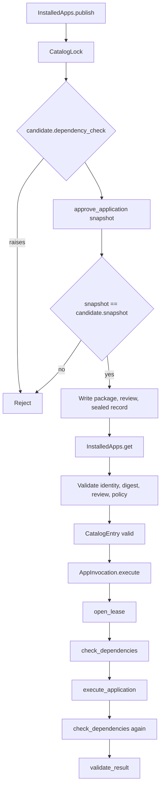

# MDD — Installed Application Catalog & Invocation

Criticality score **87.0 / 100** (centrality 4, security 4, business 5, complexity 4,
persistence 5, extensibility 4). Terminology: see [README](README.md#shared-terminology).

## 1. Purpose and Responsibilities

This component is the durable library of installed applications and the only
sanctioned way to run one. It keeps a sealed, authenticated record per
application, revalidates the exact bytes on every read, re-binds the approved tool
dependencies, and invokes the application under a cross-process usage lease.

Responsibilities:

- Seal and atomically replace install records (`InstalledApps._write_record`,
  `_write_bytes`).
- Revalidate identity, review digest, source digest and policy on every `get`
  (`_validated`).
- Keep a rejected record visible with a bounded reason (`CatalogEntry`, `entry`,
  `entries`).
- Resolve approved catalog tools and their exact bytes
  (`ApprovedToolRegistry.resolve`, `CatalogToolRegistry.resolve`).
- Recheck dependency digests before and after invocation (`check_dependencies`,
  `rebind_dependencies`).
- Hold a usage lease for the whole native operation (`open_lease`, `AppLease`).
- Plan and apply reviewed updates to installed packages (`ApplicationUpdates`).
- Store approved widget companions (`WidgetStore`).

Explicit non-responsibilities:

- It does not approve or verify a candidate; `ApplicationSupervisor` does
  ([MDD-application-composition.md](MDD-application-composition.md)).
- It does not authorize tool execution; the ledger does
  ([MDD-acceptance-and-verification.md](MDD-acceptance-and-verification.md)).
- It does not provision isolation; `execute_application` reaches
  `WindowsSandbox` ([MDD-isolated-execution.md](MDD-isolated-execution.md)).
- It does not relocate grants between roots; `CatalogMigration` does
  ([MDD-persistence-and-namespace.md](MDD-persistence-and-namespace.md)).

Layer: storage plus a thin application-facing invocation service. It depends on
`security` (sealing, reuse policy) and `lab` (digest, session) and is consumed by
`controllers/applications.py`.

## 2. Source Code Mapping

| File | Symbols |
| --- | --- |
| `src/agentix/storage/installed_apps.py` | `PURPOSE`, `InstalledApp`, `CatalogEntry`, `STATUS_BY_REASON`, `app_policy`, `InstalledApps` (`publish`, `get`, `load_stale`, `load_for_runtime_refresh`, `reseal`, `entries`, `list`, `open_lease`, `in_use`, `dependency_references`, `layout_controls`, `read_layout`, `save_layout`, `name_available`) |
| `src/agentix/storage/application_catalog.py` | `CatalogDependencyError`, `ApprovedTool`, `ApprovedToolRegistry` (`resolve`, `recheck`, `for_controller`), `CatalogToolRegistry` (`_skip_reason`) |
| `src/agentix/application/app_invocation.py` | `check_dependencies`, `rebind_dependencies`, `AppInvocation` (`catalog`, `candidates`, `execute`, `observed_answer`, `_input_contract`) |
| `src/agentix/storage/application_update.py` | `Update`, `ApplicationUpdates` (`plan`, `apply`, `_prepare`, `_commit`, `_stage`, `_dependencies`) |
| `src/agentix/storage/usage.py` | `process_alive`, `AppLease`, `app_in_use` |
| `src/agentix/storage/widget_store.py` | `StoredWidget`, `widget_policy`, `WidgetStore` (`load`, `publish`, `_validate`, `_binding`) |

Entry points: `InstalledApps.publish`, `InstalledApps.get`, `AppInvocation.execute`,
`AppInvocation.catalog`, `ApplicationUpdates.plan`/`apply`.

## 3. Architecture and Dependencies

Internal: `security/approval_store.py` (`ApprovalStore`, `policy_fingerprint`),
`security/data_protection.py`, `security/reuse_policy.py`,
`lab/application_artifacts.py` (`application_digest`, `approve_application`),
`application/general_package.py` (`RuntimeSourceChanged`,
`capture_with_current_runtime`), `storage/catalog_lock.py`, `storage/usage.py`,
`layout_contracts.py`.

External: standard library only. No model, framework or network call.

Dependency direction: `controllers` → `application`/`storage` → `security`/`lab`.
Two upward edges exist: `storage/installed_apps.py` imports
`lab/application_artifacts.py` and `application/code_package.py`, and
`storage/application_catalog.py` imports `security/reuse_policy.py`. Both are
recorded in findings.

Ports and adapters: `protector` is injected into `InstalledApps` and defaults to
`WindowsDataProtection`; `native` is injected into `AppInvocation` and defaults to
`execute_application`. `CatalogToolRegistry` is selected by
`ApprovedToolRegistry.for_controller` when the controller sets
`strict_tool_contract`.

## 4. Execution and Data Flow

Inputs: `Candidate` for publication; opaque 32-hex identity for reads and
invocation; `dict` arguments validated against the manifest input contract.

Outputs: `InstalledApp` (id, name, description, package path, digest,
dependencies, review), `CatalogEntry` (id, name, status, reason, app), and the
native result dict.

State transitions of a catalog row: `valid` → `approval_stale` /
`source_changed` / `runtime_changed` / `review_changed` / `unavailable`. The
mapping is `STATUS_BY_REASON`; a rejected row stays listed.

Error handling: `_validated` converts `OSError`, `KeyError`, `TypeError` and
`JSONDecodeError` into `ValueError("Installed application is unavailable or
unapproved")`. `entry` catches and records the bounded reason. `publish` runs
inside `CatalogLock` so publication cannot interleave with removal.

## 5. Contracts and Invariants

Public interfaces: `InstalledApps.publish(candidate) -> InstalledApp`,
`InstalledApps.get(identity) -> InstalledApp`,
`InstalledApps.entries() -> list[CatalogEntry]`,
`AppInvocation.execute(identity, arguments) -> dict`,
`ApprovedToolRegistry.resolve() -> dict[str, ApprovedTool]`.

Preconditions: `publish` requires `candidate.approved`, `candidate.verified` and a
non-`None` snapshot. `get` requires a 32-hex identity. `execute` requires a
current lease and a resolvable registry.

Postconditions: a published record binds `purpose`, `root`, `id`, `name`,
`folder`, `description`, `digest`, `review` hash, `policy` and `dependencies`.
`get` returns only when all of those still match.

Data contracts: sealed record ≤ 262144 bytes, unsealed ≤ 98304 bytes, review file
≤ 1048576 bytes, layout ≤ 65536 bytes, catalog ≤ 512 records, catalog listing
≤ 32 entries in `AppInvocation.catalog`.

Security invariants:

- `PURPOSE = "AgentiX/v5/installed-app/v1"` is a sealed-record discriminator, not
  a product version; it is rechecked on every read and must not be renamed.
- `_directory` rejects symlinked or aliased application folders.
- `dependency_references` reads protected records directly, so a dependent is
  found even when its own source is currently invalid.
- `AppInvocation` exposes no path-based entry point; only opaque IDs.
- `check_dependencies` compares `tool_name`, `function`, `contract_digest`,
  `code_sha256` and `tests_sha256` per tool.

Persistence constraint: `app_policy()` hashes 24 maintained files plus
`infra/runtime.lock.txt`. Any edit to those files makes every installed record
`approval_stale` until `reseal` runs after re-verification.

## 6. Security and Reliability

Trust boundaries: sealed record → host (authenticated by DPAPI sealing plus
policy hash); catalog directory → host (alias-checked); host → native child
(validated payload only); child → host (validated result shape).

Authorization and human review: installation requires a prior human approval and
independent verification; `publish` re-checks both flags and re-derives the
snapshot. `reseal` never re-approves changed source or a changed review.

Sensitive data: descriptions are untrusted display text bounded by `_safe_name`
and truncated to 4000 characters; logs record `app_id`, status and a 160-character
detail, never source.

Failure modes and recovery:

| Failure | Behaviour |
| --- | --- |
| Candidate not approved or verified | `ValueError("Only independently verified reviewed applications can be installed")` |
| Snapshot mismatch after verification | `ValueError("Application changed after verification")` |
| Duplicate display name | `ValueError("An application with this name already exists")` |
| Source tampering | status `source_changed` |
| Maintained runtime drift | status `runtime_changed`; `load_for_runtime_refresh` allows re-approval |
| Review file changed | status `review_changed` |
| Policy drift | status `approval_stale`; `reseal` rebinds after re-verification |
| Tool dependency changed | `ValueError("An installed application tool or its approval changed")` |

## 7. Testing and Verification

| Test file | Coverage |
| --- | --- |
| `tests/test_installed_apps.py` | Publication, validation, status reasons, leases |
| `tests/test_application_catalog.py` | Registry resolution and recheck |
| `tests/test_application_catalog_skip_reasons.py` | `_skip_reason` categories |
| `tests/test_application_update.py` | Plan/apply, stale review digest, rollback |
| `tests/test_v5_policy_bindings.py` | Policy hash invalidation and reseal |
| `tests/test_catalog_maintenance.py`, `tests/test_maintenance_owners.py` | Removal and in-use checks |
| `tests/test_widget_reuse.py` | `WidgetStore` load/publish |
| `tests/integration/test_widget_protection.py` | Protected widget companions |

Focused command: `python -m pytest tests/test_installed_apps.py tests/test_application_catalog.py tests/test_application_update.py`

## 8. Architectural Findings

Strengths, evidenced:

- Every read re-derives the digest; there is no cached "trusted" path.
- Rejection reasons are a closed, owner-actionable set (`STATUS_BY_REASON`), which
  keeps a broken record visible instead of hiding it.
- `publish` and `reseal` run under `CatalogLock`, and `open_lease` reserves before
  native work starts.

Technical debt, evidenced:

- `installed_apps.py` is 583 lines and mixes record sealing, digest policy,
  layout persistence and catalog listing in one class.
- `InstalledApps` calls `self.records._path(...)`, a private `ApprovalStore`
  method, and `dependency_references` reaches into
  `self.records.directory`/`namespace` directly.
- `app_policy()` reads 25 files at call time on every validation, which is
  correct but I/O-heavy on a listing of many records.
- `storage` imports `lab` and `application`, inverting the intended layering.

Risks:

- `_publish` writes package files with `write_bytes` outside the atomic helper, so
  a crash mid-copy leaves a partial package that later reads as `source_changed`.
- `entries()` unseals every record to learn its ID, so a large library costs one
  DPAPI unseal per record.

Extension points: `protector` and `native` injection; `CatalogToolRegistry`
subclassing for a different eligibility policy; `ApplicationUpdates` accepts a
`verifier` callable.

## 9. Traceability

Source: as listed in section 2. Tests: section 7.

Related documentation: [`V7_STORAGE.md`](../V7_STORAGE.md), specs
[031](../specs/031-approved-catalog-and-application-review.md),
[047](../specs/047-catalog-migration.md),
[048](../specs/048-installed-application-update.md),
[056](../specs/056-stale-application-reapproval.md),
[`docs/reference/src__agentix__storage__installed_apps.md`](../reference/src__agentix__storage__installed_apps.md),
[`docs/reference/src__agentix__application__app_invocation.md`](../reference/src__agentix__application__app_invocation.md).

## 10. Open Questions

- Whether `app_policy()` is intended to be memoised per process is not stated;
  the current implementation recomputes on every call.
- The intended maximum library size is bounded per operation (512 records) but no
  documented target exists for total installed applications.
