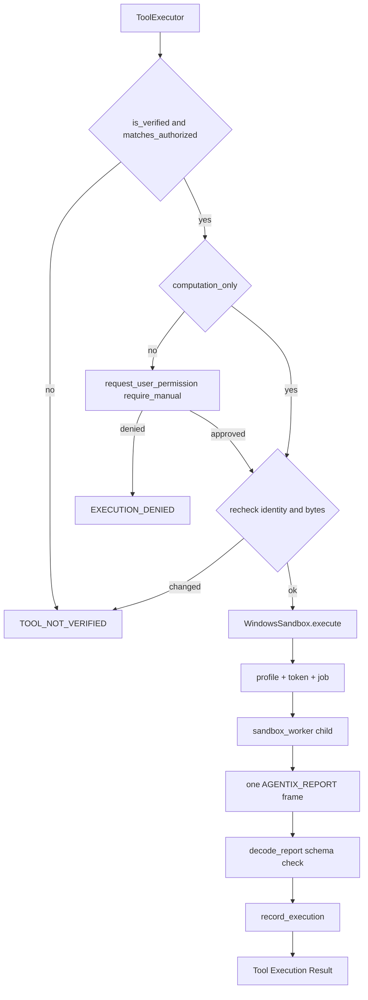

# MDD — Isolated Execution Boundary

Criticality score **83.0 / 100** (centrality 5, security 5, business 4, complexity 5,
persistence 2, extensibility 3). Terminology: see [README](README.md#shared-terminology).

## 1. Purpose and Responsibilities

This component is the only place where generated Python runs. It provisions a
fresh AppContainer profile, a restricted token, a job object and a disposable
runtime directory per invocation, then reads exactly one framed JSON report from
the child. When the boundary cannot be provisioned it denies; there is no
ordinary-subprocess fallback.

Responsibilities:

- Validate resource bounds at construction (`WindowsSandbox.__init__`).
- Copy code, tests and a request file into a fresh runtime directory
  (`_copy_runtime`).
- Provision profile, token, job and pipes, then start the child
  (`NativeWindows.profile`, `NativeWindows.run`).
- Enforce timeout, memory, process count and output size.
- Decode and schema-check the single child report (`decode_report`).
- Track and clean up AppContainer profiles (`ProfileCleanup`).
- Gate a user-visible call on current authorization (`ToolExecutor`).

Explicit non-responsibilities:

- It does not decide whether a result is acceptable
  ([MDD-acceptance-and-verification.md](MDD-acceptance-and-verification.md)).
- It does not approve anything ([MDD-approval-and-containment.md](MDD-approval-and-containment.md)).
- It does not choose which tool to run
  ([MDD-tool-creation-pipeline.md](MDD-tool-creation-pipeline.md)).
- It does not install packages or resolve dependencies.

Layer: sandbox infrastructure plus one application-facing service
(`ToolExecutor`). It depends on `domain/contracts.py` (`ExecutionBackend`) and on
`security/verification.py` for eligibility.

## 2. Source Code Mapping

| File | Symbols |
| --- | --- |
| `src/agentix/sandbox/__init__.py` | `IsolationUnavailable`, `SandboxResult`, `decode_report`, `WindowsSandbox` (`execute`, `evaluate`, `_copy_runtime`) |
| `src/agentix/sandbox/windows_process.py` | `NativeWindows` (`api`, `checked`, `close`, `profile`, `run`, `_delete_profile`, `_process_alive`) |
| `src/agentix/sandbox/profile_cleanup.py` | `ProfileCleanup` (`for_user`, `track`, `release`, `recover`, `_record`, `_safe`) |
| `src/agentix/sandbox_worker.py` | `main` |
| `src/agentix/execution.py` | `ToolExecutor` (`execute_generated_tool_tool`) |

Entry points: `WindowsSandbox.execute`, `WindowsSandbox.evaluate`,
`ToolExecutor.execute_generated_tool_tool`, `sandbox_worker.main`.

## 3. Architecture and Dependencies

Internal: `domain/contracts.py` (`ExecutionBackend`), `security/verification.py`
(eligibility), `security/reuse_policy.py` (`computation_only`),
`security/acceptance.py` (`validate_json` and `_unique` used by `decode_report`),
`diagnostics.py`.

External: `ctypes` against `kernel32`, `advapi32` and `userenv`; `unittest` inside
the child. No third-party package is imported by the sandbox itself.

Dependency direction: `execution` → `sandbox` → `domain`. The reverse edge is
`acceptance` → `sandbox` through the `ExecutionBackend` port, which is why the
port exists. One real inversion: `sandbox/__init__.py` imports
`security.acceptance._unique` and `validate_json` inside `decode_report`, so the
sandbox depends on an acceptance helper at call time.

Ports and adapters: `ExecutionBackend` is the port; `WindowsSandbox` is the only
production adapter. `ToolExecutor` takes the port, so tests substitute a double
and never start a child.

## 4. Execution and Data Flow

Inputs: code bytes, optional test bytes, tool name, function name, kwargs dict,
`observation` flag.

Outputs: `SandboxResult(exit_code, output, report, isolated, failure)`; a fixed
result string from `ToolExecutor`.

State transitions: no child state survives an invocation. Each call creates a new
runtime directory, profile and job; `ProfileCleanup.track`/`release` records the
profile name so a crash can be recovered by `recover`.

Error handling: `IsolationUnavailable` is raised, never converted into a
successful result. A timeout, non-zero exit, missing report or malformed report
becomes an unsuccessful `SandboxResult` with `failure` set. `ToolExecutor` maps
each case to a distinct fixed string.

## 5. Contracts and Invariants

Public interfaces: `execute(code, tests, tool_name, function_name, kwargs, *,
observation=False) -> SandboxResult`, `evaluate(code, tool_name, function_name,
kwargs) -> SandboxResult`, `execute_generated_tool_tool(tool_name, function_name,
kwargs_json="{}") -> str`.

Preconditions: `sys.platform == "win32"`; `tool_name` matches
`[a-z][a-z0-9_]{0,63}`; bounds satisfy `0 < timeout <= 120`,
`16 MiB <= memory <= 1 GiB`, `1 <= processes <= 16`,
`1 KiB <= max_output <= 1 MiB`.

Postconditions: exactly one report frame is accepted; `isolated` is true only when
the OS boundary was actually established.

Data contracts (`decode_report`): exactly one line starting with
`AGENTIX_REPORT:`; the JSON object must match one of three exact key sets —
`{kind, result}` for `call`, `{kind, status, value}` or
`{kind, status, exception_type}` for `observation`, and
`{kind, run, failures, errors, skipped, successful}` for `tests`. Duplicate keys
are rejected.

Security invariants:

- No host fallback: `IsolationUnavailable` denies execution outright.
- The child never receives a host object; the boundary is JSON text.
- `channel_handles` must be exactly two distinct inheritable pipe handles, checked
  with `GetFileType` and `GetHandleInformation`.
- A persistent job requires an owned cancellation event.
- The child's `unittest` is untrusted; a passing report is provisional evidence.
- `sandbox_worker` refuses a private or missing function name.

## 6. Security and Reliability

Trust boundaries: host → child (code, tests, request file); child → host (one
framed report, untrusted); OS → host (exit code, job limits).

Authorization and human review: `ToolExecutor` requires current authorization and,
for any tool that is not `computation_only`, an explicit per-call approval of the
exact arguments. The approval does not widen OS permissions.

Sensitive data: `output` is bounded by `max_output`; logs record failure kinds and
counts, not child output bodies.

Failure modes and recovery:

| Failure | Behaviour |
| --- | --- |
| Non-Windows host | `IsolationUnavailable` |
| Profile or token provisioning failure | `IsolationUnavailable` |
| Timeout | unsuccessful result, job killed |
| Child crash or non-zero exit | unsuccessful result with `failure` |
| Missing or duplicate report frame | `ValueError("Missing or ambiguous sandbox report")` |
| Report schema mismatch | `ValueError("Invalid sandbox report schema")` |
| Leftover profile after crash | `ProfileCleanup.recover` releases it |

## 7. Testing and Verification

| Test file | Coverage |
| --- | --- |
| `tests/unit/test_sandbox_protocol.py` | `decode_report` framing and schema, constructor bounds |
| `tests/unit/test_execution_handoff.py` | `ToolExecutor` eligibility and denial strings |
| `tests/integration/test_windows_isolation.py` | Real AppContainer child (marker `windows_isolation`) |
| `tests/test_v5_profile_cleanup.py` | Track, release, recover |
| `tests/test_widget_ipc_gate.py`, `tests/test_widget_transport_gate.py` | Handle and transport gating |

Focused command: `python -m pytest tests/unit/test_sandbox_protocol.py tests/unit/test_execution_handoff.py`

Real isolation is only established by the `windows_isolation` marker; the default
suite uses doubles and proves the gate logic, not the OS boundary.

## 8. Architectural Findings

Strengths, evidenced:

- Denial is the default: every provisioning problem raises rather than degrading.
- Report validation uses exact key sets, so an extra field cannot smuggle data
  past the parent.
- `ProfileCleanup` makes profile leakage recoverable instead of permanent.

Technical debt, evidenced:

- `windows_process.py` is 480 lines of `ctypes` structure definitions and
  `kernel32` calls in one class, with no unit-testable seam below `run`.
- `decode_report` imports private helpers from `security.acceptance`, coupling the
  sandbox to an unrelated module's internals.
- `sandbox/__init__.py` mixes provisioning, runtime copying, execution and report
  decoding in one class.

Risks:

- The isolation guarantee is only as strong as the AppContainer capability set;
  the code establishes the boundary but the capability list is not asserted by a
  test that enumerates what the child can reach.
- `ToolExecutor` records the child-authored `result` as the execution outcome;
  host recomputation is not performed.

Extension points: `ExecutionBackend` allows an alternative boundary;
`WindowsSandbox` accepts resource bounds; `ProfileCleanup` is injectable.

## 9. Traceability

Source: as listed in section 2. Tests: section 7.

Related documentation: ADR [0004](../adr/0004-native-windows-execution.md),
[`LLM_SECURITY_2026.md`](../LLM_SECURITY_2026.md), specs
[022](../specs/022-generated-widget-execution.md),
[`docs/reference/src__agentix__sandbox____init__.md`](../reference/src__agentix__sandbox____init__.md),
[`docs/reference/src__agentix__sandbox__windows_process.md`](../reference/src__agentix__sandbox__windows_process.md),
[`docs/reference/src__agentix__execution.md`](../reference/src__agentix__execution.md).

## 10. Open Questions

- The exact AppContainer capability set granted to the child is defined in native
  calls but not enumerated in documentation, so the reachable surface cannot be
  reviewed from documents alone.
- Whether a non-Windows boundary is intended at all is not stated; the code treats
  it as unsupported rather than unimplemented.
