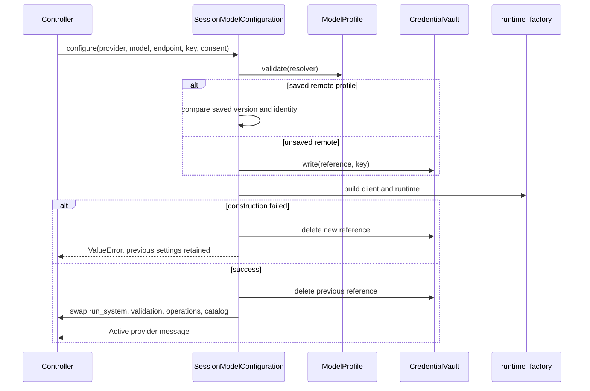

# MDD — Model Configuration & Session Runtime

Criticality score **85.0 / 100** (centrality 4, security 4, business 4, complexity 5,
persistence 4, extensibility 5). Terminology: see [README](README.md#shared-terminology).

## 1. Purpose and Responsibilities

This component owns how a model provider is described, validated, credentialed and
activated for one session, and it is the composition root that wires every other
critical component together. Its central guarantee is transactional activation:
either a fully constructed runtime replaces the previous one, or the previous
settings remain in force.

Responsibilities:

- Validate a provider profile: provider, model name, endpoint, consent, address
  resolution and redirect policy (`ModelProfile.validate`).
- Guard outbound HTTP with an opener that re-checks every destination and status
  (`RemoteRequestPolicy`, `remote_interceptor`).
- Store API keys in Windows Credential Manager under opaque references
  (`WindowsCredentialVault`, `DeferredCredentialVault`).
- Persist saved profiles with optimistic version checks (`SavedProfiles`).
- Activate a provider atomically and retain the old runtime on any failure
  (`SessionModelConfiguration.configure`).
- Verify a local model's generation identity (`verify_generation_identity`,
  `read_generation_identity`).
- Build the object graph and per-session controllers (`create_runtime`,
  `get_default_ui`).

Explicit non-responsibilities:

- It does not route queries or build tools
  ([MDD-tool-creation-pipeline.md](MDD-tool-creation-pipeline.md)).
- It does not decide acceptance or authorization
  ([MDD-acceptance-and-verification.md](MDD-acceptance-and-verification.md)).
- It does not own storage roots; `Settings` does
  ([MDD-persistence-and-namespace.md](MDD-persistence-and-namespace.md)).
- It does not reveal, log or export a key.

Layer: models plus composition root. `bootstrap.py` sits at the outermost edge and
is the only module allowed to construct concrete adapters.

## 2. Source Code Mapping

| File | Symbols |
| --- | --- |
| `src/agentix/models/model_profiles.py` | `MAX_MODEL_NAME_LENGTH`, `MODEL_NAME_PATTERN`, `MAX_ENDPOINT_LENGTH`, `REQUEST_TIMEOUT_SECONDS`, `MAX_OUTPUT_TOKENS`, `resolve_addresses`, `ModelProfile.validate`, `ensure_configurable`, `create_profile_llm`, `SessionModelConfiguration` (`configure`, `close`, `saved_choices`, `select_saved`, `ensure_generation_identity`, `reset_generation_identity`, `save_profile`, `delete_profile`), `RemoteRequestPolicy`, `remote_interceptor`, `installed_models` |
| `src/agentix/models/profile_errors.py` | `ProfileError` |
| `src/agentix/models/generation_identity.py` | `_NoRedirects`, `verify_generation_identity`, `read_generation_identity` |
| `src/agentix/storage/profile_store.py` | `SavedProfiles` (`get`, `list`, `save`, `delete`, `trust_generation_digest`, `_exclusive`, `_check_path`) |
| `src/agentix/security/credentials.py` | `redact`, `register_secret`, `SecretFilter`, `WindowsCredentialVault`, `DeferredCredentialVault` |
| `src/agentix/security/data_protection.py` | `WindowsDataProtection` (`seal`, `unseal`) |
| `src/agentix/bootstrap.py` | `configure_process`, `create_llm`, `Runtime`, `create_runtime`, `get_default_llm`, `get_default_runtime`, `get_default_tools`, `get_default_ui`, `run_ui` |
| `src/agentix/settings.py` | `Settings.from_environment`, `data_directory`, `tools_root` |

Entry points: `SessionModelConfiguration.configure`, `save_profile`,
`select_saved`, `create_runtime`, `run_ui`.

## 3. Architecture and Dependencies

Internal: `security/credentials.py`, `security/data_protection.py`,
`storage/profile_store.py`, `settings.py`, and — inside `create_runtime` — every
application, storage and security service.

External: `crewai` and the provider client are constructed through injected
factories (`llm_factory`, `runtime_factory`), so tests never reach a network.
`urllib` is used directly for catalog reads with a no-redirect handler.

Dependency direction: `bootstrap` → everything; `models` → `security`/`storage` →
`domain`. `models/model_profiles.py` imports `security.credentials` lazily inside
`__init__`, which keeps import-time coupling low but hides the dependency from a
static reader.

Ports and adapters: `vault_factory`, `llm_factory`, `runtime_factory`,
`store_factory`, `catalog_reader` and `resolver` are all injectable. This is the
widest injection surface in the codebase and the reason the component is testable
without credentials.

## 4. Execution and Data Flow

Inputs: provider (`Ollama` or a remote provider), model name (≤ 200 characters,
`MODEL_NAME_PATTERN`), endpoint (≤ 2048 characters), key, consent flag.

Outputs: an activation message, a swapped `controller.run_system`,
`controller.validation`, `controller.tool_operations`,
`controller.get_installed_tools_catalog`, and updated `profile`,
`generation_digest`, `persistent_active`.

State transitions: local non-secret profile → validated candidate → constructed
runtime → committed. `close()` clears session state but never deletes a persisted
user credential.

Error handling: every failure inside the `try` deletes the newly written
reference and raises `ValueError("Model configuration failed; previous settings
are retained")` from `None`, so no credential or native error body escapes. A
credential-cleanup failure aborts before the runtime swap.

## 5. Contracts and Invariants

Public interfaces: `configure(provider, model, endpoint, key, consent) -> str`,
`save_profile(...) -> str`, `select_saved(identity) -> dict | None`,
`saved_choices() -> list[tuple[str, str]]`, `close() -> None`.

Preconditions: `ensure_configurable(controller)` must pass (no active work);
`ModelProfile.validate` requires a known provider, a pattern-matching model name,
a parseable endpoint, and `remote_consent` for any non-local endpoint.

Postconditions: on success all four controller callables point at the new
runtime; on failure none of them changed.

Data contracts: `SavedProfiles` records carry `version`, `provider`, `model`,
`endpoint`, `credential_ref`, `generation_digest`; `save` requires the caller's
version to match, giving optimistic concurrency. `installed_models` bounds the
catalog to 1 MiB and 1024 entries with a 5-second timeout.

Security invariants:

- Keys live only in Windows Credential Manager; the record holds an opaque
  `credential_ref` of the form `AgentiX/v5/<session>/<uuid>`.
- `RemoteRequestPolicy.validate_url` rejects non-HTTPS remote destinations,
  private/link-local/loopback addresses for remote providers, embedded userinfo
  and over-long URLs; `validate_response` rejects 3xx.
- `remote_interceptor` installs the policy on the opener, so a redirect cannot
  bypass the first check.
- `register_secret` plus `SecretFilter` redact known secret values from log
  records.
- `configure` refuses to activate an unsaved remote profile when a store exists,
  forcing persistence and consent to be explicit.

Persistence constraint: profile records are sealed with `WindowsDataProtection`;
`_check_path` rejects aliases and traversal, and `_exclusive` serialises writes.

## 6. Security and Reliability

Trust boundaries: user input → profile (validated); host → provider (HTTPS,
public destination, no redirect); provider → host (bounded response); vault →
process (opaque reference only).

Authorization and human review: remote activation requires `consent=True` and a
saved profile whose version matches. There is no API to read a key back.

Sensitive data: `redact` and `SecretFilter` cover logs; `configure` never returns
the key; error messages are fixed strings.

Failure modes and recovery:

| Failure | Behaviour |
| --- | --- |
| Invalid provider or model name | `ProfileError` with a code |
| Remote endpoint without consent | validation error, no request made |
| Private or loopback remote address | rejected by `resolve_addresses` check |
| Redirect response | `validate_response` rejects 3xx |
| Runtime construction failure | new reference deleted, previous runtime retained |
| Credential cleanup failure | activation aborted, previous runtime retained |
| Stale saved version | `ValueError("Save or reload the changed profile before activation")` |
| Local model identity mismatch | `verify_generation_identity` fails before activation |

## 7. Testing and Verification

| Test file | Coverage |
| --- | --- |
| `tests/unit/test_model_profiles.py` | Profile validation, endpoint and address rules, activation |
| `tests/unit/test_saved_model_profiles.py` | Version checks, sealing, path checks, session configuration |
| `tests/integration/test_model_provider_transport.py` | Remote policy, redirect rejection, transport |
| `tests/integration/test_windows_credentials.py` | Real Credential Manager round trip (marker `windows_credentials`) |
| `tests/unit/test_generation_identity.py` | Local identity verification |
| `tests/unit/test_composition.py`, `tests/unit/test_config.py` | `create_runtime` wiring and settings |
| `tests/integration/test_gradio_native_profiles.py` | Native profile selection |

Focused command: `python -m pytest tests/unit/test_model_profiles.py tests/unit/test_saved_model_profiles.py tests/integration/test_model_provider_transport.py`

## 8. Architectural Findings

Strengths, evidenced:

- Activation is genuinely transactional: the swap happens only after both the new
  runtime and the old-credential cleanup succeed.
- The redirect policy is enforced at the opener, not only at the first URL.
- Injection of six factories keeps the whole component offline-testable.

Technical debt, evidenced:

- `model_profiles.py` is 521 lines and holds profile validation, session
  configuration, HTTP policy and catalog reading in one module.
- `SessionModelConfiguration.configure` is a 70-line method with four nested
  branches over persistence state, which is the hardest control flow in the
  component.
- The credential reference prefix is `AgentiX/v5/...` while the product is v7; the
  prefix is a namespace label, not a version, but it reads as a version.
- `models/model_profiles.py` imports `security.credentials` inside `__init__`,
  hiding a real dependency from the module header.

Risks:

- `configure` mutates four controller attributes in sequence without a rollback if
  the fourth assignment were to fail; the window is small but not atomic.
- `close()` intentionally leaves persisted credentials, so a shared machine keeps
  a usable reference after the session ends.

Extension points: a new provider is a `ModelProfile` branch plus a factory;
`catalog_reader` and `resolver` allow alternative discovery; `Runtime` is a plain
dataclass, so additional services can be added without changing call sites.

## 9. Traceability

Source: as listed in section 2. Tests: section 7.

Related documentation: [`MODEL_CONFIGURATION.md`](../MODEL_CONFIGURATION.md),
[`LLM_SECURITY_2026.md`](../LLM_SECURITY_2026.md), ADR
[0003](../adr/0003-owned-sessions-and-approvals.md), specs
[050](../specs/050-ollama-launch-compatibility.md),
[058](../specs/058-profile-selection-diagnostics.md),
[`docs/reference/src__agentix__models__model_profiles.md`](../reference/src__agentix__models__model_profiles.md),
[`docs/reference/src__agentix__bootstrap.md`](../reference/src__agentix__bootstrap.md).

## 10. Open Questions

- Whether the `AgentiX/v5/` credential prefix is intentionally stable across
  product versions is not documented; changing it would orphan existing entries.
- The intended behaviour when a saved profile's `generation_digest` no longer
  matches the running local model is enforced at activation, but no recovery path
  is described for an already-active session.
