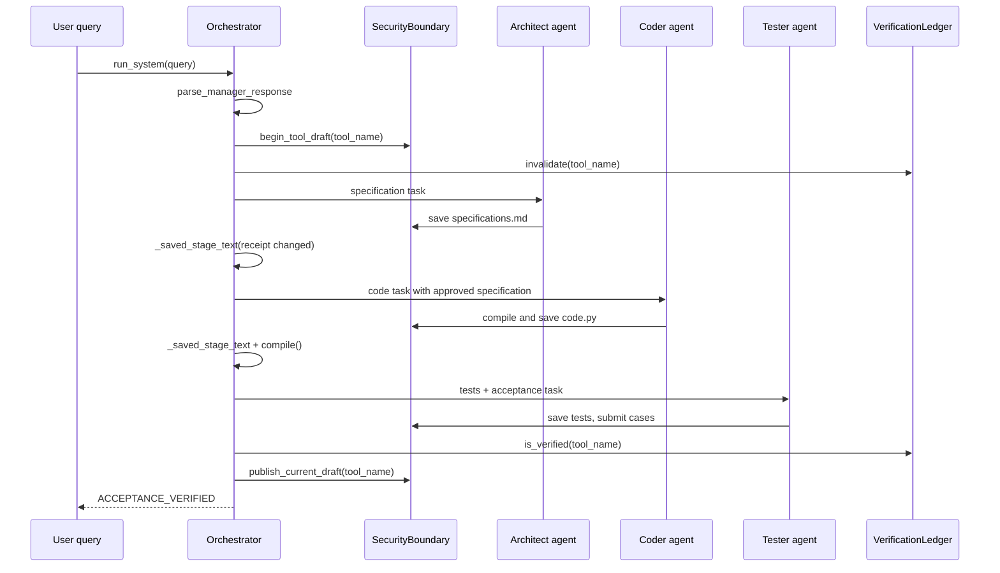

# MDD — Tool Creation Pipeline & Orchestration

Criticality score **88.0 / 100** (centrality 5, security 4, business 5, complexity 5,
persistence 3, extensibility 4). Terminology: see [README](README.md#shared-terminology).

## 1. Purpose and Responsibilities

This component decides what a user query should do, then drives the gated
Architect → Coder → Tester creation sequence for a new tool. Its defining
property is that a model's completion claim never advances a stage: each stage
advances only when the host observes a fresh approved write with a matching
receipt.

Responsibilities:

- Parse a manager response into an exact decision
  (`parse_manager_response`, `parse_application_selection`).
- Route to an installed application, an existing tool, or a new tool
  (`Orchestrator.run_system`, `_select_application`, `_reuse_selected`).
- Run one model task per creation stage and enforce its save postcondition
  (`_creation_stage`, `_saved_stage_text`).
- Bound concurrent work (`_WORK_CAPACITY`, a `BoundedSemaphore(4)`).
- Publish the reviewed draft only after acceptance verifies
  (`publish_current_draft`).
- Return the observed execution result rather than model prose
  (`_execution_answer`).
- Repair a rejected tool through the same gates (`ToolRepair.save_and_validate`).

Explicit non-responsibilities:

- It does not decide acceptance. `AcceptanceEvaluator` does
  ([MDD-acceptance-and-verification.md](MDD-acceptance-and-verification.md)).
- It does not execute generated code. `ToolExecutor` does
  ([MDD-isolated-execution.md](MDD-isolated-execution.md)).
- It does not write files directly; every write goes through
  `SecurityBoundary`/`ArtifactStore`
  ([MDD-approval-and-containment.md](MDD-approval-and-containment.md)).
- It does not initialise CrewAI or a model client; `bootstrap` injects them
  ([MDD-model-configuration.md](MDD-model-configuration.md)).

Layer: application. It depends on `domain`, `security` and `storage` contracts and
on `adapters/crewai.py` for framework objects, which are injected as `AgentSet`
and a backend namespace.

## 2. Source Code Mapping

| File | Symbols |
| --- | --- |
| `src/agentix/application/tool_workflow.py` | `_WORK_CAPACITY`, `Orchestrator` (`_saved_stage_text`, `_creation_stage`, `build_tool_pipeline`, `run_system`, `_select_application`, `_run_system`, `_reuse_selected`, `_execution_answer`) |
| `src/agentix/application/tool_routing.py` | `RoutingModelClient`, `ToolRouter` (`select`, `acceptance`) |
| `src/agentix/application/tool_repair.py` | `RejectedTool`, `capture_rejection`, `ToolRepair.save_and_validate` |
| `src/agentix/tools.py` | `ArtifactTools` and its eight `*_tool` methods |
| `src/agentix/testing.py` | `TestRunner.run_and_save_tests_tool`, `TestRunner.verify_existing_tool` |
| `src/agentix/decisions.py` | `DecisionValidationError`, `CreateToolDecision`, `RunApplicationDecision`, `parse_manager_response`, `parse_application_selection` |
| `src/agentix/adapters/crewai.py` | `AgentSet`, `register_tools`, `build_agents`, `_bind_operation` |
| `src/agentix/agents/workflow_policy.py` | `WORKFLOW_POLICY`, `APPLICATION_REUSE_POLICY` |
| `src/agentix/agents/repair_acceptance.py` | Repair acceptance prompts and validation |

Entry points: `Orchestrator.run_system` (routing), `Orchestrator.build_tool_pipeline`
(creation), `ToolRepair.save_and_validate` (repair), and the `ArtifactTools`
methods registered as model-facing tools.

## 3. Architecture and Dependencies

Internal: `security/verification.py` (ledger and receipts), `security/acceptance.py`
(indirectly through `ArtifactTools`), `storage/catalog.py` (read-only catalog
callback), `domain/tool_schema.py` (contract shape).

External: `crewai` through `adapters/crewai.py` only. `tools.py` is framework-free
by design, so importing it never initialises a model.

Dependency direction: `controllers` → `application` → `adapters`/`security`/`storage`
→ `domain`. `tool_workflow.py` imports `adapters/application_crewai.py` lazily
inside methods, which keeps import-time cost and framework coupling low.

Ports and adapters:

- `AgentSet` and `backend` (`Task`, `Crew`, `Process`) are injected, so tests
  substitute CrewAI without a model.
- `catalog` is a `Callable[[], str]` returning rendered catalog text, not a store
  handle; the orchestrator cannot mutate the catalog.
- `router` and `operations` are optional collaborators, allowing the same class to
  serve routing-only and creation-only tests.

## 4. Execution and Data Flow

Inputs: `tool_name` (lowercase identifier, ≤ 64 characters), `user_requirement`
(≤ 16000 characters at the routing entry), optional feedback dict for repair.

Outputs: fixed stage strings — `PIPELINE_STAGE_FAILED: <stage>: <reason>`,
`ACCEPTANCE_VERIFIED: creation stages completed with host evidence.` — plus
`ArtifactTools` result strings such as `TESTS_PROVISIONAL_PASSED:`,
`REUSE_READY:`, `ACCEPTANCE_REJECTED:`, `TOOL_NOT_VERIFIED:`.

State transitions: draft root active → public root restored. Every failure path
calls `restore_public_tool_storage()` before returning, so a failed creation never
leaves the coordinator pointed at a draft.

Error handling: `_creation_stage` returns `(None, None)` when no fresh receipt
exists and `(None, "CONTRACT_ERROR: ...")` when the model reported a contract
error; both stop the pipeline without retry. Model exceptions propagate. The
tester stage re-reads `code.py` and `specifications.md` and invalidates the ledger
if either changed during testing.

## 5. Contracts and Invariants

Public interfaces: `Orchestrator.run_system(user_query) -> str`,
`Orchestrator.build_tool_pipeline(tool_name, user_requirement) -> str`,
`ToolRepair.save_and_validate(draft, code, tests) -> str`, and the `ArtifactTools`
tool methods.

Preconditions: a verification ledger must be present, otherwise
`build_tool_pipeline` returns `PIPELINE_STAGE_FAILED: specification: verification
service unavailable.` A tool name must satisfy
`[A-Za-z][A-Za-z0-9_]{0,127}` for draft routing and
`[a-z][a-z0-9_]{0,63}` for a manager-created name.

Postconditions: a successful pipeline leaves the tool published in the public
catalog, verified in the ledger, and the coordinator restored to the public root.

Data contracts:

- Manager decision: exactly `{"action": "CREATE_TOOL", "tool_name", "purpose"}`
  or `{"action": "RUN_APPLICATION", "app_id", "arguments"}`; duplicate keys,
  extra fields, fenced JSON with wrong shape and reserved Windows names are
  rejected by `_unique_fields` and the regex checks. The Tools workflow never
  executes an application: a `RUN_APPLICATION` answer fails closed, and the only
  application decision it accepts is the argument-free suggestion
  `{"action": "SUGGEST_APPLICATION", "app_id"}` or
  `{"action": "NO_APPLICATION_MATCH"}`, parsed by
  `parse_application_suggestion` after tool routing returns `CREATE_TOOL`.
- Stage artifact: ≤ 1 MiB, non-empty after strip, SHA-256 equal to the receipt
  digest, and `compile()`-clean for `.py` suffixes.
- Acceptance proposal: `version: 1` with `cases[]`, as defined in
  [MDD-acceptance-and-verification.md](MDD-acceptance-and-verification.md#5-contracts-and-invariants).

Security invariants:

- A receipt is bound to `(owner_id, operation_id)`; `get_artifact_receipt` returns
  `None` for any other operation, so an old save cannot satisfy a new stage.
- `_saved_stage_text` never imports the artifact; it reads bytes, hashes and
  compiles only.
- The catalog callback is read-only text; the orchestrator cannot add or remove
  catalog entries.
- Denial instructions are in the task text, but enforcement is in
  `ApprovalCoordinator`, not in the prompt.

## 6. Security and Reliability

Trust boundaries: model → decision JSON (untrusted, fail-closed); model → artifact
write (mediated by human approval); artifact bytes → next stage (host-verified);
child test report → acceptance (provisional only).

Authorization and human review: every artifact write inside a stage is a
`request_user_permission` call in `ArtifactStore.write`. A rejected write stops
the stage; the pipeline never reprompts.

Sensitive data: log events carry stage names, draft IDs and error types only.
`DecisionValidationError` messages never echo the model response.

Failure modes and recovery:

| Failure | Behaviour |
| --- | --- |
| Invalid manager JSON | `DecisionValidationError`; no fallback decision |
| No fresh receipt after a stage | `PIPELINE_STAGE_FAILED: <stage>: no fresh approved artifact.` |
| Artifact changed during testing | ledger invalidated, acceptance stage fails |
| Acceptance not verified | `PIPELINE_STAGE_FAILED: acceptance: no current human-approved evidence.` |
| Publication failure | `PIPELINE_STAGE_FAILED: publication: reviewed draft was not published.` |
| Capacity exhausted | `manager_capacity_rejected`; no queueing |

## 7. Testing and Verification

| Test file | Coverage |
| --- | --- |
| `tests/unit/test_orchestration.py` | Routing and pipeline stage gating |
| `tests/unit/test_decision_security.py` | `parse_manager_response` fail-closed cases |
| `tests/unit/test_creation_stage_gates.py` | Receipt-based stage advancement |
| `tests/unit/test_agent_workflow_policy.py` | Policy text and role wiring |
| `tests/unit/test_tools.py` | `ArtifactTools` result contracts |
| `tests/test_tool_repair.py` | Repair path through the same gates |
| `tests/test_catalog_routing.py` | Router selection and acceptance |
| `tests/test_workflow_bindings.py` | Controller-to-orchestrator bindings |
| `tests/unit/test_stage_completion_adapter.py` | Stage completion adapter |

Focused command: `python -m pytest tests/unit/test_orchestration.py tests/unit/test_decision_security.py tests/unit/test_creation_stage_gates.py`

## 8. Architectural Findings

Strengths, evidenced:

- Stage advancement is receipt-based, which is the strongest available defence
  against a model claiming a save it never performed.
- `decisions.py` is framework-free and rejects duplicate JSON keys, closing a
  classic last-value-wins ambiguity.
- The tester stage re-verifies earlier stages, so a late edit cannot ride on an
  earlier approval.

Technical debt, evidenced:

- `build_tool_pipeline` embeds long prompt strings (specification, code, tests)
  inline in control flow, mixing prompt engineering with orchestration.
- `Orchestrator.__init__` takes seven collaborators, three of them optional and
  mutually dependent (`router`, `operations`, `applications`), which makes valid
  combinations implicit.
- `_WORK_CAPACITY` is a module-level semaphore, so the bound is process-wide and
  not injectable for tests.
- `_saved_stage_text` imports `hashlib` and `Path` inside the function body, a
  local-import pattern repeated across the module.

Risks:

- Stage gating depends on `ApprovalCoordinator` class-level state; two owners in
  one process rely on `for_owner` subclassing to stay isolated.
- The pipeline has no timeout of its own; a stalled model call is bounded only by
  the provider client.

Extension points: `AgentSet` accepts additional roles; `ToolRouter` is injectable;
`ToolRepair` accepts `propose_cases` and `on_saved` callbacks for alternative
repair flows.

## 9. Traceability

Source: as listed in section 2. Tests: section 7.

Related documentation: ADR [0007](../adr/0007-creation-stage-receipts.md), ADR
[0008](../adr/0008-observed-execution-handoffs.md), specs
[038](../specs/038-catalog-removal-and-tool-repair.md),
[052](../specs/052-application-tool-candidates.md),
[`docs/reference/src__agentix__application__tool_workflow.md`](../reference/src__agentix__application__tool_workflow.md),
[`docs/reference/src__agentix__decisions.md`](../reference/src__agentix__decisions.md),
[`docs/reference/src__agentix__tools.md`](../reference/src__agentix__tools.md).

## 10. Open Questions

- Whether `_WORK_CAPACITY = 4` reflects a measured limit or an initial guess is
  not recorded in code or documentation.
- The intended behaviour when a model stage exceeds a provider timeout (retry,
  fail, or resume) is not expressed in this component.
