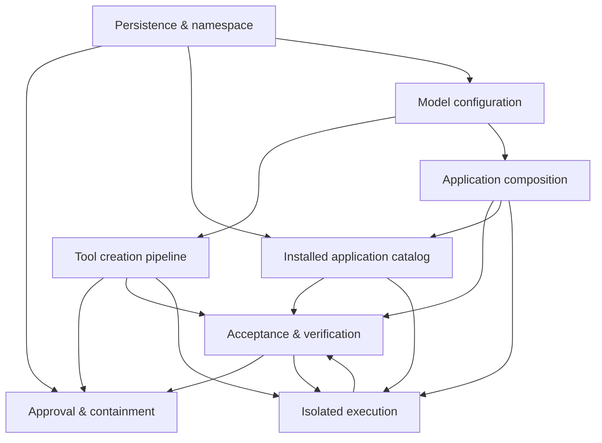

# AgentiX v7 — Module Design Documents

Component-level design documentation for the eight architecturally critical
components of AgentiX v7. Each MDD describes the implementation that exists in
`src/agentix/`, not an intended design. Per-file API detail stays in
[`docs/reference/`](../reference/README.md); this set explains boundaries,
contracts, flows and risks that span files.

Scope note: this directory is additive. It does not replace
[`V7_ARCHITECTURE.md`](../V7_ARCHITECTURE.md), [`V7_STORAGE.md`](../V7_STORAGE.md),
[`ACCEPTANCE_REVIEW.md`](../ACCEPTANCE_REVIEW.md),
[`MODEL_CONFIGURATION.md`](../MODEL_CONFIGURATION.md),
[`LAB_ARCHITECTURE.md`](../LAB_ARCHITECTURE.md) or the specifications in
[`docs/specs/`](../specs/).

## Shared terminology

These terms carry the same meaning in every MDD. Where the code uses a different
word, the mapping is given.

| Term | Meaning in this codebase | Primary symbol |
| --- | --- | --- |
| Provisional verification | Automated `unittest` run inside the isolated child. Evidence only; never authorizes execution. | `TestRunner.run_and_save_tests_tool`, `VerificationLedger.is_provisional` |
| Acceptance contract | Declarative JSON (`version: 1`, `cases[]` with `id`, `purpose`, `function`, `kwargs`, `expect`). | `parse_contract` |
| Human approval | One explicit owner decision on one pending request, identified by `request_id` + `owner_id`. | `ApprovalCoordinator.resolve_pending_request` |
| Authorization | Ledger state binding exact code bytes, test bytes, contract digest and approved function set. | `VerificationLedger.authorize` |
| Execution eligibility | Authorization still current for the exact bytes plus a fresh call in the current operation. | `is_verified`, `matches_authorized`, `begin_execution` |
| Publication | Moving reviewed draft bytes into the public Tools catalog. | `publish_tool_draft` |
| Installation | Sealing an approved and independently verified application package into the user library. | `InstalledApps.publish` |
| Execution | One isolated child invocation of approved bytes. | `WindowsSandbox.execute` |
| Owner | Session-scoped identity owning approvals, drafts and leases. | `ApprovalCoordinator.for_owner` |

Two words are deliberately kept apart: **approval** is a human decision,
**authorization** is host state derived from that decision plus verified bytes.
Neither alone permits execution.

## Selected components

Scores are weighted 0–100 from the criteria in the assessment
(centrality 20%, security 20%, business 20%, complexity 15%, persistence 15%,
extensibility 10%), each rated 0–5.

| Rank | Component | Score | Class | Architectural responsibility | MDD |
| ---: | --- | ---: | --- | --- | --- |
| 1 | Acceptance & verification evidence | 98.0 | Critical | Converts a human-reviewed declarative contract plus fresh isolated observations into content-bound execution authorization | [MDD-acceptance-and-verification.md](MDD-acceptance-and-verification.md) |
| 2 | Application composition & supervision | 93.0 | Critical | Plans, packages, reviews, independently verifies and gates installation of composed applications | [MDD-application-composition.md](MDD-application-composition.md) |
| 3 | Tool creation pipeline & orchestration | 88.0 | Critical | Routes a query, runs gated Architect→Coder→Tester stages, enforces host-observed stage completion | [MDD-tool-creation-pipeline.md](MDD-tool-creation-pipeline.md) |
| 4 | Installed application catalog & invocation | 87.0 | Critical | Revalidates sealed install records, re-binds tool dependencies, leases and invokes applications | [MDD-installed-application-catalog.md](MDD-installed-application-catalog.md) |
| 5 | Model configuration & session runtime | 85.0 | Critical | Validates provider profiles, guards outbound requests, swaps runtime transactionally per session | [MDD-model-configuration.md](MDD-model-configuration.md) |
| 6 | Approval coordination & artifact containment | 84.0 | Critical | Single-use owner-bound decisions, draft/public root separation, Windows path confinement | [MDD-approval-and-containment.md](MDD-approval-and-containment.md) |
| 7 | Isolated execution boundary | 83.0 | Critical | AppContainer/job provisioning, bounded child protocol, fail-closed denial | [MDD-isolated-execution.md](MDD-isolated-execution.md) |
| 8 | Persistence, namespace isolation & catalog migration | 77.0 | Critical | v7 namespace enforcement, catalog reads, cross-process lock, reviewed grant relocation | [MDD-persistence-and-namespace.md](MDD-persistence-and-namespace.md) |

## Source-file ownership

Each file below is owned by exactly one MDD, so no flow is documented twice.

| MDD | Owned source files |
| --- | --- |
| Acceptance & verification | `security/acceptance.py`, `security/verification.py`, `security/reuse_policy.py`, `security/approval_store.py`, `domain/contracts.py`, `domain/tool_schema.py` |
| Application composition | `application/app_workflow.py`, `application/general_pipeline.py`, `application/general_package.py`, `application/general_acceptance.py`, `application/code_package.py`, `application/code_cases.py`, `application/app_review.py`, `application/app_controls.py`, `domain/application_code.py`, `lab/application_artifacts.py`, `agents/catalog_agents.py`, `adapters/application_crewai.py` |
| Tool creation pipeline | `application/tool_workflow.py`, `application/tool_routing.py`, `application/tool_repair.py`, `tools.py`, `testing.py`, `decisions.py`, `adapters/crewai.py`, `agents/workflow_policy.py`, `agents/repair_acceptance.py` |
| Installed application catalog | `storage/installed_apps.py`, `storage/application_catalog.py`, `storage/application_update.py`, `storage/usage.py`, `storage/widget_store.py`, `application/app_invocation.py` |
| Model configuration | `models/model_profiles.py`, `models/profile_errors.py`, `models/generation_identity.py`, `storage/profile_store.py`, `security/credentials.py`, `security/data_protection.py`, `bootstrap.py`, `settings.py` |
| Approval & containment | `security/approvals.py`, `security/__init__.py`, `security/paths.py`, `storage/artifacts.py` |
| Isolated execution | `sandbox/__init__.py`, `sandbox/windows_process.py`, `sandbox/profile_cleanup.py`, `sandbox_worker.py`, `execution.py` |
| Persistence & namespace | `storage/locations.py`, `storage/catalog.py`, `storage/catalog_lock.py`, `storage/catalog_migration.py`, `storage/tool_publication.py`, `storage/maintenance.py` |

`controllers/*`, `ui/*`, `lab/widget_*`, `retrieval/*` and `diagnostics.py` are
consumed by several components and owned by none of these MDDs; see
[Excluded components](#excluded-components).

## Cross-component dependencies

Arrows mean "depends on the contract of". No cycle exists at the module import
level; the runtime cycle between creation and acceptance is mediated by the
ledger.

Reading the graph: `Persistence & namespace` is foundational and depends on no
other component. `Acceptance & verification` and `Isolated execution` are mutual
at runtime — acceptance calls `sandbox.evaluate`, execution calls
`ledger.record_execution` — but the dependency is on data, not on imports.

Ownership boundaries worth stating explicitly:

- Only `AcceptanceEvaluator` may call `VerificationLedger.authorize`. No model-facing
  tool exposes it (`security/verification.py:140`).
- Only `ToolExecutor` may call `WindowsSandbox.execute` for a user-visible call;
  `AcceptanceEvaluator` and `TestRunner` call it for observation only.
- Only `InstalledApps.publish` may write an install record; `ApplicationSupervisor`
  cannot install without `candidate.approved and candidate.verified`.
- Only `ApprovalCoordinator` may resolve a pending request; controllers pass
  `request_id` and `owner_id` through unchanged.

## Excluded components

| Component | Score | Why excluded |
| --- | ---: | --- |
| Widget preview & transport (`lab/widget_session.py`, `lab/widget_bridge.py`, `lab/widget_worker.py`, `lab/widget_panel.py`, `lab/ipc_protocol.py`) | 72.0 | Already specified by [`LAB_ARCHITECTURE.md`](../LAB_ARCHITECTURE.md), [`LAB_DIRECT_WIDGET_DESIGNER.md`](../LAB_DIRECT_WIDGET_DESIGNER.md) and specs [022](../specs/022-generated-widget-execution.md)/[023](../specs/023-widget-ipc-bridge.md). An MDD would restate them. |
| Session & UI controller boundary (`controllers/tool_controller.py`, `controllers/applications.py`, `controllers/sessions.py`, `controllers/state.py`, `ui/*`) | 71.0 | Presentation adapters. Behaviour is fully expressed by their signatures plus `tests/unit/test_sessions.py` and `tests/test_applications_backend.py`; they hold no trust decision of their own. |
| Retrieval (`retrieval/*`) | 48.0 | Supporting; covered by [`TOOL_RETRIEVAL.md`](../TOOL_RETRIEVAL.md) and spec [051](../specs/051-tool-retrieval.md). |
| Diagnostics, presentation, styles, constants (`diagnostics.py`, `ui/presentation.py`, `widgets/styles.py`, `layout_contracts.py`) | — | Supporting utilities with no independent contract. |

## Historical v5 data is not migrated

`storage/catalog_migration.py` relocates **authenticated grants between two v7
roots** on the same machine. It is not a v5→v7 data migration and must not be
used as one. `storage/locations.py:require_v7_namespace` rejects any path inside
the retired `agentix/v5` or `agentix-data/v5` namespace, and
`Settings.from_environment` requires `AGENTIX_HOME` and `AGENTIX_TOOLS_ROOT`
explicitly so no v5 default can be inherited. See
[MDD-persistence-and-namespace.md](MDD-persistence-and-namespace.md#4-catalog-migration-mechanism).

## Verification of this document set

Checks performed after generation are recorded in
[Verification results](#verification-results) below.

### Verification results

Measured after generation, over the nine files in this directory:

| Check | Result |
| --- | --- |
| Documents | 9 (8 MDDs + this index), within the cap of 8 MDDs |
| Cited `src/agentix/...` paths | 56 checked, 0 missing |
| Cited symbols in symbol tables | 302 checked, 0 unresolved |
| Local Markdown links | 115 checked, 0 broken |
| Cited `tests/...` paths | 62 checked, 0 missing |
| Required MDD sections | 10 of 10 present in all 8 MDDs |
| Files modified outside `docs/mdd/` | 0 |

Two defects were found and corrected during these checks: one broken reference
link (`src__agentix__sandbox.md` → `src__agentix__sandbox____init__.md`) and 23
cited test paths that did not exist. The test tables now name only files present
in `tests/`.
